# ARS Approval Platform — Flows

> **Mandatory living file.** Every flow in the platform is recorded here: sign-in, approvals, notifications, admin work.
> - Add a flow here *before* building it (and add a checklist item in PLAN-CHECKLIST.md).
> - When a flow changes, update it here and note the date. Never delete an old flow; mark it `Superseded (date) by F-xx`.
> - Part A holds the Asana flows as **reference only** (D-013: no import). Part B holds the new platform flows.
> - Diagrams use Mermaid (renders in VS Code, GitHub and the artifact pages).

## ★ North star
**Multi-level approvals in any custom manner.** Every approval flow below (F-20 and later) is built from the same parts:
- node types: START, APPROVAL, PARALLEL-SPLIT, JOIN, CONDITION, WORK, END
- completion rules: ALL / ANY_ONE / ANY_N_OF_M
- approver sources: user, role, HOD, manager, group, form field

The number of levels and how they combine is unlimited. There are no fixed "Level 1–4" slots.

## Index
| ID | Flow | Status |
|---|---|---|
| A-01…A-12 | Asana reference flows | Reference |
| F-NEXT-WAITING | Next waiting for you after a decision from Waiting for me | Built 23 Nov 2026 (v1.80.0) |
| F-MOTION | Page changes: pending feedback, skeletons, place memory, toasts vs inline errors, page transitions (switch) | Built 23 Nov 2026 (v1.80.0); page transitions on by default and the WebKit hold fixed 24 Nov 2026 (v1.89.0, D-420) |
| F-212 | Meeting Management: schedule, points and MOM approval, action tasks, follow-ups | Built 10 Nov 2026 (v1.51.0) |
| F-PM-TABS | Project tabs for every view, Save view / Reset | Built 22 Nov 2026 (v1.61.0, behind pm_foundations) |
| F-PM-LIST | The List as a keyboard treegrid, windowed; 15 s refresh | Built 22 Nov 2026 (v1.61.0) |
| F-TS-R1 | Task Summary: range per tab, My sections (landing, moves, rules at midnight), CSV | Built 23 Nov 2026 (v1.76.0, behind pm_foundations) |
| F-PM-BOARD-KEYS | Board: move a card from the keyboard (Space, arrows, Enter, Escape), announced | Built 22 Nov 2026 (v1.62.0, behind pm_foundations) |
| F-PM-PANE | Task pane beside the view, resize kept; reactions; complete and delete with Undo; celebrations | Built 22 Nov 2026 (v1.62.0) |
| F-ADMIN-RECORDS | Admin Records: five tabs, power-search chips, the record pane (side, dialog, full page) | Built 23 Nov 2026 (v1.85.0) |
| F-PANELS | Admin and Super Admin navigation: five groups each, Health console, Search settings, old addresses redirect | Built 23 Nov 2026 (v1.84.0 Super Admin; v1.85.0 Admin) |
| F-NAV-RETURN | Sign-in return to the same view (path + query, area checked), the way back from Admin → Records for every record page, crumbs named after the origin list, Back with an unsent pane comment, ← Back stays in the app | Built 24 Nov 2026 (v1.89.0, in progress; D-419) |
| F-TASK-PANE-EVERYWHERE | Every task opens in the side pane on every screen; ⤢ dialog (kept per person); Open full page; full page for direct visits and phones; unknown /users addresses a real 404 | Built 23 Nov 2026 (v1.83.0; 404 fixed v1.85.1) |
| F-PM-SIDEBAR | Starred and department projects in the sidebar, sort and reorder | Built 22 Nov 2026 (v1.62.0) |
| F-PM-PURGE | Deleted tasks and projects removed for good after 30 days | Built 22 Nov 2026 (v1.62.0) |
| F-01 | Google sign-in | Built 28 Sep 2026 (live test pending Firebase Admin values) |
| F-02 | User ID + password + OTP | Built 28 Sep 2026 (live send pending the CEOITBox key) |
| F-03 | New-login detection and alert | Built 28 Sep 2026 (device cookie; location later) |
| F-04 | Set password + forgot password | Built 30 Sep 2026 (live send pending the CEOITBox key) |
| F-05 | Lockout and "This wasn't me" | Built 28 Sep 2026 (admin unlock in S2-03) |
| F-06 | User creation, roles, inactivation (Admin Portal) | Built 30 Sep 2026 (bulk import later) |
| F-07 | Break-glass access | Partly built: sign-in window + alert; enable script S2-07 |
| F-08 | Role routing: /users, /admin, /superadmin | Built 28 Sep 2026 |
| F-10 | Request state machine | Built (engine and request lifecycle; status checked 31 Oct 2026) |
| F-11 | Submission → workflow resolution | Built with screens 30 Sep 2026 |
| F-12 | Approver action authorisation | Built and tested on MySQL 30 Sep 2026 |
| F-20 | Multi-level building blocks | Engine core built 28 Sep 2026 |
| F-21 | Sequential multi-level | Engine core built 28 Sep 2026 |
| F-22 | Parallel (ALL) | Engine core built 28 Sep 2026 (joins ALL / ANY_ONE / ANY_N) |
| F-23 | Any-one / Any-N-of-M | Engine core built 28 Sep 2026 |
| F-24 | Conditional / DoA routing | Built with screens 1 Oct 2026 (choices + skip conditions; DoA values: Q-004) |
| F-25 | Hybrid (combined) | Engine core built 28 Sep 2026 |
| F-26 | Changes required → resubmission | Built with screens 30 Sep 2026 |
| F-27 | On Hold / resume | Built with screens 30 Sep 2026 |
| F-28 | Reject | Built with screens 30 Sep 2026 |
| F-29 | Reopen | Built 1 Oct 2026 (Super Admin) |
| F-17 | Withdraw by the requester | Built and verified 1 Oct 2026 |
| F-55 | Working calendar (working days, holidays) | Built 1 Oct 2026 |
| F-56 | Management dashboard (was numbered F-70 by mistake; F-70 is Price Realisation) | Built 1 Oct 2026 |
| F-18 | Attachments on a request | Built and tested (incl. e2e) 7 Oct 2026 |
| F-57 | Demo data loader | Built and verified in the browser 7 Oct 2026 |
| F-58 | DoA matrix per approval type | Built and tested (incl. e2e) 8 Oct 2026 |
| F-42 | WhatsApp template registry → creator | Creator built 8 Oct 2026 (create, sync, test via CEOITBox API); goes live with the app's CEOITBox key |
| F-30 | Delegation | Built and verified 1 Oct 2026 |
| F-31 | SLA, reminder, escalation | Built 1 Oct 2026 (working days and holidays) |
| F-32 | Work assignment after approval | Built as work steps, v1.4.0 (F-79, D-097; status checked 31 Oct 2026) |
| F-33 | Employee custom approval | Built and verified 1 Oct 2026 |
| F-40 | Notification pipeline | Built (in-app + email + WhatsApp, retries); WhatsApp per template as approved; outbox 8 Oct 2026 (F-43) |
| F-43 | Notification outbox and idempotent submit | Built and tested 8 Oct 2026 |
| F-50 | Workflow authoring: design → validate → test → publish → version | Levels builder with choices built 1 Oct 2026; canvas later |
| F-51 | Admin configuration change (audited) | Built for settings, users, departments, workflows 30 Sep 2026 |
| F-52 | Provider settings and test send (Super Admin) | Built 30 Sep 2026 |
| F-53 | Break-glass console script | Built 30 Sep 2026 (Q-015 open) |
| F-13 | Request persistence and concurrency | Built and tested on MySQL 30 Sep 2026 |
| F-15 | Comments on a request | Built and verified 1 Oct 2026 |
| F-16 | Handing over pending approvals | Built and tested on MySQL 1 Oct 2026 |
| F-54 | DoA view derived from workflows | Built 1 Oct 2026; reads DoA matrices 8 Oct 2026 |
| F-85 | Drafts: autosave, restore, discard, submit | Built 9 Oct 2026 (v1.5.0) |
| F-86 | Search and saved views | Built 9 Oct 2026 (v1.5.0) |
| F-87 | Bulk approval | Built 9 Oct 2026 (v1.5.0) |
| F-88 | Mentions in comments | Built 9 Oct 2026 (v1.5.0) |
| F-89 | Notification choices | Built 9 Oct 2026 (v1.5.0) |
| F-91 | Due soon, workload and handover suggestions | Built 9 Oct 2026 (v1.5.0) |
| F-92 | Request summary PDF | Built 9 Oct 2026 (v1.5.0) |
| F-93 | Request ids and Super Admin failure alerts | Built 9 Oct 2026 (v1.5.0) |
| F-84 | Custom approval → approval type (IT) | Built 9 Oct 2026 (v1.4.0) |
| F-83 | Backups and restore | Built 9 Oct 2026 (v1.4.0) |
| F-82 | Late approvals: reminder and escalation levels | Built 9 Oct 2026 (v1.4.0) |
| F-81 | Builder rules: all/any conditions, nested choices | Built 9 Oct 2026 (v1.4.0) |
| F-80 | Stuck step: IT moves it on | Built 9 Oct 2026 (v1.4.0) |
| F-79 | Work steps and FYI steps | Built 9 Oct 2026 (v1.4.0) |
| F-78 | Sign-in safety rules from the audit (idle sign-out, safe redirect, code tries, encrypted retries) | Built 9 Oct 2026 (v1.3.6) |
| F-77 | Profile page: details + Notifications, Out of office, Sign-in & devices as tabs | Built 9 Oct 2026 (v1.3.5) |
| F-76 | Form submission resilience (errors, time limit, session ended) | Built 9 Oct 2026 (QA session 14) |
| F-75 | Form field creator: all types, master-data dropdowns | Built 8 Oct 2026 (S12) |
| F-72 | Approver designations (who can be picked as approver) | Built 8 Oct 2026 (S11) |
| F-73 | Super Admin deletes a request (soft) | Built 8 Oct 2026 (S11) |
| F-74 | Admin dashboards: utilisation, department, approver, raiser | Built 8 Oct 2026 (S11) |
| F-59 | Bulk import of master data (template, check, import) | Built 8 Oct 2026 (S10) |
| F-90 | GoDaddy deployment and go-live | v1.0.0 prepared 8 Oct 2026 (guide, release notes, tag); deploy with the owner |
| F-14 | Request screens: raise → queue → act → resubmit | Built and verified in the browser 30 Sep 2026 |
| F-41 | Retry runner for failed messages | Built 30 Sep 2026; heartbeat 9 Oct 2026 (cron: DEPLOYMENT Part I) |
| F-09 | Rate limiting on sign-in and codes | Built and verified 30 Sep 2026 |
| F-60…F-71 | First templates mapped from Asana | Built and published 7 Oct 2026 on demo staff (12 types) |

---

# Part A — Asana reference flows (as found 24–25 Sep 2026)

Full detail: `reference/asana-approval-audit.html` and `reference/asana-rules-notes.md`.

| ID | Asana system | Flow as it runs | Defects to avoid (guardrails) |
|---|---|---|---|
| A-01 | Tier template (ED, Finance, Valarmadhi, SCM, Sumit) | Form → master "Form Submission" → built-in approval by one approver → Approved / Rejected / Hold (Hold marked complete) → copied into the department project by rule | Hold = complete (G-03); department copies (G-05); duplicate comments (G-06); no amount routing (G-07); CA/NBD not routed (G-11) |
| A-02 | MD | Form → Approval ARS = Submitted → MD sets Approved / Reviewed / Hold / Request Changes / Rejected → Resubmission loop (Resubmitted → back to Form Submission, due +1 day) | Rejected → Approved Section (G-02); copies mark any completion Approved (G-02); shared MD account (G-12) |
| A-03 | ED | As A-01, approver Rajesh Bhatia; the dropdown does nothing | Stuck when only the dropdown is set (G-02) |
| A-04 | Finance + Valarmadhi | Two parallel single-approver tiers; F&A re-files between them after a rejection | Split history (G-04); anyone can change the approval status (G-01) |
| A-05 | SCM | Single approver madhanagopal (86% POs) | No amount limit (G-07) |
| A-06 | Sumit | Single approver; only NBD uses it; routing never ran | NBD not routed (G-11) |
| A-07 | Legacy HR tier | Dropdown-driven, dormant | Unused structures (G-15) |
| A-08 | HR / Admin / Recruitment | Manager → HOD (Srinivasa Raghavan K / Gokulakrishnan → Subashini); rules reopen the task and reassign it to the HOD | Checks the assignee, not the actor (G-01); Recruitment has no check |
| A-09 | Finance Internal | Level 1 by Nature (6 checkers) → optional level 2 (Naveen / Anbu) → HOD Valarmadhi | No reject/hold at level 2 (G-10) |
| A-10 | IT Internal | HOD (Babulal) → Approved; intended "Assigned To → Task Completed" never runs | Misrouted work hand-off (→ F-32) |
| A-11 | Price Realisation | Parallel HOD approval subtasks → ED → MD; stalled at ED | "AI decides approver count" (G-13); approve vs acknowledge undecided |
| A-12 | ASP / Plant / Branding / Training / IT Head | Manager → HOD templates, unused | Plant HOD check wrong (G-09); Branding impossible routing (G-08) |

---

# Part B — New platform flows

## F-NEXT-WAITING: Next waiting for you after a decision (v1.80.0, D-407)
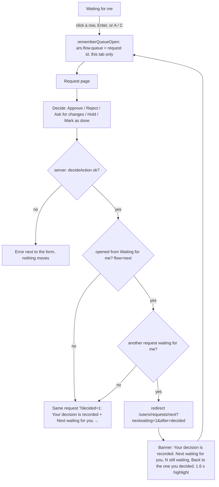

## F-MOTION: Page changes, place and feedback (v1.80.0, D-407)
```mermaid
flowchart TD
  C[Click an internal link] --> U{UnsavedGuard holds it?}
  U -- yes --> L[Leave without saving?]
  U -- no --> T{same page, new query?}
  T -- yes --> DIM[Link spinner (useLinkStatus) + html data-nav-pending: table at 60 %]
  T -- no --> SK{list page on a wide screen?}
  SK -- yes --> TS[after 150 ms: table skeleton over main]
  SK -- no --> BAR[after 150 ms: top bar; phone: screen skeleton]
  C --> PM[PlaceMemory: remember scroll + link for this page, 30 min, this tab]
  C --> VT{page_transitions on (default ON since v1.89.0), view transitions, no reduce motion, not a task link that opens the pane, no transition running?}
  VT -- no --> PLAIN[Page changes as before; a click during a running transition ends it at once]
  VT -- yes --> X[startViewTransition: old main fades out 150 ms, new main fades in + 4 px 200 ms; row title → page heading 250 ms]
  X --> SLOW{new page committed within 300 ms?}
  SLOW -- no --> SKIP[skip AND end the update callback: page simply appears, then fades in if a skeleton showed]
  SLOW -- yes --> FOCUS[focus the new h1 unless focus moved elsewhere]
  BACK[Back / Forward: never animated, a running transition ends] --> RESTORE[PlaceMemory: same height, the link focused, its row lit 1.6 s]
  SAVE[Form saved] --> TOAST[Toast repeating the verb; nothing inline]
  FAIL[Form refused] --> INLINE[Inline error; field errors under fields]
```
- v1.89.0 (D-420): timings are the owner's tokens (GLOBAL_MOTION_TOKENS.md); dialogs 250 in / 150 out, drawers and panes 250 / 150, menus 150; raw `<dialog>`s close through the same exit as Dialog; toasts fade out before they go.
- Dialogs: open = showModal + CSS @starting-style fade/scale (drawer: slide); close = Chrome/Edge CSS exit (overlay + allow-discrete), Firefox/Safari data-closing → wait for the animation → close(); focus back to the opener. guardDraft: Escape, × or backdrop after typing → Discard draft? (Keep editing / Discard).
- Bottom sheets and phone drawers: drag down ≥ 80 px or a quick flick closes; otherwise they spring back.


## F-01 Google sign-in (no OTP, D-006)
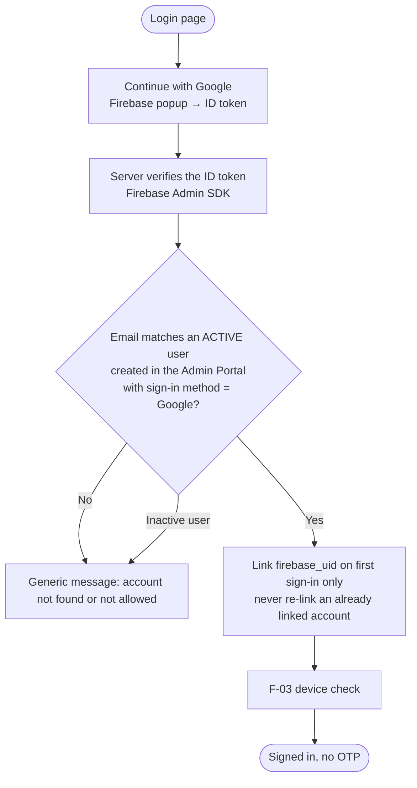
- Any email domain is allowed (D-004). Pattern taken from the Power BI site (`server/auth/google-login.ts`). *Updated 28 Sep 2026.*
- **v1.54.7 (D-316, Workspace domain move):** the account is found by (1) Firebase uid, (2) Google sub (`users.google_sub`; the same Google account with a new Firebase uid is relinked), (3) exact email of an unlinked account, (4) the same mailbox on the other side of a configured domain move (`arssteels.co.in` and `arsenergy.co.in`, unlinked account only; the exact email wins). Then the sub is kept and the account's email follows Google's primary (not if another account uses it, never back onto a retired domain; audited). Nothing is created; access rules unchanged.

## F-52b Sending an email (v1.54.8, D-317)
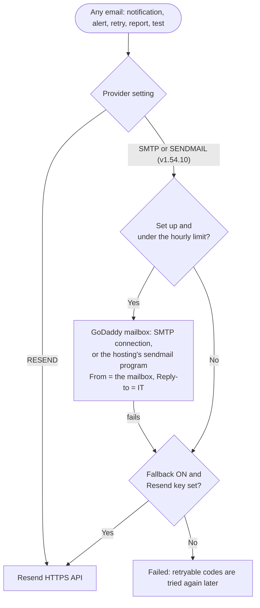

## F-52c Email diagnostics (v1.54.14, D-323)
1. Super Admin → Settings → Email diagnostics: enter a recipient and choose a route (local relay, GoDaddy relay, or don't send).
2. The server checks DNS, probes each route once, and talks to each reachable relay (no sign-in). It sends at most one message, and reports each reply and the queue id, with verdicts.
3. Download the report and send it to GoDaddy support. The run is audited; at most 6 runs an hour.

## F-52d Message deliveries dashboard (v1.54.16, D-325)
1. Super Admin → Message deliveries: choose the period, channel, status and provider, then Apply. The totals, charts and the list below all follow the filters.
2. Open any total, status part or table cell to filter to those messages.

## F-RL Group by on request lists (v1.54.16, D-325)
Group → Status, Approval type, Month raised, Priority; Raised by and Department (lists of other people's requests); Form: <field> for every form field on the page (matched by name; confidential values show as Hidden to those who may not see them).

## F-MTG-CAL Meeting scheduled → told and on the calendar (v1.55.2, D-330)
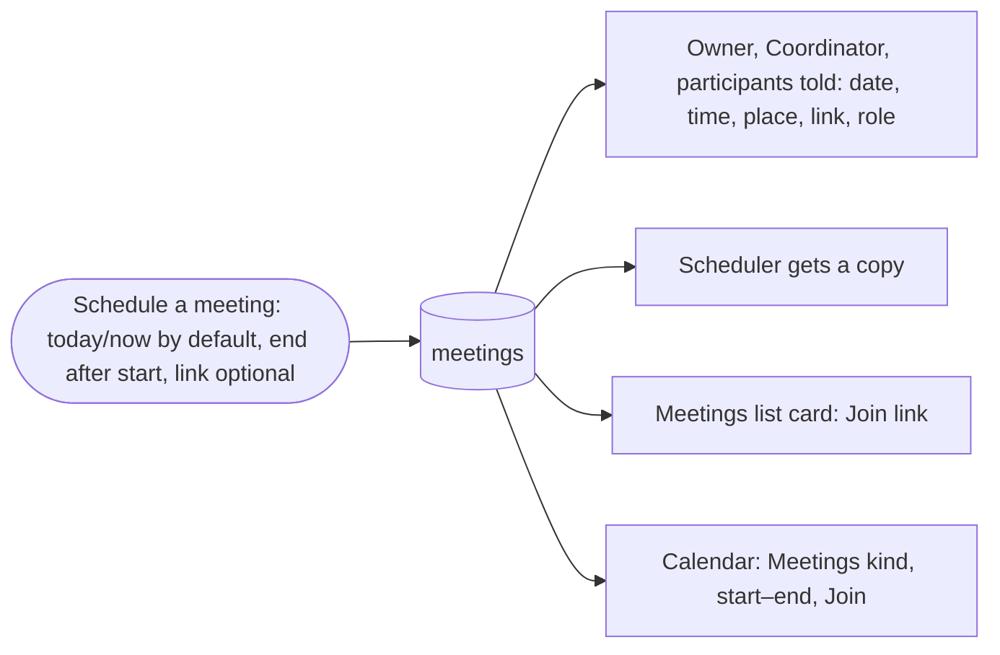

## F-TABLES Sort, saved views and folded groups on every table (v1.58.0, D-351 to D-354)
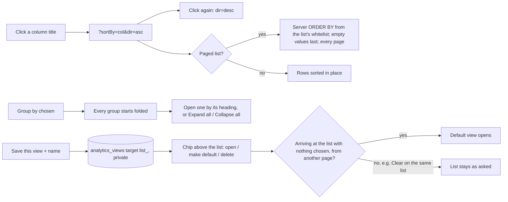
A request's Priority sorts everywhere (v1.58.1, D-355: confidential or missing ranks last). Not sortable on purpose: button columns, records Amount (could reveal confidential values), the calendar grid, editors, chart data tables. The Coordinator board and a project's Sections start open.

## F-ITEMS Item list: requested → provided (v1.57.0, D-335)
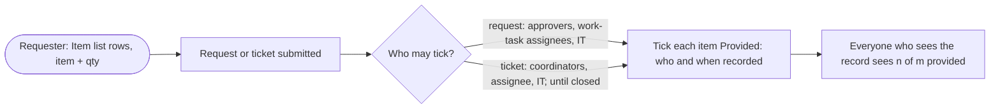

## F-TKT Ticketing System lifecycle (v1.55.0, D-328)
```mermaid
flowchart TD
  R([Anyone with the Ticketing module (D-329): Raise a ticket → ticket type (a form of a category) → subject, description, priority, required date, fields, files]) --> N[NEW: number PREFIX-YEAR-00001, requestor details filled in]
  N --> C[The form's coordinators are told; any one of them assigns]
  C -->|assign: employee, target date, remarks| A[ASSIGNED: no task (v1.59.3, D-362)]
  A -->|assignee: Start work on the ticket or its row| P[IN PROGRESS]
  P -->|assignee: Mark resolved with what was done| AC[AWAITING CONFIRMATION: 4-working-day clock]
  A -->|assignee: Mark resolved| AC
  AC -->|requester confirms (rating 1-5 optional)| CL[CLOSED]
  AC -->|requester reopens with a reason| RO[REOPENED: back with the same assignee, who starts it again; coordinators may reassign] --> C
  AC -->|reminders on working days 2 and 3; no answer after 4 full working days| AUTO[CLOSED – AUTO CLOSED]
```
- Resolving never closes a ticket. Only the requester confirms or reopens. Only the assignee starts and resolves; coordinators assign and reassign. Tickets from before v1.59.3: their open tasks are cancelled (migration 202611201000, and again on any reassign); finished ones stay as history.
- The auto-close job claims each stage once, and closes only while the ticket still waits.
- Coordinator board (D-332): every column above (New, Reopened, Assigned, In progress, Awaiting confirmation, Closed last 7 days) as one page, for coordinators and IT.

## F-02 User ID + password + OTP
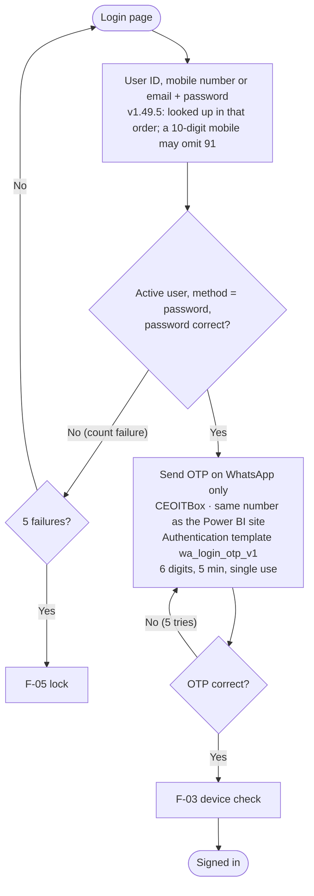
- First sign-in: set a password (asset-pack screens), then verify the WhatsApp number by OTP.
- OTP on WhatsApp only (D-025). Every response is identical whether or not the account exists (anti-enumeration). *Updated 28 Sep 2026.*
- **As built (28 Sep 2026), all values configurable in `/superadmin`:**
  - An unknown user ID still runs a dummy password check, so the timing reveals nothing.
  - An inactive account, a Google-only account or a disabled break-glass account gets the same generic "user ID or password is incorrect".
  - A locked account is refused even with the right password.
  - Codes: 6 digits, 5 minutes, stored hashed, single use. There is a 30 s cooldown between codes and a cap of 5 per hour. 5 wrong codes end the challenge; a right code after that is still refused.
  - Resend works only on an open challenge and closes the old code.
  - After the code is accepted, the account is checked again, in case it was deactivated or locked in the meantime.
  - If the OTP template is inactive or the WhatsApp send fails, the user sees "couldn't send the code" and an `OTP_DELIVERY_FAILED` audit entry is written. The sign-in cannot continue without the code; only *notifications* are fire-and-forget.

## F-03 New-login detection and alert
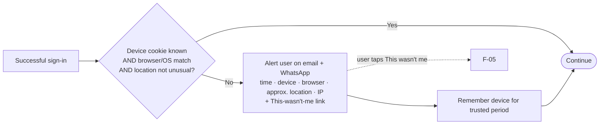
- **As built (28 Sep 2026):**
  - The device is recognised by a signed `ars_device` cookie; a forged cookie counts as a new device. Browser/OS and location matching come later (P1-17).
  - The very first sign-in on a new account is not alerted.
  - The alert is sent after the sign-in response is decided. A failed alert never blocks the sign-in.
  - Every Super Admin sign-in (N-04) and every break-glass sign-in (N-05) also alerts all Super Admins.
  - The "This wasn't me" link is a signed, single-purpose token valid for 7 days.

## F-04 Forgot password
User ID → OTP on WhatsApp → set new password → all sessions end → alert on email + WhatsApp. *Updated 28 Sep 2026 (D-025).*

**Design for S2-04 (28 Sep 2026):**
```mermaid
flowchart TD
  subgraph SP["Set password: first sign-in, P1-13"]
    A1[Admin: send set-password link] --> A2[Single-use token stored hashed
valid 72 h, emailed to the user]
    A2 --> A3[User opens /set-password?token=…
GET only shows the form; the link is never consumed by a preview]
    A3 --> A4[New password twice → policy check]
    A4 --> A5[WhatsApp OTP to the number on file
proves the number (VERIFY_WHATSAPP)]
    A5 --> A6[Code OK → save hash · token used · failures cleared
sessions ended · alert sent]
  end
  subgraph FP["Forgot password, P1-14"]
    B1["/forgot-password: User ID"] --> B2{Active password user
with WhatsApp, not security-locked?}
    B2 -- No --> B3[Same screen as yes: 'If the account exists, a code was sent'
fake challenge, no message]
    B2 -- Yes --> B4["OTP on WhatsApp: PASSWORD_RESET"]
    B4 --> B5[Code + new password twice]
    B5 --> A6
  end
```
- An account locked by "This wasn't me" can't reset its own password; only an admin unlock clears it. A reset clears a wrong-password lock.
- The same OTP limits as sign-in apply (cooldown, per-hour cap, attempts), counted per purpose.

## F-09 Rate limiting (S3-08, P1-21, D-059)
Counted in MySQL (a hit table with a sliding window), per IP address and per User ID, independent of whether the account exists:

| Action | Per IP | Per User ID |
|---|---|---|
| Password sign-in (step 1) | 20 / 15 min | 10 / 15 min |
| Code check (sign-in, set / forgot password) | 30 / 15 min | (the challenge already allows only 5 tries) |
| Forgot password (step 1) | 10 / 15 min | 5 / hour |
| Set password (step 1) | 10 / 15 min | (the link is single-use) |
| Google sign-in | 30 / 15 min | (not applicable) |

- Over the limit → HTTP 429 with a generic "Too many attempts. Try again in a few minutes." and a Retry-After header. Nothing reveals whether the User ID exists.
- The retry runner (F-41) deletes hits older than a day.

## F-05 Lockout and "This wasn't me"
- **Lockout:** 5 wrong passwords → locked 15 min (configurable) → alert to the user. Repeated locks also alert the Super Admin.
- **"This wasn't me":** end all sessions → lock the account → notify the Super Admin → the Super Admin unlocks after checking and resets the password or OTP numbers.
- **As built (28 Sep 2026):**
  - The lock happens on exactly the 5th wrong password (D-044). An `ACCOUNT_LOCKED` audit entry is written and the user is alerted.
  - "This wasn't me" ends every session and locks the account until an admin unlocks it. It writes a `NOT_ME_REPORTED` audit entry, sends "account secured" to the user, and sends a security alert to every Super Admin.

## F-06 User creation, roles, inactivation (Admin Portal only, D-033)
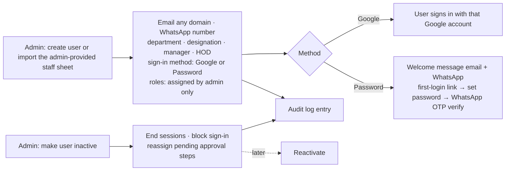
- Users are never hard-deleted, so history and audit stay intact. *Updated 28 Sep 2026.*

**Invite and reset password (v1.13.0, D-166, owner 23 Oct 2026). Every message goes by email only.**
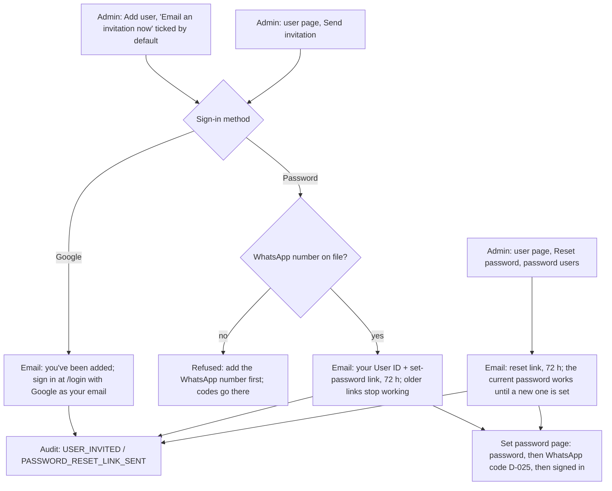
- The link is never shown to the admin; if the email fails, the screen says why (e.g. email not set up) and nothing else changes.
- The rules of who may act are the same as for editing the user (IT Admins can't invite or reset another IT Admin; only the Super Admin can).

**Rules for S2-03 (D-047, 28 Sep 2026):**
- IT Admin and Super Admin can manage users.
- Only the Super Admin can grant or remove SUPER_ADMIN, or change a Super Admin or the break-glass account.
- Nobody can deactivate themselves or remove their own admin role.
- The last active Super Admin can never be deactivated or demoted.
- Other actions:
  - **Deactivate:** ends every session at once. Reassigning pending steps comes when requests exist.
  - **Unlock:** clears both wrong-password locks and security locks.
  - **Force sign-out:** ends every session.
  - **Changing the email of a linked Google account:** unlinks it, so the new Google account links on its next sign-in.
  - **Changing to Google sign-in:** removes the password.
  - **Changing to password sign-in:** the user needs a set-password link.
- Changes to the WhatsApp number or sign-in method alert the user (N-03).
- Every change writes an audit entry with before and after values; the password hash is never included.

## F-08 Role routing in the single app (D-034, D-039)
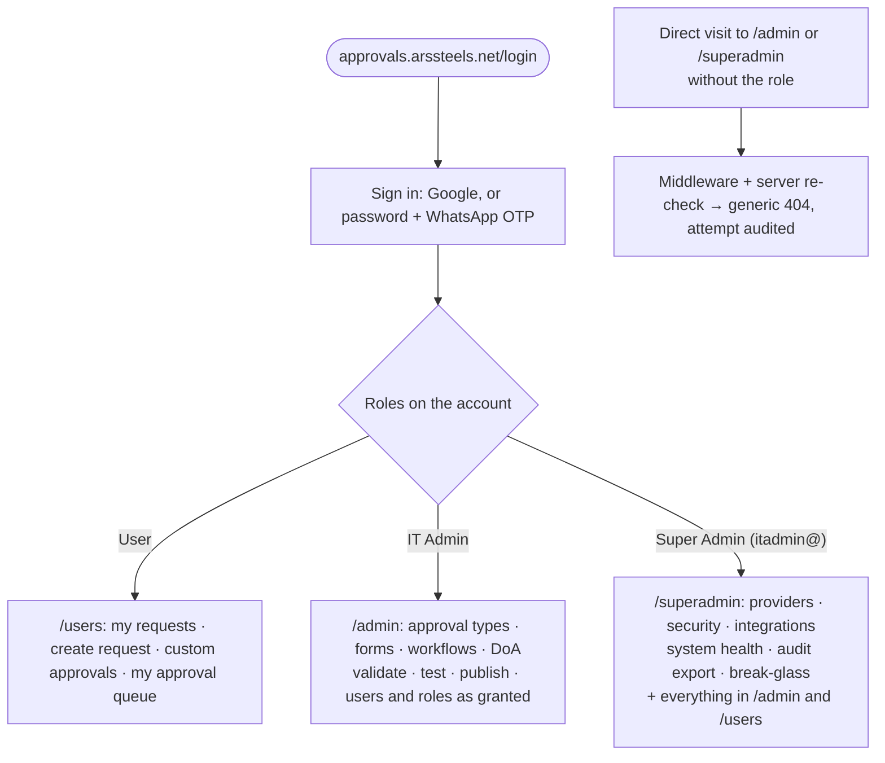
- Everyone lands on `/users`. The three parts are called **spaces** on screen (D-083). The account menu at the top right (name → menu) shows the current space and a **Switch space** list, only with the spaces the person's roles allow, plus Sign out. On phones the space's pages open from a menu button as a drawer. *Superseded 8 Oct 2026: the "Switch area" block at the bottom of the sidebar.*
- **Sidebar fold (v1.89.0, D-421):** ☰ folds the sidebar to a 72 px rail of icons (names on hover or focus) and opens it again (250 px); the choice is kept on the device (`ars_sidebar`) and always wins. With no choice yet, a tablet-sized window (768-1279 px) starts on the rail and a wider one open, following the window if it is resized; phones (below 768) have no sidebar (phone layout or menu drawer).
- **As built (28 Sep 2026):**
  - With no session, or an invalid or forged one, every area redirects to `/login?next=…`.
  - A signed-in user without the role gets a generic 404, and the attempt is audited.
  - The check runs in the middleware, in every layout **and** every page (the App Router can render a page without its layout), and in every API route.
- Protection is enforced on the server in 3 layers: middleware, then every page/handler/action, then record scope. It is never enforced by hiding links alone. *Superseded 28 Sep 2026: the earlier separate admin.arssteels.net portal version of this flow.*

## F-07 Break-glass access (D-011, D-041)
Sealed recovery credentials held offline by itadmin@ → server-side script run from the GoDaddy console enables the account for a limited time → every sign-in or action alerts the Super Admin and the holder → the account auto-disables when the window ends.

## F-10 Request state machine (D-017)
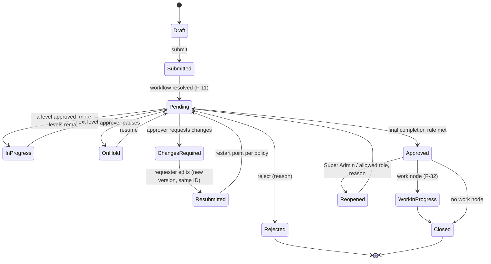
- On Hold and Changes Required are **never** complete (G-03). Rejected can never be shown as Approved (G-02).

## F-11 Submission → workflow resolution
1. The requester chooses an approval type (a published template) or a custom approval (F-33).
2. The form is validated against the template's **form version**.
3. The request gets a permanent ID (e.g. `PUR-2026-000421`), version 1.
4. It binds to the **published workflow version** at submission time. Later edits to the workflow never affect it.
5. The engine walks the graph from START:
   - evaluates CONDITION nodes against the form data and the DoA matrix;
   - opens the first reachable APPROVAL node(s);
   - resolves the approvers for those nodes now, and records them.
6. It emits the events: submitted (to the requester) and action needed (to the approvers).

## F-12 Approver action authorisation (D-020)
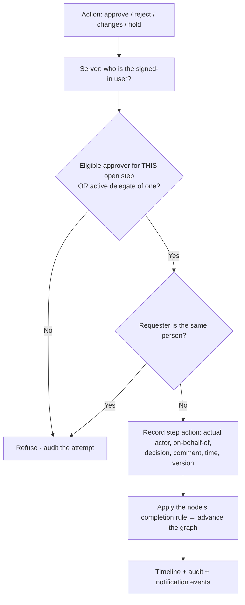

## F-13 Request persistence and concurrency (S2-06, D-050)
```mermaid
flowchart TD
  A[Action arrives] --> T[DB transaction]
  T --> L[Lock the request's state row
SELECT … FOR UPDATE]
  L --> D[Build the directory snapshot
active users · managers · HODs · roles · groups]
  D --> E[Pure engine call
start / decide / hold / resume / resubmit]
  E --> W[Write the new state JSON (version + 1)
sync the task table for queues
append events to the timeline (append-only)]
  W --> C[Commit]
  C --> N[Notifications after commit, never inside the transaction]
```
- The request is bound to the **published workflow version** it was submitted against.
- The request number is `PREFIX-YYYY-000001`, from a locked sequence row per prefix and year.
- If two approvers act at the same moment, the row lock makes them run one after the other. The second sees the updated state, and gets a clear error if its task is closed.
- **As built (30 Sep 2026):**
  - Notifications after the commit:
    - approval needed → each new approver;
    - approved, rejected (with reason), changes requested and on hold → the requester;
    - blocked (no eligible approver, or no matching path) → every IT Admin.
  - Email and in-app work now; WhatsApp waits for the owner's templates (Q-013).
  - Only the requester can resubmit, on the same number, in the next round, optionally with new form data.

## F-14 Request screens (S3-01 to S3-04, D-055, D-057)
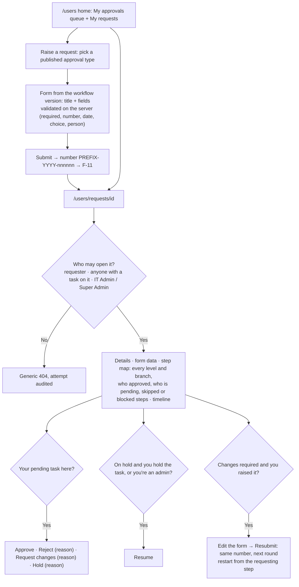
- Every button calls a Server Action that re-checks everything on the server (F-12). The screen only hides buttons for convenience.
- **The form belongs to the workflow version (D-055)**, so a running request keeps the fields it was raised with.
- **As built (30 Sep 2026):**
  - Title and field errors come back together.
  - After a resubmission, a level finished in an earlier round still shows who approved it.
  - The timeline hides bookkeeping events and says each thing once.
  - Rejecting or asking for changes needs a reason; hold takes an optional one.

## F-41 Retry runner (S3-07, P1-48, D-058)
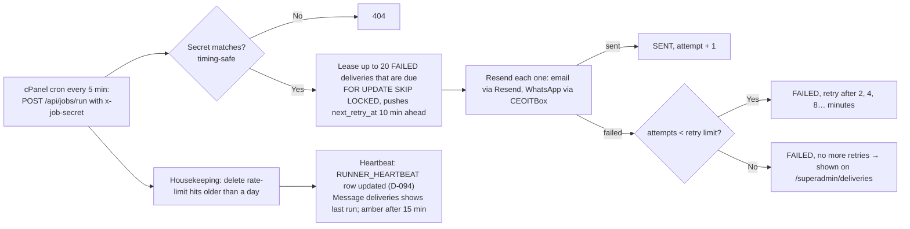
- The Super Admin can press **Retry now** on a failed delivery, which makes it due immediately.

## F-20 Multi-level building blocks (north star)
| Part | Options |
|---|---|
| Node types | START · APPROVAL · PARALLEL-SPLIT · JOIN · CONDITION · WORK · NOTIFY · END |
| Completion rule (group) | ALL · ANY_ONE · ANY_N_OF_M (N set per node) · optional mandatory member |
| Approver source | Specific user · Role · Requester's HOD · Department HOD · Reporting manager · Manager's manager · Department · Approval group · Requester-selected (within governance) · User from a form field |
| Per-node settings | Allowed actions · SLA · reminder · escalation · skip rule · notification overrides |
| Level count | Unlimited; levels combine freely |

- **As built (28 Sep 2026)** in `server/engine`: the graph is START → (APPROVAL | SPLIT → … → JOIN | CONDITION)* → END.
  - Each APPROVAL step has approver sources and a completion rule (ALL, ANY_ONE, ANY_N). A JOIN has its own rule over its branches.
  - When a step starts, approvers are resolved: inactive users are dropped, duplicates are removed, and the requester is never their own approver.
  - A step with no eligible approver is **BLOCKED**, never silently approved, unless the step is set to SKIP.
  - `skipIf` skips a step when its condition matches.
  - Only the task's approver or their delegate can decide. The delegate is recorded as the actor, with on-behalf-of.
  - An ALL step rejects on the first rejection. An ANY step rejects only when its rule can no longer be met.
  - Test mode (`simulate`) runs the flow with sample values and lists the stages, with parallel steps together.

## F-21 Sequential multi-level
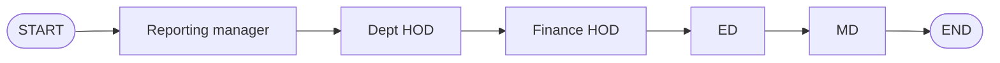

## F-22 Parallel (ALL must approve)
```mermaid
flowchart LR
  S([START]) --> H[HOD] --> P{{PARALLEL}}
  P --> F[Finance] --> J{{JOIN: ALL}}
  P --> Lg[Legal] --> J
  P --> Pu[Purchase] --> J
  J --> ED[ED] --> E([END])
```

## F-23 Any-one / Any-N-of-M
```mermaid
flowchart LR
  S([START]) --> G{{GROUP: ANY_ONE}}
  G --> A1[ED]
  G --> A2[CFO]
  A1 & A2 --> N{{GROUP: ANY 3 OF 5\nCommittee}} --> E([END])
```
- When the rule is met, the remaining open members of the group are closed as "not required" and told so.

## F-24 Conditional / DoA routing
```mermaid
flowchart TD
  S([START]) --> H[Requester's HOD] --> C{Amount band from DoA}
  C -- "≤ ₹1 L" --> E([END])
  C -- "₹1–5 L" --> F[Finance] --> E
  C -- "₹5–25 L" --> F2[Finance] --> ED[ED] --> E
  C -- "> ₹25 L" --> F3[Finance] --> ED2[ED] --> MD[MD] --> E
```
- Conditions can use any form field (type, department, priority, amount) with AND/OR. The validator rejects impossible or conflicting conditions (G-08). The bands are placeholders until the DoA is signed off (Q-004).

## F-25 Hybrid (combined)
```mermaid
flowchart TD
  S([START]) --> H[HOD]
  H --> P{{PARALLEL}}
  P --> F[Finance] --> J{{JOIN: ALL}}
  P --> L[Legal] --> J
  P --> Pu[Purchase] --> J
  J --> C{Amount > ₹5 L?}
  C -- No --> E([END])
  C -- Yes --> A{{ANY_ONE}}
  A --> ED[ED] --> MD[MD] --> E
  A --> CFO[CFO] --> MD
```

## F-26 Changes required → resubmission (same ID)
Approver requests changes (reason required) → state Changes Required, stays open → requester edits the form and documents → **version n+1 under the same ID** → restart point per template policy (beginning / the level that asked / a specific level) → the approvers at the restart level are notified.

- **As built (28 Sep 2026):**
  - Request changes (a reason is required) closes the open tasks, remembers which steps were open, and sets the request to CHANGES_REQUIRED.
  - Resubmit starts a new **round** on the same request. It restarts either from the beginning or from the requesting step(s), including every parallel branch that was still open.
  - Finished steps are kept.
  - Approvals from the previous round never count in the new one.
  - The full history stays on one request (G-04).

## F-APPROVER-CHANGE Approver changes the details (v1.59.0, D-357) and sent back stays visible (D-356)
```mermaid
flowchart LR
  W[Waiting for me row: Change] --> D[Drawer: values + levels after mine + reason]
  D --> C{Who?}
  C -- not the approver it waits on / on hold --> X[Refused]
  C -- approver or delegate --> V{Values changed?}
  V -- yes --> R{Route changed?}
  R -- no --> S[New round: my level starts again; earlier approvals stand]
  R -- yes --> E[New round: restart at the earliest affected level]
  V -- no, levels only --> L[New version of the levels to come; nothing restarts]
  S --> T[Requester + earlier approvers told; history, audit]
  E --> T
  L --> T
  Q[Approver asks for changes] --> B[Sent back for changes page (v1.59.1, D-359), linked from Waiting for me] --> U[Requester resubmits] --> A[Back in Waiting for me as an approval]
```

## F-TICKET-STATUS Ticket status by department (v1.59.2, D-360)
Tickets raised in the period (the board's scope) → per form (v1.59.4, D-363: a table for each form, plus one for all the forms of a category with several), per requester department → due = Target date else Required date (end of that India day) → closed (status CLOSED) by the due or with none = On time; closed later = Delay; open past due = Overdue; open otherwise = Not due → Total row. Priority filter (?tpriority=) narrows the counts; the departments stay.

## F-27 On Hold / resume
Approver puts the request on hold (reason) → state On Hold, stays open, counts as pending, SLA paused → the approver resumes → back to Pending at the same level.

## F-28 Reject
Approver rejects (reason required) → state Rejected (final) → requester and watchers notified. A new attempt, if allowed, is a resubmission (F-26) only when the template permits "resubmit after reject". Otherwise it is a new request that links to the old one.

## F-29 Reopen
An approved request is reopened by the Super Admin or a role the Super Admin allows. A reason is required. Restart from: beginning / a chosen level / current level. A new version is created, and everything is audited.

**First cut for S5-02 (D-066):**
- **Who:** only the Super Admin can reopen an **approved** request, and a reason is required.
- **What happens:** it restarts from the first level in a new round, on the same number and the same workflow version. Earlier approvals stay in the history but don't count.
- **Who is told:** the requester and the new approvers.

## F-17 Withdraw (S5-02, D-066)
While a request is still open (in progress, on hold, or waiting for changes), **only the requester** can withdraw it, with an optional reason.
- Every pending approval is closed, and the status becomes **Withdrawn** (stored as CANCELLED). It can't be undone; raise a new request instead.
- The people who had a pending approval are told it's no longer needed.

## F-30 Delegation (D-018)
The approver (or the Super Admin) sets a date range, a delegate and a scope (all or listed types). While it is active, the delegate sees the steps and acts **on behalf of** the approver, and both are recorded. Delegation start and end notify both people.

**Design for S4-03 (D-062):**
- **Who sets it:** each person sets their own out-of-office in `/users/delegation`: a delegate, a from and to date (at most 90 days), and a reason. IT Admins can set or end one for anyone from the user page.
- **While active** (today within the dates, not ended, delegate active):
  - the delegate sees the person's pending approvals in "Waiting for me", marked "for <name>";
  - the delegate can open those requests and act; the task records the actor and "on behalf of".
- **Limits:**
  - No chains: a delegate can only act for the person who named them.
  - A delegate can never approve their own request (the engine refuses the requester as actor). v1.71.2 (D-388): nor pass it on, hold it, resume it or ask a question on it.
- **Alerts:** starting or ending a delegation alerts both people.
- **Back-dating (v1.85.3, D-415):** the from date can be up to 30 days before today. A range already over is recorded only (no cover, no task moves, the delegate isn't told; the person gets "Out-of-office recorded"). A range that started earlier and runs on covers from now; only tasks due from today move.

## F-31 SLA, reminder, escalation
The node starts → at the reminder time (e.g. 12 h) the approver is reminded → at the SLA (e.g. 24 h) the manager or escalation contact is notified → at the escalation time (e.g. 48 h) the request is escalated and optionally reassigned per node settings. Working days follow the holiday calendar.

**Working calendar (S5-04, D-067):**
- Respond-within hours count only on **working days**: Monday to Saturday by default; IT can change this in `/admin/calendar`.
- **Holidays** listed there don't count.
- Days are India dates. A due time that would fall on a holiday or Sunday moves forward by the skipped days.
- Escalation is at twice the working time (`escalate_at`, worked out the same way).

**First cut for S4-04 (D-063):**
- A builder step can have "respond within N hours". Each task gets a due time when it is created.
- The job runner (F-41) checks every 5 minutes:
  - **due time reached** → a reminder to the approver (and their active delegate);
  - **twice the time** (e.g. 48 h for a 24 h limit) → an escalation notice to the approver's manager and to the IT Admins.
- Each notice is sent once per task, recorded in `task_reminders`.
- The queue shows the due time, and an "Overdue" flag once it's passed.
- Hours are calendar hours for now. Working days and the holiday calendar come later.

## F-32 Work assignment after approval
Final approval → WORK node assigns a person or department (with optional tasks) → assignee completes the tasks → requester notified → Closed. Example: IT purchase approved → IT team buys and installs → complete.

## F-33 Custom approval (any user, whenever needed, D-026)
```mermaid
flowchart TD
  A[Any user in /users: Create custom approval] --> B[Add levels: pick ANY users as approvers + pattern\nsequential / parallel / any-one / any-N / mixed]
  B --> C{Safety rules: approvers active?\nno self-approval?}
  C -- No --> B
  C -- Yes --> D[Validator F-50 checks the graph]
  D --> E[Submit → same engine F-11 onward]
```
- Predefined approvals are created only by the IT team in the Admin Portal (F-50). Custom approvals are open to everyone. *Updated 28 Sep 2026.*
- **8 Oct 2026 (D-085, F-72):** the approvers anyone can pick are now the **approver-eligible** people (designation ticked as Approver), no longer any active user.

**Design for S4-01 (D-060):**
- Any user opens `/users/custom` and enters:
  - a title, details, and an optional amount;
  - the levels, using the same levels editor as the IT team: any person, their own manager or HOD, a group; one step or parallel steps; all / any one / any N.
- It is submitted at once as a **CUSTOM** workflow owned by that user, with version 1 published and the request raised in one go. The number looks like `CUS-2026-000001`.
- **Checks:**
  - A step made only of the requester can't be used (no self-approval).
  - The same graph validator applies.
  - Custom approvals never appear in anyone else's "New request" list.
- Everything after submission is the normal flow (F-11 to F-14).

## F-18 Attachments on a request (S6-05, D-072)
```
Requester raises / resubmits ──(files)──┐
Anyone who can see the request, while open ──(Add files)──┤
                                        ▼
   check: signed in, can view, request open (raise/resubmit: is requester)
   check each file: ≤ 10 MB, ≤ 20 files per request, allowed type
   (PDF, images, Office, CSV, text), contents match the type (sniffed)
                                        ▼
   save to UPLOAD_DIR/<yyyy>/<mm>/<random id> (outside the web root)
   row in request_attachments (name, type, size, sha256, who, round)
   timeline: "Ravi attached quote.pdf"
                                        ▼
   Download: GET /api/attachments/<id> → session + same view check as the
   request page (else 404, audited) → sent as a download, never inline
```
Files are never deleted or replaced. A newer file is simply added, so the history stays complete.

## F-57 Demo data loader (S6-02a, D-071)
`/superadmin/demo` → "Load demo data" (Super Admin only, audited) creates:
- demo departments, designations and people, with managers and HODs;
- approver groups (MD office, ED office, Finance (Prabu's desk), Finance (Valarmadhi's desk), Purchase & SCM, Sumit's desk, Price realisation reviewers, Finance checkers, Finance level 2);
- the first approval types F-60 to F-70, published.

It is safe to run twice: anything that already exists is left as it is. "Retire demo staff" makes every demo person inactive. Pending approvals then block and IT is told (G-02), so the real people must be put into the groups or HOD slots first.

## F-42 WhatsApp template registry (S6-04)
```
catalogue in code ──► docs/NOTIFICATION-TEMPLATES.md ──► owner creates each in CEOITBox
        │                                                      │ Meta approves
        ▼                                                      ▼
/superadmin/templates: Super Admin enters the approved name, ticks "Approved and on"
        ▼
whatsapp_templates (+ variables in catalogue order) ──► notify() sends it
```
Until a template is switched on, the WhatsApp send is SKIPPED (TEMPLATE_NOT_CONFIGURED). Email and in-app messages still go out.

## F-15 Comments on a request (S4-02, D-061)
Anyone who can open the request (D-057) can post a comment of up to 2,000 characters.
- Comments are **append-only**: no edit or delete, like the rest of the history.
- They appear in a Discussion section on the request page.
- A comment notifies the requester and the people with a pending approval, except its author.
- Attachments wait for the GoDaddy disk check (Q-001).

## F-16 Handing over pending approvals (S4-05, D-064)
```mermaid
flowchart LR
  A["Admin: user page → Hand over pending approvals"] --> B["Choose an active person"]
  B --> C["Each pending task of the leaver moves to that person\nengine: TASK_REASSIGNED, timeline + audit"]
  C --> D["New approver is told"]
  E["Admin: Deactivate"] --> F{"Pending approvals left?"}
  F -- Yes --> G["Refused: hand them over first"]
  F -- No --> H["Deactivate: sign-in blocked, sessions end"]
```
- The replacement can't be the requester of that request, and can't already be an approver on the same step; those tasks are listed as needing IT.
- v1.71.2 (D-388, D-390): the IT person can't move the approvals of a request they raised (listed as skipped), and the replacement can't be someone who already decided another part of that step.
- Only pending tasks move. Decisions already taken stay with the person who took them.

## F-40 Notification pipeline
```mermaid
flowchart LR
  E[Engine / auth event] --> H[Notification hub: record event ONCE]
  H --> R[Resolve recipients + template per channel]
  R --> M[Email via Resend\nfrom itadmin@arssteels.co.in]
  R --> W[WhatsApp via CEOITBox\nonly Meta-approved templates]
  R --> I[In-app]
  M & W & I --> L[Delivery log · failures never roll back the business action]
  L --> O[Retry outbox via cron job runner\nrespects CEOITBox rate limit]
  O --> SA[Persistent failures → Super Admin]
```
- SMS removed: OTP is WhatsApp only (D-025). *Updated 28 Sep 2026.*
- Messages carry secure deep links. Nobody approves from inside a WhatsApp chat (D-019).
- **In-app bell (S4-06):** the header shows an unread count. `/users/notifications` lists the latest 50, each opening its request, with "Mark all as read".

## F-50 Workflow authoring (IT team in `/admin`)

**Structured builder (S3-05, D-056):** a workflow is a list of **stages** run in order. A stage is either:
- **one step:** approvers from any source (people, role, requester's manager or manager's manager, requester's department HOD, a department's HOD, a group, a person chosen in a form field); needs all, any one, or any N of them; optional "skip this step when [field] [condition] [value]"; or
- **parallel steps:** two or more steps side by side, joined by all, any one, or any N of them.

The builder turns this into the engine's node graph (START → … → END; parallel stages become SPLIT → steps → JOIN). The builder's own description is saved with the version, so it can be edited again. The drag-and-drop canvas (P3-01) comes later and uses the same graph.

Before publishing:
- **Validate:** errors block publishing, warnings are shown.
- **Test mode:** enter sample form values and a sample requester, and see each stage with the names that would approve.

Publishing makes this version the one new requests use; the previous version is archived. Running requests stay on their version.

**Choices between paths (S5-06, D-068):** a level can also be a **choice**:

> If [field] [condition] [value] → these levels, otherwise → those levels.

- Either path can be empty (nothing extra needed). After the choice, both paths carry on to the next level.
- Inside a path, a level is one step or parallel steps. Choices aren't nested, to keep the screen readable.
- The builder turns this into a CONDITION node: one condition edge, plus the "otherwise" edge.
- The request page shows the path that was taken, and marks the other one "Not taken".
- The DoA view follows the choice when it depends on the amount.

Design (drag-and-drop) → configure the nodes → **validate** (errors block publishing; warnings are shown) → **test mode** with sample values shows the exact levels and approvers → publish as version n → running requests stay on their original version → archive old versions when no longer used.

## F-54 DoA view (S4-08, D-065)
Approval limits (DoA) are expressed in the workflow itself: each amount-dependent level has "skip this step when amount is at most ₹N".
- `/admin/doa` reads every live workflow and shows it as a matrix: amount bands in rows, the levels needed in each band.
- The owner can review the bands with IT (Q-004); changing them is a new workflow version.

## F-90 GoDaddy deployment and go-live (S4-07)
Follows the Power BI site's route (Node.JS Hosting, connected to the GitHub repo).
Full steps are in `docs/DEPLOYMENT.md`:
- environment variables;
- the MySQL setup, including the TRIGGER privilege check;
- migrations and seeds;
- the first Super Admin;
- the cron line for the job runner;
- Firebase authorised domains;
- provider keys in `/superadmin`;
- the break-glass setup;
- a post-go-live checklist.

## F-59 Bulk import of master data (S10, D-084)
Kinds: **Users, Departments, Designations, Approver groups, Holidays**. The same screen is in the Admin space (`/admin/import`) and the Super Admin space (`/superadmin/import`). Each kind's list page links to it.

```mermaid
flowchart TD
  A[Choose what to import] --> T[Download template: CSV with the header row]
  A --> C[Download current data: same columns, filled]
  T --> E[Fill in Excel, save as CSV UTF-8]
  C --> E
  E --> U[Upload the file]
  U --> K{Check file: dry run, nothing saved}
  K -- "any row has a problem" --> R[Every problem listed by row and column; download the problem list] --> E
  K -- "all rows fine" --> P[Preview: N new · M changed · K unchanged]
  P --> Y[Import: Yes, continue]
  Y --> TX[One transaction: every row, or none]
  TX -- "fails (e.g. someone else changed the data meanwhile)" --> F[Nothing saved, reason shown] --> U
  TX -- ok --> D[Audit: one entry per record + IMPORT_COMPLETED summary] --> AL[After commit: WhatsApp-changed / sign-in-changed alerts to updated users]
```
- **Match key:** User ID (users), code (departments, designations, groups), date (holidays). A known key updates that record; a new key creates one. Rows that match exactly are left alone.
- **Never through import:** deleting anything, deactivating users (that needs the pending-approval handover, F-16), break-glass and demo accounts.
- **References:** a user's department and designation codes, and a department HOD and group members (User IDs), must already exist. A manager can be another row of the same file.
- **Same rules as the forms:** only a Super Admin grants or removes Super Admin (D-047); password sign-in needs a WhatsApp number (D-025); there are no reporting-line loops; the email and WhatsApp number are unique.
- **Group members:** the cell is the full list (User IDs separated by `;`). People left out are removed from the group, and that applies only to steps starting from now.
- **Limits:** CSV only, 2 MB at most, 2,000 rows at most. A formula-looking cell (`=`, `+`, `-`, `@`) in a download gets a leading `'`, so Excel won't run it.
- **Loaders:** the buttons show a spinner, and the page shows "Checking…" / "Importing… don't close this page" while the server works.

## F-72 Approver designations (S11, D-085, supersedes the "pick anyone" part of D-026)
```mermaid
flowchart TD
  A[Admin → Departments → Designations: tick **Approver** on Manager and above] --> B[Approver-eligible person = active, not break-glass, designation ticked as Approver]
  B --> P1[Workflow builder & custom approval: named people]
  B --> P2[Approver group members]
  B --> P3[Department HOD]
  B --> P4[Reporting manager]
  B --> P5[Out-of-office delegate]
  P1 & P2 & P3 & P4 & P5 --> S{Saved on the server}
  S -- "new choice not eligible" --> R[Refused: '<name> isn't an approver (designation X)'; untick → pick another]
  S -- "eligible, or unchanged from before" --> OK[Saved]
```
- Pickers list eligible people only; a value that is already saved stays shown and valid until it is changed. Existing data never breaks.
- The engine is unchanged: requests in flight, and published workflows, keep their approvers. Rules apply when something is **chosen** (save, publish, custom submit, group change, delegation, import).
- Roles, GROUP and the REQUESTER_MANAGER / HOD sources resolve at run time as before. They draw on people who could only be chosen if eligible.
- At the migration, every existing designation is ticked (no change on deploy). New designations start unticked, and IT unticks the junior ones.
- People without a designation are not approvers. Give the Super Admin a designation ticked as Approver if they approve.

## F-73 Super Admin deletes a request (S11, D-086)
```mermaid
flowchart TD
  A[Super Admin → Requests (all requests, search) or a request page] --> B[Delete → reason (required) → Yes, delete]
  A --> M[v1.49.5: tick requests (or the header box for the page) → Delete selected → one reason → Yes, delete N]
  M --> B2[Each ticked request deleted on its own, as B; one on a legal hold is skipped and named in the message]
  B2 --> T
  B --> T[One transaction: request marked deleted (who, when, why) · pending tasks CANCELLED · audit REQUEST_DELETED]
  T --> H[Gone from: every list and queue, request page (404), reminders and escalation, Insights, Dashboards, Admin counts]
  T --> K[Kept: the database row, timeline and audit log (D-012); Super Admin → Requests → Deleted shows it read-only]
```
- v1.49.5 (owner): **Delete selected** deletes up to 100 ticked requests with one reason; each gets its own audit record.
- Only the Super Admin can delete. There is no undo; raise the request again if it was deleted by mistake.
- People with a pending approval on it are not messaged (the request simply disappears from their queue).

## F-74 Admin dashboards (S11, D-087)
`/admin/dashboards`: four pages with one filter bar (from/to date, approval type, department) and a CSV download of every table. Deleted requests are never counted.
- **Utilisation:** per approval type (live and custom), how many raised, approved, rejected, withdrawn and open, the approval rate, the average time to close and when it was last used. Types never used in the period are listed too.
- **Department-wise raised:** per department of the person who raised: raised, approved, rejected, open, average time to close; plus each department's top approval types.
- **Approver-wise:** per approver: assigned, approved, rejected, changes asked, pending now, overdue now, average time to decide, decided within the response time %.
- **Raiser-wise by department:** each raiser grouped under their department: raised, approved, rejected, open, average time to close, last raised.

## F-79 Work steps and FYI steps (v1.4.0, D-097)
```mermaid
flowchart LR
  A[Approvals done] --> W["Work step: Raise the PO\nassigned to the requester or a buyer"]
  W -- "Mark as done (comment)" --> F["FYI step: tell Finance\n(no action, moves on)"]
  W -- "Ask for changes" --> R[Requester updates and resubmits]
  F --> E[Approved]
```
- A work task shows as **To do** in Waiting for me. It can't be rejected, and it may be the requester's own.
- v1.50.0 (owner): a work step has **Task priority** and an optional **Task due date** (end of that day, India time). When the step starts, the task reaches the assignee's Task Management with them (put the work level after the approval levels so it starts once they approve); the step's due date shows in Waiting for me, and the request page lists the tasks in its **Work tasks** card.
- FYI recipients get "For your information". The level map lists who was told.

## F-80 Stuck step: IT moves it on (v1.4.0, D-098)
```mermaid
flowchart TD
  B["Step finds nobody (e.g. no HOD)"] --> N[IT Admins told: Request blocked]
  N --> P["Request page: Stuck: needs IT"]
  P -->|Give it to people| T[Tasks for them]
  P -->|Skip| S[Next level]
  P -->|Try again after fixing masters| X[Resolve again]
  P -->|Choice: pick a path| C[That path]
  T & S & X & C --> M["Requester told: moving again; timeline + audit"]
```

## F-81 Builder rules (v1.4.0, D-099)
- A choice, or a skip rule, holds up to 10 conditions, joined by **all of these** or **any one of these**.
- A path of a choice can hold another choice, up to 3 deep.
- The level map writes the rule as "Amount is more than 5,00,000 or Nature is Capex".

## F-85 Drafts (v1.5.0, D-108)
```mermaid
flowchart LR
  T[Typing in New request / Custom approval] -->|1.5 s pause or leaving a field| S[Save draft: own row per person + form, version checked]
  S -->|other tab saved first| C[Stop saving; ask to reload]
  M[My work: Your drafts] --> R[Form opens restored: Restored your draft from …]
  R --> D[Discard draft → confirm → removed]
  R --> U[Submit request] --> X[Draft removed]
  J[Job runner] --> E[Drafts older than 30 days removed]
```
Files aren't kept in drafts; the restore note says to add them again.

## F-86 Search and saved views (v1.5.0, D-108)
`/users/search`: number, title or name; status, my role (raised / approver), type, department (IT), dates, sorting; 25 a page. Only requests the person may see are found (requester, has or had a task, active delegate, or IT). **Save view** keeps the filters privately; a default view opens when Search opens with no filters.

## F-87 Bulk approval (v1.5.0, D-108)
```mermaid
flowchart LR
  Q[Waiting for me] --> T[Tick plain approvals, max 25] --> V[Review: the list + optional comment] --> Y[Yes, approve N]
  Y --> E[Each one: decideTask (lock, version, rules, DoA, audit, messages)]
  E --> O[Per item: approved / skipped (held, work task, already decided) / not approved]
```

## F-88 Mentions (v1.5.0, D-112)
Comment with `@UserID` → for each mentioned person: can they already see the request (requester, task holder or decider, active delegate, IT)? **Yes** → "You were mentioned" (inbox + email), instead of the plain new-comment message. **No** → not told, and the writer is told who wasn't. The audit records who was mentioned.

## F-94 Recall, ask for information, consult, delegate (v1.6.0)
- **Recall:** the requester can recall a request before anyone has decided. It returns to them for changes, and approvers are told.
- **Ask for information:** an approver can ask the requester a question. The request goes on hold until the requester answers, then comes back to the same approver.
- **Consult:** an approver can ask anyone for an opinion. The consultee can see the request and answer, but never decides.
- **Delegate one task:** an approver can hand one task to an eligible person. There is no circular delegation and at most 3 hops.
- **Links and follow-ups:** "Raise a follow-up" on an approved request starts a new linked request; links show on both requests.

## F-95 Smart forms (v1.6.0, D-114)
Builder field:
- Show if / Required if: a rule on another field.
- Calculated: a formula over number fields, with + − × ÷, brackets and round().
- Line items: description, quantity, rate, GST %.
- Section: a heading.

When the requester types, the page works out totals and shows or hides fields live. On submit, the server recomputes everything, clears hidden fields and checks the required ones. The line-items total (or a calculated field) can be the DoA amount.

## F-96 Check before submitting (v1.6.0, D-115, D-116)
```mermaid
flowchart LR
  F[Requester fills the form] --> C[Check before submitting<br/>no writes]
  C --> P{Result}
  P -->|Ready| S[Submit]
  P -->|Warnings| A["Tick 'I've read the warnings'<br/>+ reason for a possible duplicate"] --> S
  P -->|Blocked| X[Fix the linked fields] --> C
  F -. changes after a check .-> St[Result marked out of date]
  S --> T["Server: lock the type → re-run every check<br/>→ store the result, reason, budget figures"] --> R[Request page: 'Checked at submission']
```
- **Blocking:** required fields and formats, title, DoA/approver problems, missing files, invalid workflow, a duplicate under a BLOCK policy (non-admins), over budget under the BLOCK budget policy.
- **Warnings:** possible duplicate (same values in the type's match fields within N days), same title within minutes, no budget loaded, over budget (WARN policy). Routing and missing-department notes are shown but needn't be confirmed.
- **Budgets:** Admin → Budgets per department and financial year (April–March), with a warn-at percentage. Committed = open and approved requests.

## F-97 Templates, raise again, profile autofill (v1.6.0, D-117)
- **Save a template:** on one of your own requests, choose **Save as a template** and give it a name.
- **Start from a template:** New request → type → pick from "Start from one of your templates".
- **Raise again:** on one of your own requests, **Raise again like this** starts a new request with the same values.
- **Profile autofill:** empty Department and Designation fields fill from your profile.

Each prefilled field shows where its value came from. People, calculated values and files are never copied.

## F-98 Needs attention and Automation (v1.6.0, D-118)
- **IT → Needs attention:**
  - shows blocked steps, inactive approvers with no delegate, no activity for N days, sent back and not resubmitted, and messages not sent;
  - each finding says why, since when and what to do;
  - from here IT can **Resend messages** or **Hide for a while** (with a reason, audited).
- **Super Admin → Automation:**
  - the inventory, with each job's health (Running / Late / Last run failed / Never run);
  - **Run now** for all jobs or one, with each job's run history;
  - Messages not sent, with **Resend**.
- **Every 5 minutes**, cron calls the job runner. Each job runs and is recorded on its own, and a failure alerts the Super Admin once a day.

## F-99 Amend an approved request (v1.6.0, D-120)
1. **IT:** on the approval type, open Submission checks → **Amendments after approval** and tick the fields that may change.
2. **Requester:** on their approved request, choose **Amendments → Amend**. Only the allowed fields can be edited; the rest are shown locked. They give a reason and submit.
3. **Approval runs again.** The amendment is a new request, "Amendment: …", and goes through the type's current steps with DoA worked out on the new values.
4. **Outcome:**
   - **Approved:** the original shows "Amended: the values in force are from …".
   - **Rejected or withdrawn:** nothing changes.
5. **One at a time:** while an amendment is open, another can't be raised.

## F-100 Compare versions, restore, move open requests (v1.6.0, D-121)
Workflow page → **Versions**:
- **Compare with live:** steps, routes and fields added, removed or changed.
- **Restore as draft:** copies an older version as a new draft, which is then checked and published as usual.
- **Move N open requests to the live version:** opens a page that checks each request. Each gets one of four results: Compatible, Compatible with warnings, Needs manual review (map a removed step onto a live step of the same kind) or Can't be moved safely.

To move requests:
1. Choose the requests (Compatible ones are pre-ticked; tick "Move requests with warnings" if needed).
2. Press **Move selected** and confirm.
3. Each request is checked again as it moves. The page shows the run's result; the history lists each request's outcome, and the request's timeline says "Moved from workflow version N to M".

## F-101 Analytics (v1.6.0, D-122)
**Sidebar -> Analytics.**
1. Choose whose numbers: My requests, My approvals, My team, My department, or Whole organisation (IT only).
2. Choose the period, approval type and, for the organisation, the raiser's department.
3. Read the page:
   - **Right now** cards show open, waiting, overdue, back with the requester, on hold and blocked;
   - **period** cards show each figure against the previous equal period;
   - charts each have "Show as a table".

**How these are worked out** opens the metric dictionary. **Save these filters** keeps a view.

## F-102 Reports, schedules and alerts (v1.6.0, D-123)
**Sidebar -> Reports.**
1. Pick a report; filter it; download Excel, CSV or PDF.
2. Optionally:
   - **Email this to me regularly** (daily, weekly or monthly, India time). It runs with your permissions at that time; three failures, or losing access, pause it.
   - **My alerts:** "tell me when *overdue tasks* for *my department* reaches *5*". You're told in the app and by email, at most once a day while it stays over the line.

## F-103 Import and export approval types (v1.6.0, D-125)
1. **On the test site:** type -> Versions -> **Export live version** (JSON file).
2. **On the live site:** Approval types -> **Import** -> **Check the file**. The check shows the diff, anything missing here (people, groups, departments) and any validation problems.
3. **Import as a draft**, then check it and publish as usual.

## F-104 Legal holds, retention, feature switches (v1.6.0, D-124, D-126)
- **Super Admin -> Retention & holds -> Place a hold:**
  - give a reference, the owner, what it covers (a request, a person, or an approval type) and the reason;
  - held requests can't be deleted;
  - **Release** needs a reason;
  - the retention dry run shows what the configured durations would affect. Nothing is deleted.
- **Super Admin -> Providers & security -> Feature switches:** ON, OFF, or IT_ONLY for each new feature.

## F-105 Attachment field (v1.6.1, D-127)
1. **IT:** workflow builder → Add field → type **Attachments (files)** → label, Required (at least one file), Up to 1–5 files.
2. **Requester:** the field shows a file picker. Submitting without a file (when required) shows "Attach at least one file to …".
3. **Request page:** the files are listed under the field in Details, and also under Attachments with the field's name.
4. **Resubmit:** files already in the field count; new files are added to them.

## F-106 Collaborators (v1.6.1, D-127)
- **Adding people:** on a new request or custom approval, choose "Collaborators (optional)". Type a name or user id, pick people (they appear as chips) and submit. They are told by inbox and email.
- **Request page → Collaborators:** the requester or IT adds or removes people (up to 20); a collaborator can **Stop following**.
- **What collaborators can do:** see the request, comment and add files. They are told when it is approved, rejected, sent back, resubmitted or withdrawn. They never approve.
- **Finding them:** collaborators see these requests under **My requests → Shared with me**.

## F-107 Approval expiry (v1.7.0, D-129)
1. **IT:** approval type → Submission checks → "Approval valid for (days)".
2. **On approval:** the request gets a valid-until date (approval time + days).
3. **Request page:** "Valid until …" (amber in the last 7 days), then "Expired on …".
4. **7 days before:** the requester is told once (inbox and email).

## F-108 Needed-by calendar (v1.7.0)
**Sidebar → Calendar.** A month of requests by their "needed by" date (the date field IT ticked "needed by"). Choose **Mine and waiting on me** or **All I can see**. Previous and next month links; a list below the grid.

## F-109 Move pending tasks (v1.7.0, IT)
1. **Workload → Move pending tasks.** Narrow by who has them and by approval type.
2. Tick tasks (up to 100), choose who takes them, give a reason, confirm.
3. Each task is moved through the normal locked path (timeline, both told) and gets its own result line. Approval steps need someone who can approve; work steps anyone active; never the requester; never by the requester (v1.71.2: an IT person's own request is moved by another IT person).

## F-110 Form preview (v1.7.0, IT)
Workflow builder → **Preview the form**: the form as requesters see it, including unsaved changes, with rules and formulas working. Submitting it only says "Preview only: nothing was submitted."

## F-111 Re-check and fix (v1.7.0, IT, D-131)
Needs attention → a request flagged "Workflow state doesn't add up" → **Re-check and fix**. Either "nothing to fix", "fixed: task records now match", or "can't be fixed by a button: report it". Audited; the workflow itself never changes.

## F-112 Analytics drill-down and filters (v1.7.0, D-134)
1. Analytics → set the period, **Compare with**, type, department and **More filters** (status now, approver, step, response time, open for).
2. Click a count card, a bar, a legend entry or a heatmap cell: the list of requests behind it opens, with the same filters.
3. **← Back to Analytics** returns with the filters kept.
4. Saved views: **Share** (everyone sees the name and filters, with their own numbers), **Make default** (opens with it).

## F-113 Scheduled report recipients and edits (v1.7.0, D-135)
Reports → My scheduled reports → **Change**: how often, day, time, format, and **Also send to** (people in the app). Each recipient gets the report with their own permissions; anyone without access is skipped (shown in the delivery note).

## F-114 Alert options (v1.7.0, D-135)
Reports → My alerts: choose **Severity**, **Tell me by** (app inbox, or inbox and email) and optional **Quiet hours**. A warning during quiet hours waits until they end; a critical alert is sent at once.

## F-115 Large export in the background (v1.7.0, D-136)
1. A report → **Large export in the background** → format → **Make the export**.
2. You are told in the app when it's ready.
3. Reports → **My exports** → **Download** (within 7 days; only you).

## F-116 Backup check (v1.7.0, D-136, Super Admin)
1. Create an empty database (cPanel).
2. Run `npm run db:verify-backup -- <backup file> --into=<empty database> --report=backup-check.json`.
3. It prints table, row and trigger counts and "OK", or the problems. It refuses the live database.
4. Drop the check database afterwards.

## F-117 Navigation (v1.7.1, D-137)
- **Sidebar (My approvals):** Overview, Waiting for me, My requests, New request, Custom approval, Search, Calendar, Analytics.
- **Account menu (your name, top right, every space):** switch space, Profile, Notifications, Sign-in & devices, Help, Sign out.
- **Admin sidebar:** … Analytics (`/admin/analytics`, stays in Admin), Reports (IT and Super Admin only) …

## F-118 Collaborating and list filters (v1.7.2, D-138)
1. **Sidebar → Collaborating** (or My requests, or Waiting for me).
2. Pick a quick tab, or open **More filters** and combine any of them, then **Apply**.
3. Active filters show as chips; click one to remove it; **Clear all** resets.
4. **Save these filters** → a named view (Share, Make default).
5. Open a request from the list; Back returns to the same filtered list.

## F-119 My approved requests / Approved by me (v1.8.0, D-139)
Sidebar → **My approved requests** or **Approved by me** → quick tab or **More filters** → open a request. Filters stay in the address; save them as a view.

## F-120 Custom approval set-up (v1.8.0, D-140, IT)
1. Admin → **Custom approval**.
2. Add, change or remove fields (same builder as approval types).
3. Step options: default and "People may change it".
4. **Preview the fields** → **Save set-up** → confirm.
5. New custom approvals use it; earlier requests keep their fields.

## F-121 Page access (v1.8.0, D-141, Super Admin)
1. Super Admin → **Page access**.
2. Per page: the level for everyone (Full / View only / Hidden) → Save.
3. **Departments and people** link → add a department or person rule, or change or remove one.
4. **Check what a person can open** → choose the person → their level on every page.
5. Effect: hidden pages leave the menus and answer "not found"; view-only pages show a note and refuse changes.

## F-122 Inactivity sign-out (v1.8.0, D-142)
After 28 minutes without activity (default 30): "Still there?" → **Stay signed in** or **Sign out now**. At 30 minutes: "You were signed out" → **Sign in again**. The Super Admin sets the minutes (Providers & security → Authentication) and is never signed out for inactivity.

## F-123 Task types and Information types (v1.9.0, D-144, IT)
1. Admin → **Task types** (or **Information types**) → **New type**: name, code and description.
2. Edit the draft: the form fields (same builder as approval types), the behaviour options, and who may create.
3. **Check and preview** → **Publish**. New records use the published version; earlier records keep theirs.
4. Later: **Edit as a new draft** → publish again. **Retire** stops new records; **Reactivate** brings the type back. Every change is in the type's history.

## F-124 Tasks (v1.9.0, D-143)
1. Sidebar → **New task** → choose a task type → title, assignee (within the type's scope), due date, priority, the type's fields, files; optionally a related request → **Create task**. The assignee is told.
2. The assignee: **Start** (In progress), **Blocked** (if the type allows, with a reason) and back, comments and files, then **Complete** (with the completion note or file the type asks for).
3. The creator or IT may **Reassign** (if allowed) or **Cancel** (reason). After completion: **Reopen** (if allowed, reason).
4. Lists: **My tasks** (assigned to me), **Assigned by me**, **Team tasks** (people who report to me; IT sees all), with filters, overdue and due-soon tabs. Reminders go before the due time and once when overdue.

## F-125 Information (v1.9.0, D-143, D-145)
1. Sidebar → **New information** → choose a type → subject, message, importance, the type's fields, files, recipients (people, departments, groups, or everyone if the type allows) → **Save draft** or **Publish**.
2. At publishing the recipient list is fixed, and each recipient is told.
3. A recipient opens it from **Information inbox** (it is then marked read). If acknowledgement is asked, they press **Acknowledge**.
4. The sender sees who read and who acknowledged, can **Withdraw** (reason) or **Archive**. After its expiry date it shows as Expired. Reminders go to people who haven't acknowledged.

## F-132 Signed out after inactivity (v1.12.1, D-158)
1. No activity for the set minutes (default 30); a warning appears 2 minutes before ("Stay signed in").
2. Time runs out → the session is ended → the page goes to **Signed out**: "Signed out after inactivity … no activity for 30 minutes".
3. **Sign in again** → the sign-in page → back to the space they were in. Since v1.89.0 (D-419, F-NAV-RETURN) the same view: the path and its query (the open task or record, view, filters, sort).
4. The same page explains the other endings: 12-hour limit, signed out elsewhere or by IT, account switched off or locked.

## F-131 Analytics Center (v1.12.0, D-156)
1. Analytics (sidebar) → Executive overview opens.
2. Choose whose numbers and the period → **Apply**.
3. Switch tabs (Approvals, Tasks, Information, Employees, Departments, SLA, Trends, Data quality). Scope, period and comparison carry over.
4. A number with a list behind it opens the list (Approval board; the oldest tasks and lowest-acknowledgement records link to the record, which applies its own access rule).
5. **Download as CSV** (employees, departments, 24 months): the same scope and period; needs Can export; audited.
6. "How these are worked out" → the dictionary, with each metric's board, reliability and limits.

## F-129 Google Calendar: set up and connect (v1.11.0, D-152)
1. The owner creates the Google OAuth client (DEPLOYMENT Part Q).
2. Super Admin → Integrations → Google Calendar → Save configuration → Test configuration (every check green) → Enable.
3. A person → Profile → Calendar → **Connect Google Account** → Google's consent screen → back to ARS (state and nonce checked) → Connected. The first full sync and a watch channel are queued.
4. Optional: choose another calendar → a full resync. **Disconnect** (optionally removing ARS events) → tokens revoked and deleted.
5. The Super Admin can **Revoke** anyone's connection, retry failed syncs, or run a full resync.
- v1.12.6 (D-165): the way back to the Calendar tab (from connect and from Google's callback) is a relative address, because behind GoDaddy's proxy the server sees itself as `http://localhost:<port>`.

## F-130 Google Calendar: two-way sync (v1.11.0, D-153, D-154)
1. **Trigger:** every 5 minutes, the job runner queues a sync for each connection not synced within the interval. A Google push notification, Sync now, or a change to a personal entry queues one sooner.
2. **Pull:** Google's changes since the last sync token.
   - New Google event → personal entry.
   - Changed → updated (or a conflict, if it also changed in ARS).
   - Deleted → removed (personal) or the policy (business).
   - Events ARS wrote, coming back unchanged (same etag), are skipped.
   - 410 → a full relisting.
3. **Push:** what ARS wants in the calendar (business dates + personal entries) against what was last written → create (fixed id), update (content changed) or remove (left the calendar: policy).
4. **Failures:** retried with backoff; DEAD after the limit → Super Admin alert; Retry on the Integrations page.
5. **Conflicts:** the person (or the Super Admin) keeps the ARS version, keeps the Google version, or leaves both.

## F-128 Page access follows the action (v1.10.0, D-151)
1. A person posts a change (Server Action or API).
2. The area guard checks the role.
3. The page rule of the posting address is checked.
4. If the action names its own page (for example "admin.import"), that page's rule is checked too:
   - Hidden → refused (404);
   - View-only → refused for changes.
5. Super Admin addresses refuse anyone who isn't a Super Admin.
6. "Sign-in & devices" is never restricted.

## F-146 AI Analytics (v1.22.0, D-193)
1. IT Admin or Super Admin opens **Admin → AI → AI Analytics** and picks a period.
2. They read the headline figures (with the change from the previous period), the trend, the breakdowns, providers, top users, the weekday × hour pattern, failure reasons and the daily limit.

## F-145 Admin records (v1.21.0, D-191)
1. IT Admin or Super Admin opens **Admin → Records → Approval requests / Tasks / Information**.
2. They filter (search, status, type, department, person, waiting on, priority, overdue, dates) and sort by a column title; 50 rows a page.
3. **Download CSV** gives every matching row (up to 10,000) for Excel; audited. A row number opens the record.

## F-200 Background work (v1.44.0, D-273)
1. In New request (or IT's workflow designer) a Work task level has the box **The request waits until it's done** (ticked by default).
2. Unticked: when the request reaches that level, each person on it gets a task in Task Management (linked to the request, due after the level's response time) and a "Task for you" message; the request moves straight on.
3. The task is an ordinary task (hand over, tick, reopen); finishing it decides nothing on the request. Its holder may open the request, read-only.
4. The journey shows it as a Work task card ("Doesn't hold the request up"), never as a checkpoint.

## F-212 Meeting Management (v1.51.0, D-300, D-301)
Roles: one **Meeting Owner** (approves the points and the MOM) and one **Coordinator** (runs the meeting); the same person may be both. People are always chosen by search (one for Owner, Coordinator, presenter and action owner; several for participants and departments).
1. **Schedule** (Meetings → Schedule a meeting): title, type (one general format; the type suggests default points), date and times, Owner, Coordinator (defaults to the scheduler), participants, organising and involved departments, mode/venue/link, priority, visibility (General or Management only), external guests, optional "Points due by" and "MOM due by" deadlines, and the Owner's choice if points aren't approved in time (hold anyway / don't start). Owner and Coordinator are added as participants. Everyone is told (MEETING_INVITED).
2. **Points:** the Coordinator edits and sends them; the Owner approves or returns them with remarks. If the Coordinator is the Owner, sending approves them. Approved points are shared with the participants (MEETING_PUBLISHED). Changing approved points before the meeting sends them back to draft.
3. **Answers:** invitees (not the Owner or Coordinator) answer Attend / Maybe / Can't attend before the meeting; Can't attend needs a reason and tells the Coordinator.
4. **Run:** the Coordinator starts it (refused under "don't start" until the points are approved) or records it as held with the real times; marks attendance; writes the MOM: discussion per point, decisions, action items (title, one responsible person, priority, due date), open points.
5. **MOM approval:** sent to the Owner; returned with remarks, or approved. On approval each action item becomes a **General task** (assigned by the Coordinator; the Owner follows it) with `tasks.meeting_id` set; the task page links back to the meeting. Participants are told.
6. **Follow-up:** the register (Meetings → Follow-ups) shows each action's state from its task (in progress, overdue, done to confirm, confirmed, cancelled). The Owner or Coordinator **confirms** a completed task, **sends it back** with a note (the task reopens) or adds a note. Open points are closed with a note.
7. **Follow-up meeting:** carries every unconfirmed action (a new row pointing to the same task) and every open point into the next meeting of the series.
8. **Close:** only when every action is confirmed, cancelled or carried forward.
9. **Visibility:** the people on the meeting; HODs of its departments (General meetings only); the Management group (ED, MD, set in Admin → Meeting settings) and IT see all.
10. **Reminders:** the job runner reminds the Coordinator once per deadline when the points or MOM are due within a day.
11. **Dashboard:** compliance from timestamps (points in time, started/ended on time with 5 minutes' grace, MOM in time), attendance, actions done/overdue, by type and department.

## F-211 Request page and journey (v1.48.0, D-283, D-284)
1. Open a request → the journey card (refresh = check now; share = copy the link; tap a level for its details; Status guide explains the colours).
2. Below: Request details and Approval levels (banner + tiles + levels); on the right the viewer's actions (decision, Recall & change, Withdraw), Attachments, Collaborators, Discussion.
3. Timeline: the latest 3, newest first → Show more (N) → the rest in a scroll box → Show less.
4. Footer: Raise again like this; the Super Admin also has Super Admin and Delete.

## F-210 Coloured choices and request priority (v1.47.0, D-281)
1. IT → Form Designer → a Dropdown / Radio / Multi-select field → each option chip's colour select (or No colour) → Save (stored as `optionColors` in the form JSON).
2. A field keyed `priority` of a choice type makes the request's priority: its value and colour (from the request's own form version).
3. Shown as a pill: request page header, PDF, request lists (Priority column, sort and group in option order), Home widgets, search, Super Admin requests, Admin Records + CSV, phone cards; other choice values as pills in details and task tables.
4. A confidential priority field: "Hidden" for people who may not see confidential values; never ranked by the sort.

## F-202 Comment at the bottom of a task, phone (v1.46.0, D-276)
1. A task page on a phone shows **Add a comment** fixed above the tab bar.
2. Tap → the box opens (text, Mention someone, "Let people I mention see this task", Send); Pico Bot steps aside.
3. Send → the same comment action as on a computer → the thread updates, the box closes. Escape or leaving it empty closes it.

## F-203 Break-glass sign-in without the WhatsApp code (v1.46.0, D-278; Q-015)
1. IT opens the break-glass window from the server console (as before).
2. The break-glass account enters its password → no code is sent → signed in at once.
3. Audit `LOGIN_SUCCESS` (otpSkipped) + `BREAK_GLASS_SIGNIN_NO_OTP`; Super Admins get the break-glass alert.
4. Outside the window the break-glass account can't sign in at all (as before); everyone else is unchanged.

## F-204 Encrypted backup to Google Drive (v1.46.0, D-278; DR-08)
1. Super Admin → Settings → Google Drive backup: service-account JSON key, shared-drive folder id, how many to keep → **Test** (reads the folder only).
2. Daily: job step `backup` writes the encrypted file → step `driveBackup` uploads only `.enc` files (and their `.sha256`), skips ones already there, deletes the oldest beyond the number kept, audits each copy.
3. A failure is a failed step (Super Admin told); the local backup stays.

## F-205 Resubmit after a route-changing edit (v1.46.0, D-279; Q-022/DR-09)
1. Approver asks for changes → requester edits → **Resubmit**.
2. The engine compares the route under the old and new values (skip rules, DoA bands, choices, approver fields).
3. Route changed → restart from the earliest affected step (or the beginning if the type says so); earlier approvals stay; history `ROUTE_CHANGED` names the steps added or removed. No change → as before.

## F-206 One branch rejects in an any-one / any-N stage (v1.46.0, D-279; DR-01)
1. A branch rejects.
2. Join setting END (default) → the request is rejected (as before).
3. WHEN_UNREACHABLE → that branch ends (`BRANCH_ENDED`); the others keep deciding; only when the required count can't be met does the join fail (and the request, or an outer join, follow).

## F-207 Every level skipped (v1.46.0, D-279; DR-02)
1. A request reaches the end with no human approval.
2. Predefined type ticked *May finish without an approver* → Approved (as before, D-245 rule).
3. Otherwise → one approval step for the requester's HOD (`HUMAN_APPROVAL_ROUTED`); no HOD → the step blocks and IT is told (existing fallback).
4. v1.71.2 (D-390): changes asked, a recall or a change of details keep the check: the resubmit goes back to the HOD (F-HUMAN-CHECK-RESUBMIT).

## F-208 Reusing an expired approval (v1.46.0, D-279; DR-05)
1. An approved request past `valid_until` shows **Expired** everywhere (status stays APPROVED).
2. Amend or follow-up → a reason (5+ characters) is required → `EXPIRED_REUSED` on its history + audit → continues as usual.

## F-209 One rule editor (v1.46.0, D-280)
1. Form rules (show/required when) and workflow rules (skip, choice) use the same editor and save `{ field, operator, value }` or `{ match: ALL|ANY, conditions }`.
2. On start of v1.46.0 the migration converts saved form rules (backup in `condition_rules_backup`); any old rule still read is converted on the fly.

## F-201 Phone screens, Asana pattern (v1.45.0, D-275)
1. Any list screen (Approvals, My tasks, Inbox): big title; **…** opens a sheet of that screen's other pages.
2. **Choose view** (floating pill) → sheet of the lists → tap one → the page opens on it (address `?tab=` or `?state=`).
3. **Manage view** (sliders) → sheet: Compact mode (cookie `ars_m_compact`, this device; the server draws the list compact), Sort / Group by (tasks; address `sort=`, `group=`), filters and read status (inbox; `type=`, `mentions=1`, `unread=1`).
4. **+**: Approvals → New request; My tasks → the one Create task window.
5. Task row: tick the circle → completeAction (optimistic, Undo in the toast); tap the row → the task page.
6. Task page: top bar back / Mark complete / copy link / **…** (the task's actions in a sheet: start, complete with note, block, reopen, cancel, reassign, edit, share).
7. Search (top-bar magnifier, no filters yet): box + Requests (request search) or Tasks (task search); quick filters and shortcuts are existing searches' addresses.
8. A sheet closes with Escape, the backdrop, the handle, or by tapping a link in it; focus returns to its button.

## F-199 The approval journey (v1.44.0, D-273)
1. Submit: the request is sealed into an envelope and loaded into the ARS van, which drives to the first level and stops beside it; the document comes out for review (blue point, approver and "since" in the point's details).
2. A level approves (confirmed by the server): green stamp → the point turns green → the document is folded back into the van → the van drives to the next level (it turns blue) → the document comes out again. Several levels approved meanwhile play in order.
3. Rejected: red stamp, the point turns red, the van stops. Changes asked: orange stamp, the document is reloaded, the van reverses to the start; on resubmission it drives back to the level waiting.
4. Last approval: the van drives to the flag, the road turns green, 100% with a tick.
5. Beside the road: Work task cards (status, person, due or completed, whether the request waits) and Information (FYI) cards (step, people, Delivered / Pending / Failed).
6. The page asks for news every 10 seconds while open and at once on return or reconnect ("Reconnecting…" while the network is down); a reload draws the current state without replaying.

## F-198 Phone layout (v1.43.0, D-272)
1. A screen below 768 px (phone, narrow window) opens the users area in the phone layout; the browser keeps the choice in the `ars_layout` cookie, and a phone's browser is known before that. Widening or turning the screen past 768 px switches layout without signing in again. Admin and Super Admin keep their layout.
2. The bottom bar: **Home**, **Approvals** (count waiting), **Tasks**, **Inbox** (count unread), **More**. The top bar: ARS CMS, Search, bell, account.
3. **Home:** the attention line (approvals waiting, overdue steps, returned requests, overdue tasks) → four counts (each opens its list) → quick actions (New request, New task, Search, Ask AI) → the first three approvals waiting (cards) → tasks due today → my requests in progress.
4. **Approvals:** tabs Waiting for me / My requests / Approved / Drafts; a card opens the request; nothing is decided on a card.
5. **Request:** the page stacks to one column; the decision bar (Approve, Return, Hold, Reject) stays above the bottom bar; each button opens a drawer with the comment box and that one action (Reject asks again); the same server action and checks as on a computer.
6. **Tasks:** Today / Upcoming / Overdue / Completed / Assigned by me; a card opens the task; **+** opens Create task.
7. **Inbox:** All / Approvals / Tasks / Information / Mentions; Bookmarks, Archive, System and Settings below. **More:** profile, the other pages the person may open, the Admin spaces they have, Sign out (asks first).
8. On a computer, `/users/approvals` opens Waiting for me and `/users/more` opens Home.
- v1.44.1: moving to another page shows that screen's skeleton over the content until it arrives (after 150 ms; drawn by NavigationProgress, never by a route loading.tsx, D-274). The bell panel spans the screen under the top bar.

## F-197 A task from an approval (v1.42.1, D-270)
1. Wherever a task made by an approval's work step is listed (My Tasks list and board, project boards and lists, task tables, Home), it is tinted and carries a badge with the request number (e.g. EAF-2026-000001) that opens the request.
2. The task's side pane shows "From approval request …" with the same link. In task tables its fields can't be edited and only the person it's for can tick it (as F-196).

## F-196 Work step as a task (v1.42.1, D-269)
1. A request reaches a work step: each person on it gets the step on the request (Mark as done) and a task in Task Management (title "step: request", due as the step, linked to the request).
2. Ticking the task done (by that person) records "done" on the request; the request moves on and the task is completed. Pressing Mark as done on the request completes the task too.
3. Handed over on the request: the task moves to the new person. Withdrawn, rejected or otherwise closed: the task is cancelled. The task can't be handed over, cancelled, reopened or deleted on its own.
4. An FYI step tells its people (Inbox, email, WhatsApp); they can open the request from the message, read only (no comments, files or links; confidential values hidden, QA-SEC-04, D-271).

## F-195 Home: Approvals or Task Management (v1.42.0, D-264)
1. Home opens on **Approvals** for approvers and on **Task Management** for everyone else (D-265); the switch at the top changes it.
2. **Approval Overview:** four cards (Waiting for me, Overdue for me, My open requests, Changes asked of me), each opening its list; Waiting for me (or "Nothing waiting for you"), Due soon, Returned, My recent requests, Finished; on the right Your drafts (open or delete), Recently viewed, Quick insights for a chosen period.
3. **My Work – Overview:** period (Today … Custom); cards Total, Upcoming, Overdue, Completed (each opens the matching task list); My Tasks with tabs (Upcoming, Overdue, Completed, All), tick to complete, open in the side pane to edit, reassign or change the due date; Projects with progress; Latest status updates; My weekly workload; then Tasks I've assigned and My team.
4. The page refreshes its figures every minute while open. The selector shows only for people with both areas; /users/work and task links open Task Management.

## F-194 Change a task in its table (v1.42.0, D-260)
1. In a project's List, My Tasks or task search, click a cell of a task you may change:
   - Name: type in place;
   - Due date: pick a date;
   - Assignee and Priority: choose from the list;
   - Collaborators: add or remove people;
   - Tags: add or remove tags.
2. Each change is saved at once and checked on the server as in the task pane. Created by can't be changed.

## F-193 My requests (v1.41.0, D-256)
1. My requests opens on **Raised by me** (Shared with me beside it, each with its total).
2. A status card (All, Open, Waiting for approvers, Sent back, On hold, Approved, Rejected, Withdrawn, Overdue) filters the list; the counts follow the search and filters. Overdue requests are also counted under Waiting.
3. Search (number, title, type, the person it waits on), Filter, Sort, Group and Columns; the choices stay in the address (bookmarks and saved views) and the columns on the account.
4. A row shows who it waits on and its progress (the small road); the ⋮ menu offers only what that request allows: view, progress, history, update and resubmit, raise again, download the summary, withdraw (the request page asks first).
5. Pages: numbered, 25, 50 or 100 a page; the table scrolls in its own box. On a phone each request is a card.

## F-192 New request in three steps (v1.41.0, D-255)
1. **Request details:** title (required), IT's fields, files, collaborators. On a computer each column (details, workflow, summary) scrolls on its own. **Next** needs the title and every required field (marked with a red star); the missing ones are named beside them. The approval workflow can be seen but not changed until Next (D-263).
2. **Approval workflow:** levels in order, parallel steps, choices; each level is a small summary card on top (click one to edit it; a new level opens itself); the reporting manager is the first approver. **Next: Review & submit** needs approvers on every step.
3. **Review & submit:** the summary and the route; **Submit request** (shown on this step only) (the server checks everything again; a refused submit goes back to the step with the problem).
4. All along: a live summary (sticky on wide screens, folded on phones); the draft saves itself (**Save as draft** saves at once); **Reset** asks first and clears the draft; Back keeps everything typed.

## F-191 Road tracker on a request (v1.41.0, D-253)
1. The request page shows the road: "Request submitted", then one checkpoint per level of the route actually taken (a parallel level is one checkpoint; a choice shows only the path taken; FYI levels are left out), then the finish flag.
2. While a level waits the van is on its way, halfway to it; it reaches the level's name only when that level approves (D-263). The finished road is green. The road runs across the top of the request page beside the title and number (D-268); Request details (the requester first) and then Approval levels (status, progress figures, level by level) follow on the left; the decision box (a grid of decision buttons) leads the right column, then Attachments. Rejected: a red cross where it stopped. Changes asked, on hold or stuck: amber. Withdrawn: muted. Fully approved: the van at the flag with a large tick.
3. Tapping a checkpoint shows its approvers, their status, times and comments (as the page already shows them).
4. While the page is open it checks for news every 20 seconds (only while visible); when a level finishes, the van drives to the next one. Old or repeated news never moves it back.

## F-190 Notifications from IT (v1.41.0, D-252)
1. IT Admin or Super Admin opens **Admin → Notifications → Send**: title, message, category (Announcement, Management, System, Important alert), audience (people, departments, roles, heads of department and managers, everyone active), priority and the page to open.
2. Preview shows how many people and devices it reaches; **Send** asks to confirm, records it in the audit log and queues it.
3. Each person gets it in the Inbox and, on every registered device, as a phone/desktop notification. History shows queued, sent, failed and expired counts. Sent means the push service accepted it, not that it was seen.

## F-189 Phone and desktop notifications (v1.41.0, D-252)
1. Profile → App & devices → **Turn on notifications on this device**: the app explains what comes, then the browser asks once. Allowed: the device is registered (several devices per person).
2. Every message ARS sends that the person hasn't switched off for "This device" (Profile → Notifications) is queued per device and sent by the server, even when the app is closed or the person is signed out.
3. Clicking it opens the record; if the daily session ended, sign-in comes first and then the record (only if the person may see it).
4. A device the push service says is gone (404/410) is marked expired; the app re-registers it on the next visit. **Remove** on a device stops it.

## F-188 Install the app (v1.41.0, D-251)
1. First visit in a browser that can install (Android, Windows, macOS Chrome/Edge): a card "Install ARS-CMS" with **Install app** (the browser's own install) and **Maybe later**. Not over the sign-in form; never inside the installed app.
2. iPhone and iPad Safari: the card shows the steps: Share → Add to Home Screen → Add.
3. **Maybe later** hides it on that device (and on the account once signed in). Profile → App & devices always has Install and the steps.

## F-187 Daily session (v1.41.0, D-250)
1. Signing in on a phone, a tablet or the installed app starts a session that lasts until the next midnight (India time), with no sign-out for inactivity; closing the app or locking the phone keeps it.
2. On a computer browser the existing rule stays (sign-out after the idle time, 12 hours at most), unless the Super Admin chooses "everyone".
3. At midnight the server refuses the session; the next action shows "Your daily session has expired. Please sign in again." and, after sign-in, the page asked for.
4. Signing out, the midnight end or a lock never removes push registrations; deactivating a person stops their notifications.

## F-186 Backups off-site and monitoring (v1.40.0, D-246)
1. The daily backup writes `ars-db-…sql.gz` (or `.sql.gz.enc` with `BACKUP_ENCRYPTION_KEY`) and a `.sha256`.
2. With Super Admin → Settings → Off-site backup on, the encrypted file and its hash are copied to the bucket; a failed copy marks the run failed and the Super Admin is told.
3. Restore: `node scripts/database/restore.js <file> --confirm-database=<DB>` checks the hash and decrypts (same key). Check first with `npm run db:verify-backup`.
4. An uptime monitor on `/api/health/deep` alerts (503) when the job runner is late, the backup is over 26 h old, or files can't be written.

## F-185 Weekly HOD report (v1.40.0, D-247)
1. Super Admin → Settings → General → Weekly report to each head of department: On.
2. Every Monday from 09:00 (India time), the next job run emails each active department's head: their department's requests in the last 7 days (raised, approved, rejected), open and overdue now, and the 5 waiting longest, with a link to Analytics.
3. Each department gets it once a week (claimed first); a failed email is recorded on the Automation page and next week's goes out as normal.

## F-184 Workflow working draft (v1.39.0, D-241)
1. Admin → Approval types → a type: change anything. With nothing to fix, about 4 seconds later: "Saved to draft version N at hh:mm. Not published." (into the open draft, or a new one when the live version was the latest).
2. Save draft does the same at once. Publish version N → Yes, publish (unchanged).
3. If someone else saved or published since the page opened: "Someone else saved or published this workflow since you opened it…" → Reload (the browser copy keeps your changes, F-182 step 4).

## F-183 Settings console (v1.38.0, D-240)
1. Super Admin → Settings & providers (or AI settings): categories down the side; **Find a setting** narrows every category at once.
2. Change values: the category shows "Unsaved changes" (and Unsaved in the list); leaving asks first.
3. Save (one per category; AI: **Save AI settings** for General, every provider and Common) → saved together, with history and audit. Keys: blank keeps, "Remove this key" clears.

## F-182 Workflow Designer (v1.38.0, D-239)
1. Admin → Approval types → a type (or New workflow): the form designer, then **The flow**: the map (Request submitted → levels → Decided) and the levels list.
2. Click a box on the map → its level opens in the list. Fold levels (or Collapse all); drag by the handle or Alt+↑/↓; Duplicate; Remove level → "Remove level N?" → message with Undo; Undo/Redo.
3. "N to fix" (toolbar and each level) lists what to fix; "Ready to save" when none. Save as before; the server checks everything.
4. Leave without saving → next visit to the same version: "Restore them" / "Discard". Publish stays "Publish version N" → "Yes, publish". (v1.39.0: changes also save to the draft on the server by themselves, F-184.)
5. Test mode: sample values with each field's own input → the route.

## F-181 Draft task toolbar (v1.37.0, D-238)
1. Create → Task (or Q): the Draft task panel (taller than wide; larger on larger screens). Task name; For Myself / Others; in a project.
2. Description: type **/** for the menu (lists, bold, italic, strikethrough, mention, emoji, attach, due date, repeat) or **@** to mention someone; paste an image to attach it.
3. Toolbar: + (more), Formatting, Emoji, @mention, Attach, ✨ Pico Bot (if it answers you: writes the description from the name and your text; Undo), due date, repeat; collaborators beside Create task.
4. Create task → the task is made; then its files are attached and collaborators and mentioned people follow it (they are told). The description shows its formatting and mentions.

## F-180 Inbox (v1.37.0, D-237)
1. Sidebar → **Inbox** (unread count), or the bell → Read more, or an old Notifications / Task inbox link (it redirects with its view).
2. Views: All, Approvals, Tasks, Information, System; then Bookmarks and Archive; Hide the read ones / Show all.
3. Open a notice → it is marked read and its page opens. Beside each: Bookmark / Remove bookmark, Archive / Move back to the inbox. Mark all as read → Undo.
4. Notification settings: Profile → **Notifications** (or the Inbox's "Notification settings" button).

## F-179 Home (v1.37.0, D-236)
1. Sidebar → Home (`/users`): welcome, tiles, due soon, waiting for me, drafts, my requests, finished.
2. With Tasks, **My work** follows: My tasks (Upcoming, Overdue, Completed), Tasks I've assigned, My team, Projects, Latest status updates; a task opens in the pane beside them. `/users/work` comes here.

## F-178 Form Designer (v1.37.0, D-235)
1. Admin → a workflow's Form, Custom approval, or a task/information type → the designer: the field library (click or drag), the canvas, and the chosen field's properties (General, Validation, Conditions, Advanced).
2. Reorder by drag, ↑/↓ or Alt+↑/↓; Duplicate; Remove → "Remove “X”?" (names the fields that use it) → toast with Undo; Undo/Redo (Ctrl+Z / Ctrl+Y).
3. A type change that loses settings asks first. Save as before (the server checks everything).

## F-177 Approver's path (v1.36.0, D-234)
1. Waiting for me → a request → warnings shown above the decision → Approve (or Reject → "Reject this request?" → Yes, reject) → "Next waiting for you →" → the next one.
2. Requester: a custom request → Raise again like this → the same title, details and approvers → Submit.

## F-176 When something is slow, offline or blocked (v1.35.0, D-233)
1. A save still running after 8 s → "Still working… the connection seems slow"; after 30 s it stops waiting and says it may still go through.
2. Offline → banner; back → "Back online" (or "Connected, but ARS can't be reached" until the server answers).
3. Leaving a changed long form → "Leave without saving?" (Cancel / Leave without saving).
4. A search or filter with no matches → No results for "…" → Clear search / Reset filters.

## F-172 Profile and photo (v1.34.0, D-230)
1. Account menu → Profile → Upload a photo (JPEG/PNG/WebP, 3 MB) → it shows at once in the menu; Remove photo takes it away.
2. About me → Save. The details below are IT's (Admin → Users).
3. A colleague's name (search, your team list) → their card.

## F-173 Notification control centre (v1.34.0, D-231)
1. Profile → Notifications → In the app / Email / WhatsApp → untick a group or one kind → Save choices.
2. Do not disturb → pause (1 h, 3 h, until tomorrow 9:00, a week) or Resume; quiet hours from–to; days off → Save choices.

## F-174 Universal search (v1.34.0, D-232)
1. Top bar → Search ARS-CMS (or Ctrl+K) → a chip (Tasks, Requests, Projects, People, Information, Pages) → type → arrows and Enter, or click.
2. Empty: Recents and Saved searches. Filters → Type → its fields (Add filter for more) → Search → the full results page.

## F-175 Collapse the sidebar (v1.34.0, D-229)
1. ☰ → the rail (icons) → ☰ again, or a group's icon, opens it.

## F-171 Entering a form in Classic (v1.34.0, D-227)
1. Classic view → any entry screen (New request, New task, …): type a field → Enter → the next field (lit) … → the last field → Enter → the button → Enter (or Ctrl+A anywhere in the form) accepts.
2. Esc leaves a field; Esc again goes back a level.

## F-169 Filter, sort and group a list (v1.33.0, D-226)
1. Any request, waiting, information or task list → toolbar: Filter → choose fields → Apply (or Clear all); "Filters: N" and × show when in use.
2. Sort → an order; Group → Status / Approval type / Month raised / Raised by (request lists); Options → Per page, Save these filters.
3. Search box → Enter (keeps the tab, filters, sort and group).

## F-170 Draft task for others (v1.33.0, D-224)
1. + Create → Task → For: Myself (default) or Others → type part of a name → pick (Enter or click; more people for ad hoc) → Create task.

## F-166 + Create (v1.32.0, D-221)
1. Sidebar → + Create → Approval request (New request), Task (Draft task panel, any page), Project (new-project steps) or Information.

## F-167 Ad hoc and periodic tasks (v1.32.0, D-222)
1. Draft task: Ad hoc (one time) may be given to several people (+ Person): each gets their own copy, and each copy lists the others ("Also given to").
2. An ad hoc task's details (name, description, priority, dates, fields, tags, waiting for, repeat, assignee) change only by its creator (and IT); the assignee starts, completes and comments.
3. Periodic tasks repeat (F-158); their creator, project editors and the assignee (dates) plan them.

## F-168 Project permissions (v1.32.0, D-222)
1. Project → Members & settings → Project permissions (or Share → Project permissions): Add restriction → a field (Due date, Start date, Assignee, Priority, a project field) → Project admins only / admins and editors.
2. Sharing tasks with other projects → Project admins only / admins and editors / everyone in the project. Save permissions (owners).

## F-162 The task table (v1.32.0, D-220)
1. A project's List, My Tasks (List) and Task search show numbered rows with a tick, the name and the chosen columns.
2. Filters: quick filters (incomplete, completed with a range, due this week, due next week) and field filters (Add filter); the button shows "Filters: N" with × to clear.
3. Sort and Groups (sections, assignee, created by, project, due date, priority, periodic or ad hoc); Options hides columns; Search filters the rows.
4. Options → Save as a new tab names the current view; it appears in the tab strip (My Tasks: yours; a project: everyone's, made by owners/editors); a changed tab shows Save view; Options → Delete tab removes it.

## F-163 Share (v1.32.0, D-220)
1. Project header → Share: invite a person or department with a role; change who can see it (owners); change or remove roles; Copy project link.
2. Task page or pane → Share: add or remove collaborators, see who can see it, Copy task link.

## F-164 Create a task and a project like Asana (v1.32.0, D-219, D-220)
1. "+ Add task", Create task or Q opens the Draft task panel: name, For <assignee> in <project>, description, due date, Repeat (ad hoc or periodic); Create task opens it in the pane.
2. Projects → + Create project: Blank project or Use a template → details (name, department, privacy, default view, colour, description) → sections → Create; or template, name, start date, privacy → Create from template.
3. A project's actions menu → Save as template: name → the template page; Projects → Templates → Use template.

## F-165 Periodic and ad hoc tasks, ticks everywhere (v1.32.0, D-219)
1. Every task row has a tick (complete / reopen); the task page and pane have Mark complete.
2. Periodic tasks (↻) repeat; ad hoc tasks are one time. Tasks → Periodic tasks lists every repeating task; Search filters Periodic or Ad hoc.
3. v1.54.7 (D-316): Assigned to me and Assigned by me list ad hoc tasks only. Periodic tasks is the same task list (tabs Open … All, Filter, Sort, Options, pages) over the repeating tasks the person can see, with Repeats, Done so far and Stop repeating. Every task has a due date (11:59 pm unless changed). Waiting for me has no bulk approval.

## F-158 Repeating tasks (v1.31.0, D-218)
1. On the task page → Repeats → Make it repeat: every N days, weeks (choose weekdays), months, years, or N days after it is completed; Save. Stop repeating removes the rule.
2. When the task is completed (anywhere), the next one appears with the same people, projects, tags, fields and subtasks, due on the next date (moved off holidays if IT keeps that on); its assignee is told.

## F-159 Project fields, templates and copies (v1.31.0, D-218)
1. Members & settings → Fields: add Text, Number, Choice (one per line) or Date; the List shows a column per field; values change in the row or on the task page.
2. Members & settings → Reuse: Save as template (becomes a template page; Projects → Templates), or Copy it as a new project (name, start, who can see it, members too).
3. Projects → "Or start from a template" (or the template's page → Use this template): name, start, privacy → a new project with the template's sections, fields and tasks, dates moved to the start.

## F-160 Bulk changes, inbox, morning summary (v1.31.0, D-218)
1. Tick tasks in a project List or My Tasks → the bar: Complete, Assign to, Set due date, Set priority, Move to section, Add tag, Delete → Apply.
2. Tasks → Inbox: Activity, Bookmarks, Archive; mark read/unread, bookmark, archive one or all; Only unread. (v1.37.0: part of the one Inbox, F-180.)
3. Each working morning (from 9:00) people with overdue, due-today or new tasks get one summary; My Tasks → Morning summary email turns it off or on.

## F-161 Task settings (Admin, v1.31.0, D-218)
1. Admin → Task set-up → Task settings: holiday rules (F-157), upcoming holidays with move/tell, department holidays (add with department, date, name; remove), morning summary (on, hour, working days only), repeating tasks (on, skip holidays).

## F-152 Projects (v1.30.0, D-215)
1. Tasks → Projects: create one (name, who can see it: private / my department / everyone, department, dates, colour, opening view); the creator is owner; it starts with To do, In progress, Done.
2. Members & settings: add people or a whole department as Owner, Editor, Commenter or Viewer; owners change details and privacy, archive, delete (restorable for 30 days from Projects → Deleted); the last owner can't leave.
3. List: add tasks at a section's end (Enter; paste lines for many), change assignee, due date and priority in the row, drag or Alt+↑/↓ to reorder, Alt+Shift+↑/↓ to the next section; filter, only mine, show completed, sort (sorting stops dragging).
4. Board: sections as columns, drag cards between them; Calendar: drag a task to a day, + to add on a day; Timeline: bars from start to due, milestones as diamonds.
5. Overview: description, milestones, members; owners and editors post status updates (On track … Dropped); members are told.

## F-153 A task in Task & Project Management (v1.30.0, D-215)
1. The task page shows its projects (and section in each; add to another project; remove), subtasks (add: quick line, or Add subtask / + for the full Create task window under this task (v1.59.5, D-364); reorder, open), "Waiting for" tasks (by number; no loops), tags, followers (Follow / add / remove), Like, milestone, start date, Delete (with subtasks; Restore from Task search → Deleted tasks).
2. Comments: write, @mention people (they are told; people who can't see it become followers unless unticked), reply once, like, pin, edit or delete your own.
3. The tick completes or reopens from any list (types that need a note or file open the task instead); when the last task a task waits for completes, its assignee is told.

## F-154 My Tasks and Task home (v1.30.0, D-215)
1. My tasks opens My Tasks: Recently assigned, Today, Upcoming, Later and your own sections; drag to place or reorder (only you see it); tasks move to Today and Upcoming as their due date comes; list, board, calendar; "Table with filters" opens the old list.
2. Task home: greeting; my tasks upcoming / overdue / completed with ticks; assigned by me; my team (D-216); projects (starred and recent); latest status updates.

## F-155 Task search and navigation (v1.30.0, D-215)
1. Task search: words, number or comment text with status, assignee, assigned by, project, priority, tag, due range, my team, I follow, overdue; quick searches; save a search and star it.
2. Ctrl+K also finds tasks (by number or title) and projects. On task pages: Q adds a task, G then H/M/P/S goes to Home/My Tasks/Projects/Search, J/K moves through rows, X ticks, Enter opens.

## F-156 Reporting line (v1.30.0, D-216)
1. A manager sees (reads and comments, doesn't change) every task of everyone below them at every level, in Team tasks, Task search (My team) and on the task page, and can look into projects those people are in.
2. Task home lists the team with open, overdue and done counts; "My team" task types' assignment scope covers every level.

## F-157 Holidays for tasks (v1.30.0, D-217)
1. IT sets Admin → Task set-up → Task holidays: warn, block or ignore; weekly offs count or not; next or previous working day offered; start dates; reminders on holidays; calendars; telling people about new holidays.
2. Someone sets a due (or start) date on a holiday: a prompt says which holiday and offers Move to <working day>, Keep it (warn mode) or Cancel; forms show the same message with "Keep this date even though it is a holiday".
3. IT adds a holiday (Working calendar or Task holidays): assignees of open tasks due that day are told; Task holidays lists upcoming holidays with the open tasks due on each and moves them all to the next working day or the day before, or tells their assignees.

## F-150 Reminder and escalation rules (v1.27.0, D-209)
1. IT opens Admin → Reminders & escalations → New rule: name, Reminder or Escalation, Approvals or Tasks, on/off, email or inbox only.
2. Adds conditions on any field (standard or form field) and chooses all or any.
3. Adds stages (escalation levels): hours after/before (reached the person, raised, due), repeat, recipients and named people; edits the message or keeps the standard wording.
4. Test shows how many records match and how many would get a message now; Save; the job runner sends due messages every run, each once.
5. Turn off or Delete from the list.

## F-151 Classic view (v1.27.0, D-210)
1. A person chooses View → Classic in the profile menu (or Profile → Appearance); saved on the account.
2. After sign-in /users shows the Central Management System (one box): modules with highlighted letters; ↑↓ Enter or the letter opens one (v1.28.0, D-212).
3. A module page shows its name, its pages as tabs (letters open them) and its boxes; every page shows Central Management System › module › page with the tabs; Esc goes back a level.
4. Home dashboard (called Overview dashboard until D-249) is a Gateway entry. Choosing Compact brings the sidebar back.
6. (v1.29.0, D-214) The Central Management System also lists the person's other spaces and Quit (sign out). Every page change shows the Classic loader box when it takes a moment; the Overview dashboard and pages outside the modules have their breadcrumb and Esc back; in a text box the first Esc leaves the box.
5. (v1.28.0, D-211) Text size (Small to Largest) appears under View while Classic is chosen; every text on every page changes at once and the choice is saved.

## F-149 Sign in with Google or password (v1.26.0, D-208)
1. IT sets a person's "How they sign in" to Google account, User ID + password, or Both (Both and password need a WhatsApp number).
2. A Both person may press Continue with Google (their email on record) or enter User ID + password and then the WhatsApp code.
3. Invitations for Both send the set-password link; removing password sign-in clears the password; removing Google unlinks the Google account.

## F-147 New request (custom approval) options (v1.25.0, D-206)
1. IT opens Admin → Custom approval → "What people may add" and ticks any of: DoA matrix, Choice (if / otherwise), "Skip this step when…" (all off at first), then Save set-up.
2. On New request (formerly Custom approval) everyone can add levels and parallel steps; the ticked options appear too.
3. On submit the server refuses an option IT hasn't switched on.

## F-148 Analytics per person (v1.25.0, D-206)
1. Analytics lists only the dashboards the person needs: overview and trends for all; Approval/Task/Information analytics with the module; SLA with Approvals or Tasks; Employee analytics with a team, department or organisation view; Department analytics for HODs and IT; Data quality for IT.
2. The overview shows only the person's modules. Choosing a dashboard shows "Opening…" until it has loaded.
3. A link to a dashboard they can't use opens the overview.

## F-144 Public landing page (v1.20.0, D-188; supersedes the D-161 home page content)
**v1.22.4 (D-200) supersedes the v1.22.2 note below:** the split screen is back. Left: the brand panel (readable, desktop). Right: logo, "Central Management System", heading ARS-CMS, purpose, four features, **Sign in →** (fades into the sign-in form), a short note on who can use it and how Google data is used with the privacy link, then Privacy policy and Terms of use.
**v1.22.2 (D-198) supersedes steps 1, 1a, 3 and 4:** the home page is a public page about the app: header (logo, the name ARS-CMS, Sign in), a hero with the heading ARS-CMS, its purpose and Sign in, "What you can do" (multi-level approvals, information notices, tasks, optional Google Calendar), "Who can use it", "How ARS-CMS uses Google data" (links to privacy and terms), footer links. Sign in opens /login (split layout).
1. A signed-out visitor opens the home page: the sign-in split layout (brand panel left) with the welcome on the right ("Welcome to ARS Internal Workspace", "One workspace. Everything you need to work.", **Sign in to continue →**), IT Support, Privacy policy and Terms of use (v1.20.1, D-190; was a header/hero/footer page in v1.20.0).
1a. **Sign in to continue** fades the welcome out and the sign-in form in; the brand panel stays.
2. Both Sign in buttons open the existing /login; sign-in redirects as before. A signed-in visitor goes straight to /users.
3. The Google data-use explanation is in the privacy policy (linked from the footer), no longer on the home page.
4. (v1.22.1, D-197) Under the welcome, one visible paragraph says what ARS-CMS is for (requests and multi-level approvals, information, tasks, optional Google Calendar) and that IT creates the accounts, for visitors and Google's OAuth review, on desktop and phone.

## F-140 AI Assistant as a business analyst (v1.19.0, D-178, D-180, D-182)
**v1.23.0 (D-201):** before an answer is shown, every figure is checked against the data read for it (totals, differences, percentages and rounding of that data count). If some aren't there, Pico Bot is asked once to fetch them or drop them. Still unchecked: with no data read, the answer is "I couldn't read this from the data"; otherwise cards and charts showing them are removed and a note above the answer names them.
1. The person opens **AI Assistant** in the sidebar: a new chat opens and the chat list (pinned first, newest next, with a search) expands. About ten chats show; the rest scroll.
2. The top strip shows **+ New chat**, the day's limit (used, remaining, total) and the connection status.
3. They ask in plain words (v1.23.2, D-203: the box empties as soon as they press Enter; the question shows in the chat with "Analysing…" and comes back to the box only if asking fails); the analyst answers with figures from the data, metric cards and charts for dashboards, tables, insights and next steps. Technical detail (sources, provider, calculated figures) is in a hover hint.
4. Each chat's ⋯ menu: **Rename**, **Pin to top / Unpin**, **Delete** (confirmed). Owner only; audited.
5. A failed answer shows one plain sentence; the technical reason is in Super Admin → AI Details → AI Reports.

## F-141 AI Rules (v1.19.0, D-187)
**v1.24.0 (D-205):** the Salesforce chat's rules start with the ARS Salesforce guide (docs/AI-RULES-SALESFORCE.md), loaded on publish when that page is empty; IT can edit it like any rules. A Combined chat receives the rules for all chats, for each data source it reads, then its own.
1. IT Admin or Super Admin opens **Admin → AI Rules**, chooses **All chats** or one chat (General, Approvals, Tasks, Information, Salesforce data, Combined).
2. They write formatted rules (bold, italic, underline, strikethrough, headings, lists, quotes, links, tables) and press **Save rules**. Saved as Markdown; audited with fingerprints.
3. Every question, with any provider, carries the rules for all chats and for that chat, after Pic bot's safety rules (which they can't override).

## F-142 Try as (v1.19.0, D-185; supersedes the Super-Admin-only demo switch for non-demo people)
```mermaid
flowchart TD
  A[IT Admin / Super Admin opens a person's page] --> B{May try this person?}
  B -- no --> X[No Try as button]
  B -- yes --> C[Try as: one-time link, 5 minutes]
  C --> D[Admin opens it in a private window]
  D --> E{Already signed in in that window?}
  E -- yes --> F[Refused: open in a private window; own session untouched]
  E -- no --> G{Link valid, unused, rules still allow?}
  G -- no --> H[Expired / used / refused page]
  G -- yes --> I[View-only session as the person, 1 hour, banner shows who opened it]
  I --> J[Every change refused centrally; sign-out allowed]
```
- IT Admin: staff only. Super Admin: anyone except themselves and the break-glass account. Every link and use is audited.

## F-143 Super Admin AI pages (v1.19.0, D-180, D-181, D-184)
- **AI settings**: General (active and fallback provider, switches, module chats), one card per provider (key, model, business data, Test), Common settings (limits, retention, prices).
- **Salesforce Settings**: connection (Connect, Test, Disconnect, callback URL), app key and secret, allowed objects (`*` = all), hourly copy.
- **AI Details**: Data Sources, AI Reports (usage, failures, events), AI Activity History (everyone's conversations, titles only).

## F-134 Module access (AI module branch, D-168)
```mermaid
flowchart TD
  A[IT Admin: Add or Edit user] --> M[Module access: Approval, Task, Information, AI]
  M --> R{Allowed? not own account; another IT Admin's only by the Super Admin}
  R -- no --> X[Refused with a reason]
  R -- yes --> S[Saved in users.module_access; audit before/after]
  P[Any page, Server Action or API of a module] --> C{Person has the module? Super Admin exempt}
  C -- no --> N[Plain 404 / not found; audited]
  C -- yes --> PA[Page access rules as before]
  S -. sidebar, Ctrl K and shared pages follow .-> P
```
- Existing users keep exactly what they had: Approval, Task and Information; nobody gets AI until it is ticked.

## F-153 Approval templates (the requester's own) and New request (v1.54.0, D-309)
```mermaid
flowchart TD
  NR[New request] --> S1[1 Request details: title, fields, files, collaborators]
  S1 -->|Next: required fields checked| S2[2 Approval workflow: levels; new level = Specific people]
  S2 -->|Next: every level has someone| S3[3 Review & submit: all details + every approver by name]
  S3 --> SUB[Submit: request number, first level told]
  S2 -. Save these levels as a template .-> T[(approval_templates: name + levels, private)]
  RQ[A custom request I raised] -. Save as an approval template .-> T
  T --> AT[Approval templates: my templates, who approves each level; rename, delete]
  AT -->|Use this template| NR2[New request with those levels, all editable; form empty, no draft]
  NR2 --> S1
  SUB --> RP[Request page: every level names its approver, upcoming ones too; journey shows level + approver]
```
- IT's predefined approval types are removed from the screens; requests already raised from them finish as set up.

## F-152 Main modules, staged release and "Coming soon" (v1.53.0, D-307)
```mermaid
flowchart TD
  M[Main modules: Approvals, Tasks, Projects, Information, Meeting Management; then AI Assistant] --> R[Released one at a time: Approvals live, Tasks, Projects, Meetings, Information, AI]
  R --> IT[IT switches a module on per person or in bulk: Admin, Users]
  C[Common to all: Home, Inbox, Calendar, Analytics] --> V
  P[A page or card of module X] --> H{Page set to Hidden in Page access?}
  H -- yes --> N1[Not shown at all]
  H -- no --> G{Person has module X? Super Admin exempt}
  G -- yes --> V[Shown and usable; page access View/Full as before]
  G -- no --> S[Home, Classic menu, Analytics: blurred locked card or choice: Coming soon; no content sent]
  G -- no --> A[Typed address: refused, says coming soon for you; actions and APIs refused on the server]
  T[Task in a project, person has Tasks not Projects] --> TN[Project name only, with a lock; no link, no picker, no project changes]
  T --> TV[D-308: projects open no task: only tasks they are on and their team's]
  PN[Project notification] --> PQ{Recipient has Projects? Super Admin exempt}
  PQ -- no --> PX[Not sent; older ones hidden from Inbox, bell and counts until Projects is on]
  IT2[IT gives modules: form, bulk, import] --> PT{Projects without Tasks?}
  PT -- yes --> RF[Refused: Projects needs Tasks]
```
- Projects was part of Tasks; it is its own module from v1.53.0. Nobody has it until IT switches it on. New people start with Approvals and Tasks.

## F-138 Pic bot - ai (D-172)
```mermaid
flowchart TD
  L[Floating logo: shown only with at least one effective chat mode] --> P[Panel: choose a mode for a new chat]
  P --> Q[Question with a fresh request key]
  Q --> G{Server: session, AI module, page rule, emergency stop, effective modes now, conversation owner and mode}
  G -- refused --> R[Plain reason: not available / mode revoked / switched off]
  G -- ok --> K{Key seen before?}
  K -- answered --> D[Return the stored answer, no new charge]
  K -- failed --> A2[Ask again in the same chat, question not stored twice]
  K -- new --> LIM{Per-minute, daily, per-person, global queue}
  LIM -- over --> B[Busy or limit message]
  LIM -- ok --> M[Mode's tools only: Approval, Task, Information, Salesforce (live, allowlisted, USER_MODE, own records by email) or none for General]
  A2 --> M
  M --> V[Figures checked, evidence saved; Stop aborts the provider call]
```
Effective modes = global switches ∩ the person's chat modes ∩ their modules (and Salesforce scope + connection); administrator restrictions always win.

## F-139 Salesforce connection (D-172)
1. Super Admin enters the Connected App's key and secret and the allowed objects and fields; presses **Connect Salesforce**.
2. The app starts OAuth with PKCE (state hashed, tied to the Super Admin, 10 minutes, single use). Salesforce returns to the callback; the code is exchanged with the verifier; tokens are stored encrypted.
3. **Test connection** reads the org's API limits. An expired access token is refreshed; a refused refresh shows **Needs reconnecting**. **Disconnect** revokes and deletes the token.

## F-135 AI assistant (AI module branch, D-169)
```mermaid
flowchart TD
  Q[Person with the AI module asks a question] --> L{Within length and today's limit? conversation theirs?}
  L -- no --> X[Plain refusal]
  L -- yes --> R{A provider approved for business data, and the person has data tools?}
  R -- yes --> T[Active, then fallback, WITH data tools for the person's modules]
  R -- no --> N[Set-up provider WITHOUT tools; told it has no ARS data]
  T --> M[Model asks for a tool] --> S[Server runs it: re-checks module, validated args, own data only] --> M
  M --> A[Answer] --> V[Every figure checked against the tool results; missing ones flagged]
  N --> A
  V --> E[Saved with evidence, provider, model, tokens; audited without the prompt text]
  T -. retryable failure .-> F[Fallback provider, same rules]
```

## F-136 AI proposals (D-169)
1. While answering, the AI may call `propose_action`: a PENDING proposal with evidence, a version and content hash, expiring in 7 days.
2. The approver is the asker's reporting manager (any IT Admin if none). The asker and the AI never decide.
3. The approver decides it on Insights & Recommendations: Approve, or Reject with a reason. The version and hash must match.
4. Approved = a recorded decision; **nothing is carried out automatically**. Expired proposals are marked by the AI upkeep job.

## F-137 Data sources (D-169)
1. Super Admin → AI settings → Salesforce: URL, connected app key and secret (encrypted), objects and fields.
2. The AI upkeep job copies each object at most hourly (or on **Sync now**), from the last good checkpoint, page by page, keyed by Salesforce Id.
3. A failed object keeps its last good copy and checkpoint. Data Sources shows it as failing or stale.
4. Oracle ERP and Power BI: not connected (owner approvals; Oracle needs a relay inside the ARS network).

## F-133 Onboarding tour (v1.14.0, D-167, owner)
```mermaid
flowchart TD
  A[First visit to Overview, tour not done] --> T[Tour opens]
  H[Help / account menu / first-use card: Take the tour] --> Q[/users?tour=1] --> T
  T --> S[Step: open its page, highlight the part, explain]
  S --> N{Back / Next / Skip}
  N -- Next or Back --> S
  N -- Skip, Esc or Finish --> D[Saved for this person: TOUR_DONE, every device]
  S -. page hidden by page access .-> S2[That step is left out]
```
Steps: Welcome → Overview → New request → Custom approval → Waiting for me → My requests → My tasks → New task → Information → Calendar → Google Calendar (optional) → Notifications → Go to and search → Out of office → Finish (where to find it again).

## F-127 User sidebar (v1.9.2, D-149)
Overview → **My Approvals** ▾ / **Tasks** ▾ / **Information** ▾ (click to open the group's pages) → Search, Calendar, Analytics. The current page's group opens by itself; the open/closed choice is remembered.

## F-126 Notification bell (v1.9.0, D-146)
1. Bell → a dropdown with the latest 10 and filters All / Approvals / Tasks / Information.
2. Click one → its record opens and that one is marked read. **Mark all read** is a separate button.
3. **Read more** → Notifications page (same filter kept) with All / Approvals / Tasks / Information views, paging, mark read or unread.

## F-89 Notification choices (v1.5.0, D-110)
Profile → Notifications → **Settings**: per kind of message, email and WhatsApp on/off. Security and "work waiting for you" are locked on. A switched-off message is recorded as SKIPPED / USER_PREFERENCE; the in-app list always gets it.

## F-91 Due soon, workload, handover (v1.5.0, D-112)
Job runner: at 75 % of a step's response time → one "due soon" to the approver and their delegate. Then the F-82 reminder and escalations as before. **Admin → Workload:** per person waiting, overdue, on hold, age bands, median, oldest. **Hand over** (user page) suggests the eligible people with the fewest waiting.

## F-92 Request summary PDF (v1.5.0, D-111)
Request page → **Download PDF** → `/api/requests/[id]/summary.pdf` → same check as the page (else 404) → A4 PDF: details, levels and decisions, files, history, footer (who, when, page x of y) → audit REQUEST_SUMMARY_DOWNLOADED.

## F-93 Request ids and failure alerts (v1.5.0, D-112)
Every request gets an id (CF-Ray or new) → passed to the server and returned as `x-request-id` → error log lines carry it → "Copy details for IT" (Help, error page) shows it as Reference. Job runner fails, or the daily backup fails → Super Admin gets one alert a day per kind (inbox + email).

## F-82 Late approvals (v1.4.0, D-100)
With a response time T: **T** brings a reminder to the approver and their delegate. **2×T** goes to the manager and IT, **3×T** to the manager's manager, and **4×T** one level higher. How far it goes is set in Super Admin → General. Time on hold doesn't count, and a handover restarts the clock.

## F-83 Backups and restore (v1.4.0, D-104)
```mermaid
flowchart LR
  J[Job runner, once a day] --> D["ars-db-YYYYMMDD-HHMMSS.sql.gz\n+ new attachments"] --> K[Kept BACKUP_KEEP_DAYS]
  S[Super Admin: Back up now] --> D
  D --> R["restore.js / phpMyAdmin into a new database\n(DEPLOYMENT Part P)"]
```

## F-84 Custom approval → approval type (v1.4.0, D-106)
IT opens a custom request → **Reuse these levels** → name, code, prefix → a draft predefined approval type with the same levels and form. Then edit it, test it and publish it as usual.

## F-78 Sign-in safety rules added by the audit (v1.3.6, D-096)
- **Idle sign-out:** a session ends after 120 minutes without activity (Super Admin → Sign-in security, 15–720), and in any case 12 hours after sign-in. The next click goes to the sign-in page; forms say "Your session has ended" and keep what was typed (F-76).
- **After sign-in** the app only returns to a page inside this site (`?next=` is checked); anything else goes to My approvals.
- **One-time codes:** at most the set number of tries per code (default 5), even when guesses arrive at the same moment.
- **Messages kept for retry** are stored encrypted and deleted once sent, or after 7 days.

## F-77 Profile page (v1.3.5, D-095)
```mermaid
flowchart LR
  SB["Sidebar: Profile\n(or account menu → Profile)"] --> P["/users/profile\nYour details (read-only)"]
  P --- T1["Notifications\n/users/notifications"]
  P --- T2["Out of office\n/users/delegation"]
  P --- T3["Sign-in & devices\n/users/security"]
```
- The user sidebar is now: Overview, Waiting for me, My requests, New request, Custom approval, **Profile**.
- **Your details:** name, User ID, email, WhatsApp (masked), department, designation, reporting manager, access, last sign-in. Only IT can change them.
- The three tabs keep their old addresses, so links in emails and WhatsApp still work. The sidebar keeps Profile highlighted on all four.
- The bell and the account menu still go straight to Notifications.

## F-76 Form submission resilience (QA session 14, D-090)
```mermaid
flowchart TD
  A[Submit a form] --> B[Button busy: spinner, same width, aria-busy, live region]
  B --> C{Answer within 30 s?}
  C -- normal answer --> D[Show the result; fields kept on error]
  C -- answer is Not found --> E{Still signed in? /api/auth/status}
  E -- no --> S[Your session has ended. Sign in again]
  E -- yes --> D
  C -- throws: action not found, page from an older build --> R[ARS was updated: reload the page; banner with Reload page]
  C -- throws: server error with a digest --> X[Something went wrong on the server; reference for IT]
  C -- throws: offline, cut, garbage, sign-in redirect --> F{Offline?}
  F -- yes --> O[You are offline; what you typed is still here]
  F -- no --> G{Still signed in?}
  G -- no --> S
  G -- yes, unexpected answer --> V[Unexpected answer; reload and check]
  G -- yes, no answer --> U[Could not reach the server; try again]
  C -- no answer after 30 s --> T[Taking longer than expected; it may still go through]
  W[Every minute: /api/auth/status build differs from the page's] --> R
```
- v1.12.5 (D-164): every publish makes new Server Action ids. A page opened before the publish can't submit, delete, save a draft or discard one until it is reloaded; it now says so and shows a **Reload page** banner, also raised by the minute session check when the server's build changes.
- Page-level failures show `app/error.tsx` (Try again / Go to my approvals); a broken root layout shows `app/global-error.tsx`.
- Navigation feedback is a spinner on the clicked sidebar link. Period and paging links do a normal page load with a spinner, so the last click wins.

## F-75 Form field creator (S12, D-088)
IT adds fields in the workflow builder (F-50). Each field has a label, a key (follows the label until edited), a type, Required, and optional help text.

| Type | Requester sees | Stored | Conditions offer |
|---|---|---|---|
| Short text / Long text | text box | text | is / is not / empty / filled in |
| Number / amount | number box (12,50,000 accepted); optional smallest value | number | more / at least / less / at most / is / is not / empty / filled in |
| Date | date picker | YYYY-MM-DD | is before / on or before / after / on or after / is / empty / filled in |
| Choice | dropdown of IT's options (list editor) | the option | is / is not / empty / filled in, value picked from the options |
| Department (from the list) | dropdown of active departments | department code | is / is not / empty / filled in, value picked from departments |
| Designation (from the list) | dropdown of active designations | designation code | the same, from designations |
| Person | dropdown of people (approvers only when it decides an approver, D-085) | user id | is / is not / empty / filled in |

- The server checks every value: a Choice must be one of the options, and a Department/Designation an active code. A department made inactive later still displays on old requests.

## F-58 DoA matrix per approval type (S7, D-075)
```
IT creates an approval type
  ├─ form: Amount (₹) [number, required]  ← the DoA reads this field
  └─ levels: … [DoA matrix] …
        bands:        up to ₹1L │ ₹1L–₹10L │ ₹10L–₹25L │ above ₹25L
        SCM head          ✓     │    ✓     │     ✓     │     ✓
        Finance head            │    ✓     │     ✓     │     ✓
        ED                      │          │     ✓     │     ✓
        MD                      │          │           │     ✓
Compile: each level → APPROVAL step with skipIf = OR(amount in an unticked band)
Raise ₹15L → SCM head → Finance head → ED (MD skipped: "not needed at this amount")
```
Rules:
- Every band needs at least one level.
- The limits must rise, and the upper limit is inclusive (₹1,00,000 falls in "up to ₹1L").
- Only one DoA matrix per approval type.
- Changing it means publishing a new version. Running requests keep the version they started with.

## F-42b WhatsApp template creator (S7, D-076)
```
Super Admin → /superadmin/templates → event (e.g. Approval needed)
  write the wording with {{requester_name}}, {{request_no}}… → preview
  Submit → POST /api/v1/messageTemplate/create (UTILITY, en, BODY + example) → status SUBMITTED
  Sync status → GET /whatsapp/syncTemplatesFromMeta + POST /messageTemplate/getTemplates
      APPROVED → switched on automatically (notify() uses it)
      REJECTED → reason shown; edit → new version
  Send test to me → POST /whatsapp/sendMessage to the Super Admin's own number
```
Editing an approved template makes version n+1 with a new name. The old version keeps sending until the new one is approved.

## F-43 Notification outbox and idempotent submit (S8-06, D-077)
```
Action (submit / decide / …) ── one transaction ──► request + tasks + events + notification_outbox rows
                                   commit ──► deliverOutbox(ids): claim row → notify() → sent_at
crash before sending?  job runner (every 5 min): rows unsent > 2 min → claim → notify → sent_at (≤ 5 tries)

Submit form carries submission_key (UUID, one per form)
  same key again (retry or race) ──► the first request, nothing new
  same title + type within 10 min, no key match ──► "You raised … a few minutes ago" + tick "This is a separate request"
```

## F-56 Management dashboard (S5-03, D-069; numbered F-70 until 7 Oct 2026)
`/admin/insights`, for IT Admin and Super Admin; management roles come later:
- **Open now:** requests by approval type and by the level they are waiting at, plus the overdue count.
- **Speed:** average and slowest time to decide, per level, over the last 90 days.
- **Overdue list:** request, level, approver, how long overdue.
- **Who decides:** approvals and rejections per person in the last 30 days.
- **Volume:** requests raised per month in the last 6 months, by outcome.

## F-51 Admin configuration change
An admin changes a setting (no step-up OTP, D-032) → saved as a new version → audit entry with before and after values → takes effect → affected admins or users notified if relevant.

## F-52 Provider settings and test send (Super Admin only, S2-01/S2-02)
```mermaid
flowchart LR
  A["/superadmin/settings"] --> B[Grouped settings: General · Sign-in security · Email · WhatsApp]
  B --> C{Secret?}
  C -- Yes --> D[Shows only Configured / Not configured
leave blank = keep · new value replaces · Remove clears]
  C -- No --> E[Shows the value; validated within safe limits]
  D & E --> F[Save → encrypted if secret → history row
(secrets: keyed fingerprint only) → audit before/after]
  F --> G[Applies on the next request (no restart)]
  A --> T[Test send: email to my address · WhatsApp to my number]
  T --> R[Result shown to the Super Admin with the provider's error code
audit entry]
```

## F-53 Break-glass console script (S2-07, D-011)
Run in the GoDaddy console only: `node scripts/admin/break-glass.js status | create | set-password | enable --minutes N | disable`.
- `create` makes the sealed account: password sign-in, all roles, `is_break_glass`, disabled.
- `enable` opens a window of at most 240 minutes; `disable` closes it at once.
- Every command writes an audit entry (source: console).
- Signing in still needs the WhatsApp OTP (see Q-015), and every sign-in alerts the Super Admins (N-05).

---

## First templates (from Asana reference, corrected)
Built 7 Oct 2026 as published approval types on the demo staff (D-071). People are picked by group or department HOD, so the real staff swap in without editing:
- F-62 became "Finance (controller)", using the group FIN_CONTROLLER.
- F-63 became "Finance (head)", using the Finance department's HOD.
- F-64 carries the DoA example (D-074).
- F-65 became "Director Approval".
- F-68's level 2 is a choice on Nature.
- F-69 waits for F-32 for the work hand-off.
- F-71 became the generic "Department Approval (Manager → HOD)".

| ID | Template | Graph | Replaces |
|---|---|---|---|
| F-60 | MD Approval | START → MD → END; resubmission allowed; later DoA-driven | A-02 (+ all MD department copies) |
| F-61 | ED Approval | START → ED (Rajesh Bhatia) → END | A-03 |
| F-62 | Finance Approval | START → Finance (Prabu) → END | A-04 |
| F-63 | Finance Approval – Valarmadhi | START → Finance (Valarmadhi) → END; or merge into F-62 as ANY_ONE (decide with Finance) | A-04 |
| F-64 | Purchase & SCM Approval | START → SCM (madhanagopal) → END; later + DoA bands | A-05 |
| F-65 | Sumit Approval | START → Sumit Bhatia → END (NBD included) | A-06 |
| F-66 | HR / Admin Approval | START → Manager (Srinivasa Raghavan K) → HOD (Subashini) → END | A-08 |
| F-67 | Recruitment Approval | START → Manager (Gokulakrishnan Raghavan) → HOD (Subashini) → END | A-08 |
| F-68 | Finance Internal | START → CONDITION(Nature) → L1 checker → CONDITION(Nature needs L2?) → L2 (Naveen / Anbu) → HOD (Valarmadhi) → END; reject/hold at every level | A-09 |
| F-69 | IT Internal | START → IT Head → WORK (Assigned To) → END | A-10 |
| F-70 | Price Realisation | START → PARALLEL(ALL: Ragu, G Chandra Mouli, Gopi K, Prabu) → ED → MD → END (approve vs acknowledge: decide) | A-11 |
| F-71 | ASP / Plant / Branding / Training | Manager → HOD with corrected routing | A-12 |

## Audit notes, 16 Oct 2026 (no flow changed; defects found against existing flows)
The application audit (`application-audit/`) found these gaps between flows and code. Each flow is updated when its fix ships.
- **F-26 Changes required → resubmission:** a level skipped by an amount band or condition stays skipped even if the resubmitted amount needs it (AUD-02); resubmit doesn't re-run the budget, unique and duplicate checks (AUD-11). Fix planned: V181-A1.
- **F-22 Parallel / joins:** under an "any one / any N" join, one branch's rejection ends the request (AUD-06); owner decision DR-01.
- **F-30 Delegation:** a delegate who is also a named approver can decide both tasks of one step (AUD-05). Fix planned: V181-A5.
- **F-31 SLA, reminder, escalation** and **F-79 FYI steps:** escalation managers and FYI recipients receive links they can't open (AUD-09). Planned for Phase B.
- **F-59 Bulk import:** the import doesn't apply the rule that only the Super Admin changes another IT Admin's contact details (AUD-01). Fix planned: V181-A2.
- **F-121 Page access:** an action posted from an address that is no configured page isn't restricted (AUD-14). Fix planned: V181-A7.

## F-OWN-REQUEST: Nobody moves an approval of their own request (v1.71.2, D-388)
```mermaid
flowchart TD
  A[Someone acts on a pending approval: decide, pass it on, hold, ask a question, resume, change details] --> B{Actor raised this request?}
  I[IT: Hand over, Move pending tasks, a stuck step's Give it to people / Skip / Pick a path] --> B
  B -- no --> C[Usual rules: approver or their delegate; IT for handover and stuck steps]
  B -- yes --> D{Work step being done by its own assignee?}
  D -- yes, Mark as done --> C
  D -- anything else --> X[Refused: another person or another IT person does it; Waiting for me hides own approvals]
  R[IT stuck step: Try again] --> C
```
- The engine refuses it (reassignTask, putOnHold, resume, askForInformation, resolveBlocked ASSIGN/SKIP/TAKE_PATH, decide, changeByApprover), so every screen and bulk action follows. A handover list reports such items as skipped.
- A handover is also refused to someone who already decided another part of the same level this round (one person, one vote, D-147), so a level can't be left with a task nobody may decide.

## F-QA-CRAWL: The live click-through of every screen (v1.74.1, D-397)
```mermaid
flowchart TD
  setup[Set-up: a project with a task, form and automation; a portfolio; a request; a ticket with a coordinator; a meeting; a calendar entry; an information item] --> modes{Mode}
  modes --> m1[light / dark × 1366 / 768 / 375<br/>default run: light 1366 + dark 375; CRAWL_FULL=1: all six]
  m1 --> route[Each route as the person it is for<br/>public · requester · approver · HOD · staff · coordinator · no Tasks/Projects · IT · Super Admin]
  route --> checks[Status · console and page errors · hydration · failed requests · axe serious/critical · sideways scroll · controls a bottom bar covers at the end of the page · clipped text · unnamed controls · screenshot]
  checks --> green{Must stay green?}
  green -- errors, hydration, axe, 5xx, sideways scroll at 375 --> fail[Test fails]
  green -- the rest --> report[findings-*.json]
  nav[To and fro per role] --> menu[Click each menu entry → page works → browser back = menu page → forward = page]
  menu --> tabs[Click each tab · open each menu and close it with Escape]
  tabs --> back[Detail pages: breadcrumb / Back link → list → browser back = detail]
```
- Run: `npx playwright test -c playwright.crawl.config.ts` (`CRAWL_FULL=1` for the whole matrix, `CRAWL_REUSE=1` to use a server already running on `E2E_PORT`). Screenshots: `test-results/crawl/shots`.

## F-NAV-STATES: Lists, state screens and the way back (v1.72.1, D-395)
```mermaid
flowchart TD
  open[Open a list with a bare address] --> came{Came from this same list?<br/>e.g. pressed Clear / Reset filters}
  came -- yes --> all[Show everything]
  came -- no --> dv{Default view saved?}
  dv -- yes --> view[Redirect to the default view]
  dv -- no --> all
  page[Open a page of a feature] --> sw{Feature switch on for me?}
  sw -- no --> off[/users/switched-off?feature=…<br/>"X is switched off" + Go to Home/]
  sw -- yes --> acc{Page access / module?}
  acc -- no --> na[/users/no-access/]
  acc -- yes --> show[The page]
  ap[/users/approvals?tab=…/] --> dev{Phone?}
  dev -- yes --> hub[Phone hub, first tab I may see]
  dev -- no --> list[waiting → queue · mine → requests · approved → approved · drafts → Home drafts<br/>hidden list → the next one I may open]
  old[/users/work?task=N or /users?task=N/] --> task[/users/tasks/N/]
```
- Phones: More → Work lists Tickets (and the Coordinator board for coordinators) and Portfolios when the person has the module, the switch is on and page access allows; the More tab stays lit on tickets and meetings.
- Detail pages: a project and a portfolio show "Projects ›" / "Portfolios ›" breadcrumbs; a person's card has Back (the browser's back when this tab moved inside the app, else Home).
- Lists that load only the latest rows (AI history, broadcast notifications and devices, meeting follow-ups and open points, phone approvals) say "Showing the latest N" with "Show N more" (or a link to the full, paged list on phones).
- Ctrl+K also finds tickets (raised by me, assigned to me, coordinated or seen by category; all for IT) and meetings (the meetings list's own visibility), by number or title.
- One "Project templates" destination: the gallery when Projects E is on, else the Projects → Templates tab. "New task" is lit on My Tasks' Create task window.

## F-HUMAN-CHECK-RESUBMIT: The HOD check survives changes (v1.71.2, D-390; extends F-207)
```mermaid
flowchart LR
  E[Route reaches End with no human approval] --> H[HOD asked on an anchor level: humanCheck]
  H -->|HOD asks for changes / requester recalls / HOD changes details| C[Changes required: changesRequested.humanCheck kept]
  C --> R[Requester resubmits]
  R --> Q{Restart point is the anchor level?}
  Q -- yes --> H
  Q -- no: new values change the route --> N[Route runs again from the earliest affected step; a level on the new path asks its own approvers; End without a human approval asks the HOD again]
```

## F-AUTO-OWNER: Editing someone else's automation (v1.71.2, D-392; extends F-PM-AUTO)
1. An owner or editor opens a rule owned by someone else: the builder says "If you save or publish a change, you become its owner".
2. **Save draft** or **Publish** → the rule's owner becomes the editor (paused rule starts again), the project's history and the audit log say so, and the previous owner gets "Automation taken over: <rule>".
3. The draft is checked against the new owner's projects; from now on it runs with the new owner's rights.

## F-HEALTH: Health checks (v1.71.2, D-389; supersedes the body of D-103/D-246)
1. Monitor or person → `GET /api/health` (or `/deep`).
2. `x-health-secret` = HEALTH_SECRET, or signed in as Super Admin → full body. Signed in otherwise → status only. Anonymous → status only, 60 a minute per address (429 after).
3. Status codes as before: `/api/health` 503 when the database is down; `/deep` 503 when degraded.

## F-PM-FILES: The project's Files tab (v1.71.0, D-384; "pm_extras")
```mermaid
flowchart TD
  A[+ Add tab → Files] --> B{pm_extras on? sees the project?}
  B -- no --> X[Not offered / Not found]
  B -- yes --> C[record_files of the project's tasks and subtasks the person may see visibleTaskClause, deleted tasks left out; Form submission when uploaded by the submitter with the submission; files of messages not deleted]
  C --> D[Gallery or List; filter type / task / added by / India day; search; sort]
  D --> E[Preview image · Open PDF inline · Download · Go to task opens the pane · Go to message]
  E --> F[/api/files/id: TASK → the task's rule; PROJECT_MESSAGE → sees the project and the message not deleted; else 404 + audit]
```

## F-PM-MESSAGES: Project messages (v1.71.0, D-384; "pm_extras")
```mermaid
flowchart TD
  A[Messages tab → Send a message to the project] --> B{commenter, editor or owner? project not archived?}
  B -- no --> X[Refused; viewers read only]
  B -- yes --> C[Subject 1-150, body 1-10,000 app formatting text, ≤ 10 files checked like task files; 20 a minute]
  C --> D[Insert thread + files + audit in one transaction]
  D --> E[Notices WORK_PROJECT_MESSAGE: members who can see the project; @mentioned who can see it; others mentioned: the sender is told they weren't]
  R[Reply on a thread] --> R1{thread exists, not deleted, is a thread not a reply?}
  R1 -- yes --> R2[Insert reply; thread last_activity; notices to the thread's people + mentions]
  ED[Edit / Delete] --> ED1{writer or IT?}
  ED1 -- yes --> ED2[Old subject + body saved to project_message_versions, then changed or marked deleted; files of a deleted message no longer served]
  ED2 --> SE[Show edits: anyone who sees the project]
  RE[Reaction] --> RE1{commenter+?} -- yes --> RE2[Toggle one of six]
```

## F-PM-PAGE: The project's page (v1.71.0, D-384; "pm_extras")
```mermaid
flowchart TD
  A[Page tab] --> B[Everyone who sees the project reads: title, formatted page, linked tasks they may see, how many they can't, version history]
  B --> E{Edit: owner or editor?}
  E -- yes --> F[Title ≤ 150, page ≤ 100,000; Link a task inserts a link to one of the project's tasks]
  F --> S[Save with the version it started from]
  S --> S1{newer version saved in between?}
  S1 -- yes --> X[Refused: copy, reload, add again]
  S1 -- no, same text --> N[No change]
  S1 -- no --> W[row_version + 1; version row; keep the newest 50; audit; people newly @mentioned who see the project are told]
  V[Version history → Restore N] --> W2[The text of N saved as a new version restored_from N]
```

## F-PM-TIME: Time tracking on a task (v1.71.0, D-384; "pm_extras")
```mermaid
flowchart TD
  A[Task → Time section] --> B{pm_extras on? sees the task?}
  B -- yes --> C[Entries, totals per person, estimate and progress]
  C --> L{may work on it? assignee, creator, project editor/owner, IT}
  L -- yes --> L1[Log time: day today or ≤ 1 year back, 1 min-24 h, note ≤ 500 → entry MANUAL + task history + audit]
  L -- yes --> L2[Start timer: one running per person and task] --> L3[Stop: minutes = elapsed, 1..1440, India day of the start]
  C --> M{change / delete an entry: its person, IT, or owner/editor of a project the task is in?}
  M -- yes --> M1[Change day / duration / note or delete; others' entries in the task history; audit with before/after]
  C --> P{plans the task?} -- yes --> P1[Estimate in minutes, empty clears]
  C --> R[Roll-ups: Overview time logged vs estimates; CSV /api/work/projects/id/time; Dashboard time entries = timer runs + entries; Workload Estimated time]
```

## F-PM-TEMPLATES: Complete templates, gallery, duplicate (v1.70.0, D-383; "pm_extras")
```mermaid
flowchart TD
  A[Project ⋯ → Save as template] --> B{pm_extras on? owner/editor?}
  B -- switch off --> L[D-218 save: 4 old field types]
  B -- no right --> X[Refused]
  B -- yes --> C[captureProject: sections, tasks + subtasks as day offsets from the start, due always set, assignees → placeholders p1.., field defs 11 types + options, values by name/offset/key, dependencies type+lag, tabs, widgets, automation drafts, forms, scheduling, permissions]
  C --> D[Template row: projects.is_template, template_json v2; members as viewers, saver owner]
  D --> G[Projects → Project templates: Mine / Organisation (template_shared, IT) / Shared with me]
  G --> P[Preview: by section, Day N, placeholder]
  P --> U[Use template: name, start, privacy, department, a person per placeholder]
  U --> V{Sees it? (member or organisation template)}
  V -- no --> X
  V -- yes --> I[instantiate in one transaction]
  I --> I1[Sections; scheduling; fields: library linked by id, others made locally; formula/lookup refs remapped; permissions remapped]
  I1 --> I2[Tasks: due = start + offset → next working day; assignee = chosen person if active and allowed by the General type, else the creator]
  I2 --> I3[Values, dependencies, tabs, widgets; forms as DRAFT with new links; automations as unpublished drafts owned by the creator; ids remapped]
  I3 --> I4[One notice per person given tasks; project event + audit]
  S[Settings → Duplicate it: parts ticked, shift N days] --> T{owner/editor?}
  T -- yes --> C2[captureProject → applyChoice → instantiate with the same people; members and status updates if ticked]
```

## F-PM-IO: Import and export (v1.70.0, D-383; "pm_extras")
```mermaid
flowchart TD
  E[Settings → Import and export → CSV / Excel / JSON] --> E1{sees the project? JSON: owner/editor}
  E1 -- yes --> E2[Rows: tasks + subtasks the person sees, List columns + every field as shown; formula-safe cells; audit PROJECT_EXPORTED; 10/min]
  M[1. Choose file] --> M1{owner/editor? readUpload: .xlsx/.csv ≤ 2 MB}
  M1 -- yes --> M2[2. Columns + guessed mapping]
  M2 --> M3[3. Check the rows: planImport dry run: name + due mandatory, dates, people by email/User ID/unique name, priority, options; ≤ 500 rows]
  M3 --> M4{Rows with problems?}
  M4 -- yes, not skipped --> M5[Import refused: fix or tick Skip]
  M4 -- none or skipped --> M6{≤ 10 imports an hour}
  M6 -- yes --> M7[New sections; each row through quickAddTask (assignee rules, holidays kept) + field values; report per row; audit PROJECT_IMPORTED]
```

## F-PM-FEED: Calendar feeds (v1.70.0, D-383; "pm_extras")
```mermaid
flowchart TD
  A[Task Summary or Project settings → Calendar feed → Make a calendar address] --> B[256-bit secret; store SHA-256 + last 4; earlier address revoked; shown once]
  C[Calendar app: GET /api/calendar/secret.ics] --> D{hash known and not revoked? 30/min}
  D -- no --> N[404]
  D -- yes --> E{person active, Tasks, pm_extras; project still visible}
  E -- no --> N
  E -- yes --> F[Open tasks with a due date the person may see now → all-day VEVENTs, escaped, folded; text/calendar]
  G[Stop the address] --> H[revoked_at set → 404 from then on]
```

## F-PM-PORT: Portfolios (v1.69.0, D-382; "pm_portfolios")
```mermaid
flowchart TD
  A[+ Create → Portfolio, or Portfolios → Create portfolio] --> B{pm_portfolios on and Projects module?}
  B -- no --> X[Not found / no menu entry]
  B -- yes --> C[Step 1: name, colour, who can see it, opens on]
  C --> D[Step 2: projects and portfolios the person can see]
  D --> E[Step 3: people with a role]
  E --> F[Create portfolio: owner = creator; items; members told WORK_PORTFOLIO_MEMBER]
  F --> G[Portfolio page]
  G --> H{Viewer's role: own grant, privacy default, manager of a member, IT owner}
  H -- none --> X
  H -- any --> I[Load items; ask which projects and sub-portfolios the viewer can see]
  I --> J{Can see the item?}
  J -- no --> K["Private project": who added it, ask for access; left out of every figure]
  J -- yes --> L[Row: latest status, task progress, due, owner, priority, own columns]
  L --> M[Tabs: List, Timeline by quarter, Progress, Dashboard]
  G --> N{Editor? Add work}
  N --> O{Visible, not already in, ≤ 500, sub-portfolio: no circle and ≤ 5 levels}
  O -- no --> P[Refused with the reason]
  O -- yes --> Q[Row added; project unchanged]
```
- **Status update:** owners and editors; a status and a headline or summary; the portfolio's `current_status`; members told (WORK_PORTFOLIO_STATUS).
- **Off track:** a project status update set to Off track → each live portfolio that holds the project → its owners who can see the project (not the person who set it) get WORK_PORTFOLIO_ALERT.
- **Delete:** owners → Deleted for 30 days (Restore) → the 30-day clean-up purges it with members, columns, values, status updates, stars and its place in other portfolios. Purging a project removes it from every portfolio.

## F-PM-AUTO: Project automations (v1.68.0, D-380; "pm_automations")
```mermaid
flowchart TD
  A[Owner/editor: Project settings → Automations → Add automation] --> B{pm_automations on, may customise, < 50 rules?}
  B -- no --> X[Refused / Not found]
  B -- yes --> C[Untitled draft, owner = creator]
  C --> D[Builder: trigger card → step cards → Paths + Otherwise; add/move/delete with buttons]
  D --> E[Save draft: zod + row version; published version untouched]
  D --> F{Publish: checkRule (sections, fields, forms, people, owner's target projects, ≤ 20 steps) and owner may edit?}
  F -- no --> G[Cards show Requires setup; Publish stays off]
  F -- yes --> H[published_json = draft, version + 1; webhook rule: token + secret shown once]
  I[A person changes a task: move, field, status, assignee, comment, file, collaborator, add, form] --> J[(automation_events, same transaction, only if the task's project has live rules)]
  J --> K[After the response, or the job runner every 5 min: claim events]
  T[Job runner: due in N days / overdue / scheduled day and time] --> M
  W[POST /api/webhooks/automations/token: signature or bearer, 60/min, logged] --> W2[Create a task, or find one by number / ID field] --> M
  MAN[Task ⋯ → Run “rule” (owners/editors)] --> M
  K --> L{Rule of the task's project whose trigger matches?}
  L -- yes --> M{Own change in the chain? Depth > 3? Owner still OWNER/EDITOR? Hourly caps? Run key new?}
  M -- own change / already ran --> N[Nothing]
  M -- depth or cap --> O[Run log: Not run, reason]
  M -- owner lost access --> P[Pause rule; tell project owners once; Become owner resumes]
  M -- ok --> Q[Steps in order as the owner, recorded as ARS-CMS Automation for the rule]
  Q --> R{Paths?}
  R -- yes --> S[First path whose conditions match, else Otherwise]
  S --> Q2[Its steps]
  Q --> U[Run log: each step's result; a failure stops the run and tells the owner once]
  Q2 --> U
  Q -. their own changes .-> J
```

## F-PM-DASH: Project dashboard and chart builder (v1.67.0, D-375; "pm_reporting")
```mermaid
flowchart TD
  A[Owner or editor: + Add tab → Dashboard] --> B{pm_reporting on and the project seen?}
  B -- no --> X[Not offered / Not found]
  B -- yes --> C[Open the tab]
  C --> D{projects.dashboard_set?}
  D -- no --> E[One transaction: write the 8 default widgets, set the flag]
  D -- yes --> F[(project_dashboard_widgets in order)]
  E --> F
  F --> G[Each chart: check its setup against the project's fields]
  G -- a field gone --> H[Widget shows a message]
  G -- valid --> I[One SQL query: tasks of the project the viewer may see, not cancelled or deleted, filters, GROUP BY X and series; time entries = stopped timer runs]
  I -- formula metric or formula/lookup/reference filter --> J[Same rows one by one, cells worked out in code, grouped like SQL]
  I --> K[assembleChart: natural order, 50 categories, 8 series with Other, burnup/burndown series]
  J --> K
  K --> L[SVG chart: one axis, legend for 2+ series, tooltips on hover and arrow keys, View as table, View full size]
  M[Owner/editor: Add widget → Chart] --> N[Chart builder: style, source, X-axis, series, metrics + Add metric, dates, filters, data labels, benchmark, size]
  N --> O[Live preview: same checks and SQL, nothing stored]
  N -- Add chart / Save chart --> P[Server: role, setup check, ≤ 20 widgets, row version] --> F
  Q[Owner/editor: drag the handle, or Space · arrows · Space; Escape cancels] --> R[Server: the same widgets, each once → new positions] --> F
```

## F-PM-WORKLOAD: Workload against capacity (v1.67.0, D-375; "pm_reporting")
```mermaid
flowchart TD
  A[+ Add tab → Workload] --> B[Days 14 or Weeks 8 from a Monday; metric: Task count or a number/timer field]
  B --> C[Open, visible tasks with a due date touching the dates]
  C --> D[Each task on its working days from start to due; weekly offs and holidays skipped; only off days → its due day]
  D --> E[Cell = tasks touching it (count) or their shares of the effort]
  F[(project_capacity: the project's default and each person's, per metric)] --> G[Capacity = per day × working days in the cell; default 5 tasks or 8 hours]
  E --> H{load > capacity?}
  G --> H
  H -- yes --> I[Cell shows ⚠ Over and says so to screen readers]
  H -- no --> J[Cell shows the figure]
  I --> K[Click a cell → its tasks → Reassign (the task's own rights apply)]
  J --> K
  L[Owner/editor: Set capacity] --> F
```

## F-PM-FORMS: Project intake forms (v1.66.0, D-374; "pm_forms")
Signed-in people only (C-1: no public link in this release). One builder: the shared Form Designer in its "Project intake form" kind.
```mermaid
flowchart TD
  A[Owner/editor: Project settings → Forms → Add form] --> B{Server: pm_forms on? may build: owner/editor, or owners only with Only admins customise? ≤ 20 forms?}
  B -- no --> X[Refused]
  B -- yes --> C[Draft: title = project name, first section, owner as default assignee, due +3 working days]
  C --> D[Builder: title, description, cover image, Name/Email read-only; questions Text/Long text/Single/Multi/Date/Number/Attachment/Heading]
  D --> E[Per question: Connect to field: task name/description/due/priority or a project field of a matching type; Add branch per option]
  D --> F[Settings: section, task name, default assignee, due offset, copy to description, confirmation, Submit another, followers, who may submit, notices]
  E --> G[Save draft: row version checked]
  F --> G
  G --> H{Publish: checkIntakeForm on the server}
  H -- problems --> D
  H -- ok --> I[(New version: immutable snapshot)] --> J[Share: link /users/forms/token + QR code]
  J --> K[Unpublish → link says not accepting] 
  J --> L[Duplicate → draft copy · Delete → soft]
```
```mermaid
flowchart TD
  A[Signed-in person opens /users/forms/token] --> B{pm_forms on, form published, project live?}
  B -- unknown --> N[Not found]
  B -- unpublished / archived --> C[This form isn't accepting submissions]
  B -- yes --> D{Who may submit: everyone / departments / members; builders always}
  D -- no --> E[You can't submit this form]
  D -- yes --> F[Fill view: published version; branches live; This field is required on Submit]
  F --> G[Submit with a submission key + files]
  G --> H{Server: same key? → the first task · ≥ 20 this hour? → refused}
  H --> I[parseFormSubmission + branches + mapped due not past + mapped fields checkValue; files checked and staged]
  I -- errors --> F
  I -- ok --> J[One transaction: task by ARS-CMS Automation, General type, default assignee, due = mapped date or + offset working days]
  J --> K[Top of the target section (first if gone) · ID field numbered · mapped fields written · files on the task · description Label: value + footer link]
  K --> L[Followers: assignee, submitter FORM · stories CREATED + Submitted through the form X on behalf of Y · submission row · audit]
  L --> M[After commit: assignee told · project owner told · submitter confirmation in-app + email]
  M --> O[Confirmation screen: message, View request when they may see the task, Submit another]
```
```mermaid
flowchart LR
  S[(users: ars-cms-automation, is_system, inactive, no password)] --> T{Any sign-in route / session / Try as / Admin → Users}
  T --> U[Refused: read as inactive; never listed or reactivated]
```

## F-PM-DEPS: Typed dependencies (v1.65.0, D-373; "pm_planning")
```mermaid
flowchart TD
  A[Task pane: Add dependency] --> B{Blocked by or Blocking}
  B --> C[Type part of a name or number → tasks from every project the person sees, with the project]
  C --> D[Pick the type: FS default, SS, FF, SF]
  D --> E[Server: switch on? planning right on the waiting task, sight of the other? same family? cap 30 each? loop?]
  E -- refused --> X[Message: e.g. This would create a circular dependency]
  E -- ok --> F[Link with type and lag 0; stories on both tasks]
  F --> G[Pane lists, Gantt Blocked by chip 'Task · FS', connector on Timeline/Gantt]
  F --> H[Type changed in place, or the link removed]
  I[A predecessor is completed] --> J{Link type}
  J -- SF --> K[Nobody is told]
  J -- FS / FF / SS --> L{Anything still holding the task? FS/FF: open; SS: not started}
  L -- no --> M[Assignee: Ready to start]
```

## F-PM-SHIFT: Dependent tasks move with their task (v1.65.0, D-373)
```mermaid
flowchart TD
  A[Owner: Project settings → Dependencies: Off / Keep the gap / Use up the slack; Scheduling: skip weekly offs and holidays] --> B[(projects.shift_mode, shift_skip_off_days)]
  C[Someone changes a task's start or due date: List, Calendar, Timeline/Gantt drag or keys, task page] --> D[setTaskFields: rights, holiday check, start ≤ due]
  D --> E[One transaction: the task's new dates]
  E --> F[Walk the links to every reachable task; each link uses a project both tasks share with shifting on]
  F --> G{Mode}
  G -- Keep the gap --> H[Move by the same working days as the date the link hangs on]
  G -- Use up the slack --> I[Move only as far as the link's rule needs: FS start ≥ due, SS start ≥ start, FF due ≥ due, SF start ≤ due]
  H --> J[Done tasks never move; length, due time and start ≤ due kept]
  I --> J
  J --> K[Write the dates; story by the mover where they may plan it, else by the system; assignees told]
  K --> L[(task_shift_batches: dates before and after)]
  L --> M[Toast: N dependent tasks moved · Undo]
  M -- Undo within 15 min, by the mover --> N[Put back each task whose dates are still as moved; others left alone]
```

## F-PM-GANTT: Timeline and Gantt editing (v1.65.0, D-373)
```mermaid
flowchart TD
  A[Project tab: Timeline, or + Add tab → Gantt] --> B[Scale Days/Weeks/Months/Quarters, zoom, Earlier/Today/Later; today line; shaded off days; rows by section; only visible rows drawn]
  B --> C{Action}
  C -- drag bar / its ends --> D[Preview dates] --> E[Release → save via F-PM-SHIFT]
  C -- keys on a focused bar --> F[← / → move, Shift: due, Alt+Shift: start; announced] --> G{Enter or Escape}
  G -- Enter --> E
  G -- Escape --> H[Back as it was]
  C -- drag the dot onto a bar, or L, or + in Blocked by --> I[Link dialog: direction, other task, type] --> J[F-PM-DEPS server checks]
  E --> K[Connectors redrawn: grey open, green done, red clash]
```

## F-PM-CAL-WEEK: Calendar weeks and keyboard moves (v1.65.0, D-373)
```mermaid
flowchart LR
  A[Calendar: Weeks or Months] --> B[Weeks: Mon–Fri + one Sat·Sun column; tasks from start to due]
  B --> C[Drag a task to a day, or focus + Space, ←/→ a day, ↑/↓ a week, Enter; Escape cancels]
  C --> D[Due day changes, due time kept, start moves too → F-PM-SHIFT]
  A --> E[No start date: tasks with only a due date → set a start date]
```

## F-PM-STATUS: Status update composer and the Friday reminder (v1.65.0, D-373)
```mermaid
flowchart TD
  A[Owner/editor: Overview → Post a status update] --> B[Headline, Status required, Owner, Dates, Summary, Next steps]
  A --> C[Highlights: completed milestones and tasks of the last 7/14/30 days → tick]
  A --> D[Recipients: members + extra people]
  B --> E[Post] --> F[Server: rights, status, summary or next steps, highlights still in the period, recipients active with Projects]
  F --> G[Frozen update + project status; members and extras told]
  H[Remind the project owner every Friday] --> I[(projects.status_reminder)]
  J[Job runner every 5 min] --> K{Friday 9 am+ India, switch not Off?}
  K -- yes --> L[Claim each project once that day → message to the owner]
```

## F-PM-A14: Home widgets without the Approval module (v1.65.0, D-373; "pm_foundations")
```mermaid
flowchart LR
  A[/users, desktop, no Approval module, Tasks on/] --> B[Widget board of F-PM-HOME: greeting, widgets, Customise]
  B --> C[Your other modules below]
```

## F-PM-FIELDS: Custom fields (v1.64.0, D-371; "pm_planning")
```mermaid
flowchart TD
  A[Owner/editor: Project settings → Fields → Add field, or + after the List's columns] --> B{Create new or Choose from library}
  B -- Create new --> C[Title, type, description, type settings: options/format/formula/prefix/reference+target]
  C --> D{Library? Notify?}
  D --> E[Server: may customise? limits 150/60/500? unique title? formula parses, no loop? lookup has a reference?]
  B -- Library --> F[Search the ARS library → Add] --> E
  E -- refused --> C
  E -- ok --> G[Field + options + project link; an ID field numbers every task PREFIX-1..n]
  G --> H[List column with ▾ menu · Board chip · pane row · Task Summary column]
  H --> I[Someone with the task's planning right changes a value]
  I --> J[Server: checks by type, field restriction, per-task limit; writes typed columns + plain copy; history 'changed X to …']
  J --> K{Notify on change?}
  K -- yes --> L[Followers except the changer, with the Projects module]
  H --> M[Filter / Sort / Group by the field; Board Columns by it; Save view keeps it]
  G --> N[Edit: rename, options add/rename/recolour/reorder/archive, format]
  G --> O[Remove from project: values kept → Add back]
  G --> P[Delete: restore within 30 days → purge job removes it with its values]
```

## F-PM-MYTABS: Task Summary tabs and Recently assigned (v1.63.0, D-369; extends F-PM-TABS)
```mermaid
flowchart LR
  O[Open Task Summary] --> P{?tab= / ?view= / default tab}
  P --> V[List, Board or Calendar tab of this person]
  V -->|List: change filters, sort, groups| U[Unsaved changes]
  U -->|Reset| V
  U -->|Save view| S[Saved for this person] --> V
  V -->|+ Add tab: List, Board, Calendar| A{Strip stored? work.my_tabs_set}
  A -->|no| M[Write List, Board, Calendar as rows] --> N[New tab last, unique name, opens]
  A -->|yes| N
  V -->|tab menu| X[Rename / Set as default / Duplicate / Copy link / Move / Remove]
  V -->|Alt + arrow or drag| R[Reorder, announced]
```
- Only the person's own strip: a tab id from anyone else's is "Not found". One tab always stays; at most 30.
- Sections: Overdue → **Recently assigned** (open, given by someone else in the last 3 days, any due date) → Due today → Due in the next 7 days → Completed today. Behind `pm_foundations`; off, as F-162 / D-313.

## F-PM-HOME: Home greeting and widgets (v1.63.0, D-369)
```mermaid
flowchart TD
  H[Open Home] --> G[Date and Good morning / afternoon / evening, name]
  G --> F{Approvals or Task Management}
  F -->|Approvals| AP[Approval Overview, unchanged]
  F -->|Task Management| L{home_layouts row?}
  L -->|no| D[Default widgets for the person's modules]
  L -->|yes| R[Stored widgets, minus kinds no longer allowed]
  D --> W[Widgets draw; only those on Home load data]
  R --> W
  W -->|Customise| C[Controls on each widget]
  C -->|drag handle, or Space then arrows then Space; Escape cancels; Alt + arrow| MV[Move, announced]
  C -->|Half / Full width| SZ[Resize]
  C -->|Remove / Add widget / Reset| CH[Change the set]
  MV --> SV[Save with version]
  SZ --> SV
  CH --> SV
  SV -->|stale version| RL[Changed in another window: reload]
  SV -->|ok| W
  W -->|type in Private notepad| NP[Autosave after 1.2 s or on leaving the box] --> NV[home_notes, owner only, versioned]
```
- Kinds: My Tasks, Projects (Recent / Starred), Latest status updates, Private notepad, My weekly workload, Tasks I've assigned, People; Forms waits for phase C. Each once, at most 20; the server refuses kinds of modules the person lacks. Without Projects, the locked "coming soon" card stays after the widgets (D-307).

## F-PM-DATES: Dates as From and To, working days and estimated hours (v1.74.0, D-398; "pm_planning")
```mermaid
flowchart LR
  S[Owner: project settings, From and To] --> V{Server: real days? From ≤ To?}
  V -->|no| E[Field error: Enter a real date / To can't be before From]
  V -->|yes| SAVE[Saved]
  SAVE --> WD[Working days From→To, both counted: weekly offs and holidays skipped]
  ADM[Admin → Task settings: hours per working day, default 8] --> H
  WD --> H[Estimated hours = working days × hours a day]
  H --> OUT[Header Dates · N working days · H h; Overview About; Settings; portfolio Duration column; Timeline/Gantt project bar]
  T[Task start and due date] --> TD[Task working days: only a due date = 1; milestone = 0]
  TD --> Q{Manual estimate set?}
  Q -->|yes| M[Estimate = the manual one]
  Q -->|no| DT[Estimate from dates = days × hours a day]
  M --> R[Roll-ups: project time totals, Workload Estimated time]
  DT --> R
  MOVE[Dates change: edit, drag, auto-shift, Undo] --> TD
```
- Worked out when read, never stored, so every date change (auto-shift included), holiday or hours setting shows at once. Clearing the manual estimate returns to the one from dates. With the switch off, only manual estimates count.

## F-PM-CPM: The Gantt's critical path (v1.74.0, D-398; "pm_planning")
```mermaid
flowchart LR
  G[Gantt tab opens] --> L[Server: projectCriticalPath: sees the project? switch on?]
  L -->|no| NF[Not found / not switched on]
  L -->|yes| D[The project's dated tasks and the links between them; links from other projects counted only]
  D --> F[Forward pass: earliest start/finish in working days, never before the planned start; done tasks fixed]
  F --> END[End = latest finish, or the To date if earlier]
  END --> B[Backward pass: latest start/finish]
  B --> SL[Slack = latest − earliest start; critical = slack ≤ 0]
  SL --> UI{Options}
  UI -->|Show critical path| CP[Critical bars: colour + stripes; driving links thicker; summary + tasks in order; announced]
  UI -->|Show slack| SK[Slack column and trailing bars; bar labels read the slack]
  DR[Drag or keys preview a move] --> RC[Browser recomputes with the same code] --> CP
  SAVE[Move saved, dependents shifted] --> G
```

## F-UI-FEEDBACK: Messages and layers while a dialog is open (v1.72.2, D-394)
```mermaid
flowchart LR
  A[An action in a modal dialog: save, copy, error] --> T[toast]
  T --> Q{A modal dialog open?}
  Q -->|yes| D[Toast region drawn inside the newest open dialog: above it, clickable, announced]
  Q -->|no| P[Toast region on the page, layer z-toast]
  D -->|dialog closes| P
```
- Layers, low to high: header, sticky bars, drawers (task pane, phone menu, Pico Bot), popovers (menus, pickers, listboxes), dialogs, toasts, tour, brand splash. Native modal dialogs sit in the top layer above all of these; popovers inside a dialog are part of it.

## F-PM-MENUS-2: The other PM screens' menus, inline rename, follow-up and duplicate (v1.73.0, D-396; extends F-PM-MENUS)
```mermaid
flowchart LR
  T[Owner clicks the project name] --> X[Text box with the name selected]
  X -->|Enter or leaving the box| RN[renameProjectAction: owners only, 2-150 characters; history + audit] --> H[Header shows the new name; focus on the name]
  X -->|Escape| H0[Old name back; focus on the name]
  K[Task ⋯] -->|Create follow-up task| CF[Create task window: Follow-up: name, a link back, same project]
  K -->|Duplicate task| CD[Create task window: name copy, description, priority, project]
  CF --> CW[Person checks it]
  CD --> CW
  CW -->|Create task| NEW[quickAddAction: every new-task rule applies] --> CL[Window closes]
  CW -->|▾ Create and add another| NEW2[Task created] --> E[Window stays open, emptied, focus on the name]
  P[Picker dropdown: trigger, step action, column sort] -->|radio item with close| PC[Choice made; menu closes; focus back on the button]
```
- Same menu component (`features/ui/MenuCore.tsx`) on: Task Summary (title ▾, each task's ⋯), Home (+ Add widgets, each widget's Actions ⋯), the Portfolios page (card ⋯, View as list), a portfolio (actions ▾, status, Add work ▾, Filter, Sort, Group, column ▾, row ⋯), the form builder's header bar (⋯: Duplicate form, Unpublish, Delete form), the Dashboard widget's More actions (Duplicate, Size ›), Workload (unit, measure), the automation builder (Choose trigger, Add step, Do this), Timeline/Gantt (Sort, Group, Options), the Calendar (Filter), the sidebar (section ⋯, department +), + Create, and the Create task window (+, Create task ▾).
- A radio or checkbox item normally keeps the menu open (part 1); a picker's item has `close: true` and closes it. A menu inside a transformed window (the centred Create task window) is placed from that window.
- Duplicate widget: `dashboardAction` save with no id (the 20-widget limit and editor rights are checked on the server as for a new widget). Duplicate form, Unpublish and Delete form use the existing form actions (owners and editors; delete asks first).

## F-PM-DATES: Pick a date or a From–To range (v1.75.0, D-399)
```mermaid
flowchart TD
  B[Date button: Create task, pane Due date row, list cell, project Dates, forms] -->|click, Enter| P[Picker: Start / Due boxes, Monday-first month, footer]
  P -->|type dd-mm-yyyy or yyyy-mm-dd| V{Real day, within min/max?}
  V -->|no| E[Say: enter a real date] --> P
  V -->|yes| A[Fill the active box]
  P -->|click a day or Enter on the grid| A
  A --> S{Start after due?}
  S -->|yes| W[Swap and say so] --> N
  S -->|no| N[Move to the other box; shade the range; announce it]
  N -->|Escape, Done, click outside| C{Changed?}
  C -->|no| X[Close, focus back on the button]
  C -->|yes, form| H[Hidden fields start_on / due_on] --> X
  C -->|yes, saved at once| R[taskFieldsAction / projectDatesAction] --> Q{Holiday?}
  Q -->|yes| HP[Holiday question: keep or move] --> R
  Q -->|no| X
```
- Weekly offs and holidays come from `GET /api/work/calendar`; a task's due date can't be cleared (kept with a notice); a milestone has one date.
- List Filters › Due date / Start date › Is between… / Is not between… keep `between:FROM:TO` in the view (both days included).

## F-PM-REPEAT: A repeating task for anyone (v1.75.0, D-400; supersedes the D-313 self-only rule)
```mermaid
flowchart LR
  C[Create task: Myself or Others, Periodic] --> M{Several people?}
  M -->|yes| G[One copy each, same assign group] --> R[Repeat set on every copy]
  M -->|no| R
  R --> D[Assignee completes] --> N[Next occurrence: same assignee, same creator, told as a new assignment]
  E[Change or stop the repeat] --> W{Creator, assigner, assignee, IT or project editor?}
  W -->|yes| OK[Saved, story REPEAT_SET]
  W -->|no| NO[Only the person who set it, the assignee and IT can change the repeat.]
```

## F-PM-MENUS: Project screens' dropdown menus and Customize panel (v1.72.0, D-387)
```mermaid
flowchart LR
  B[▾ or ⋯ button] -->|click, Enter, Space, ↓ or ↑| M[Menu opens on the first or last item, placed in the window]
  M -->|↓ ↑ Home End, a letter| M
  M -->|→ on an item with ›| S[Submenu, first item focused] -->|← or Escape| M
  M -->|Enter on an item| A[Action or link; menu closes; focus back on the button]
  M -->|Enter on a radio or checkbox item| R[Choice made; menu stays open]
  M -->|Escape| F[Menu closes; focus back on the button]
  M -->|Tab or a click outside| C[Menu closes]
  H[Header: Customize] --> P[Customize panel: + Add field / form / automation; Automations, Fields, Forms with counts; Project settings]
  P -->|a row| T[Project settings at that section]
  P -->|Escape or ✕| H
```
- One menu component (`features/ui/MenuCore.tsx`) for the project header (actions with Import and Export or sync submenus, status), the tab menu, Add tab (Popular / Other), Add task ▾ (Task, Milestone, Section), Sort, the section ⋯ (List and Board), the field column ▾, the Timeline/Gantt unit and Filter, the Calendar unit, the task pane's ⋯ and the activity order. Filter, Group and Options stay popovers (Options has pages with ← Back).
- Global shortcuts (Escape closes the task pane, Q, G, J, K, X, ?) are ignored while focus is in an open menu or the Customize panel (`isTyping`).
- Loading: a click towards a project or its settings lays that page's skeleton over the content (NavigationProgress, `desktopSkeletonFor`) until the page arrives; no route-level loading.tsx and no Suspense boundary on these pages (KNOWN_ISSUES V6-D06: lost refreshes after actions, reproduced with Suspense in v1.72.0 work).

## F-PM-TABS: Project tabs for every view (v1.61.0, D-367; extends F-162)
```mermaid
flowchart LR
  O[Open a project] --> P{?tab= / ?view= / default tab}
  P --> V[The tab's view: List, Board, Calendar, Timeline or Overview, with its saved view]
  V -->|change filters, sort, groups, columns| U[Unsaved changes]
  U -->|Reset| V
  U -->|owner or editor: Save view| S[Saved for everyone] --> V
  V -->|owner or editor: + Add tab| A{Strip stored?}
  A -->|no| M[Write the five built-in views as rows] --> N[New tab last, unique name, opens]
  A -->|yes| N
  V -->|tab menu| X[Rename / Set as default / Make a copy / Copy link / Move left-right / Remove]
  V -->|Alt + arrow or drag| R[Reorder, announced]
```
- Owners and editors change tabs; commenters, viewers and everyone else only open them and copy links; anyone who can't see the project gets "Not found". One tab always stays; at most 50.
- Behind the `pm_foundations` switch; off, the project page shows the fixed views and saved List tabs (F-162).

## F-PM-LIST: The List as a keyboard treegrid (v1.61.0, D-367)
```mermaid
flowchart TD
  T[Tab into the List: one row takes focus] -->|Up / Down, Home / End, PageUp / PageDown| T
  T -->|Right on a closed section or task with subtasks| O[Open it]
  T -->|Left on an open one| C[Close it]
  T -->|Left on a task or subtask| PA[Focus its parent]
  T -->|Enter| TP[Open the task pane]
  T -->|Space| SEL[Select for bulk actions]
```
- 150 lines or more: only the lines near the screen are drawn (spacers keep the scroll height). Every open project view, My Tasks and the task pane refresh every 15 s while visible, on focus, and after a change (paused when hidden or while typing).

## F-TS-R3: Task Summary Dashboard, Notes and Files tabs, Request access, profile Tasks card, Create task draft (v1.78.0, D-405)
```mermaid
flowchart TD
  A[Owner: + Add tab] --> B{Type}
  B -- Dashboard, pm_reporting --> C[Owner's open tasks + completed in 14/30/90 days AND visibleTaskClause of the viewer<br/>numbers and 5 charts, View as table]
  B -- Files, pm_extras --> D[record_files on tasks assigned to the owner AND visible to the viewer]
  B -- Notes --> E{Viewer is the owner?}
  E -- yes --> F[RichEditor, auto-save 1 s; row_version check: stale save refused, reload asked]
  E -- no: manager or shared --> G[These notes are private]
  H[Someone opens ?of=owner] --> I{summaryAccess}
  I -- refused, owner active --> J[Request access + optional note]
  J --> K{Open request already?}
  K -- yes --> K1[No-op, no second notice]
  K -- no --> L[task_summary_access_requests row; audit TASK_SUMMARY_ACCESS_REQUESTED; notice WORK_SUMMARY_ACCESS_REQUEST to owner]
  L --> M[Owner: notice link ?share=requests opens Share: Asking for access]
  M -->|Grant| N[changeShare add: active share, request GRANTED, audit TASK_SUMMARY_SHARED fromRequest, notice WORK_SUMMARY_SHARED]
  M -->|Decline| O[request DECLINED, audit TASK_SUMMARY_ACCESS_DECLINED; may ask again later]
  P[Profile /users/people/id] --> Q{summaryAccess OWN / MANAGER / SHARED}
  Q -- yes --> R[Tasks card: 5 soonest open tasks the viewer may see, total, View all tasks]
  Q -- no --> S[No card]
  T[Create task window: typing] --> U[sessionStorage draft, this tab only]
  U -->|reload| V[Window back minimised: Expand / Discard draft]
  U -->|Create or Close| W[Draft cleared]
```
- Owner's decision (22 Nov 2026): Add tasks with AI is deferred to a later release (not built).

## F-TS-R2: Share Task Summary, open someone else's read-only (v1.77.0, D-404)
```mermaid
flowchart TD
  A[Owner: Share lock button] --> B[Manage privacy dialog: Invite disabled until a person is chosen]
  B -->|Invite| C{Server: active person, not me, at most 50}
  C -- no --> C1[Message, nothing saved]
  C -- yes --> D[task_summary_shares row active; audit TASK_SUMMARY_SHARED; notice WORK_SUMMARY_SHARED to them]
  B -->|Remove| E[revoked_at set, row kept; audit TASK_SUMMARY_UNSHARED; they lose access at once]
  F[Viewer: switcher, profile View Task Summary, or the notice link] --> G[/users/work/my-tasks?of=owner/]
  G --> H{summaryAccess: owner active and viewer is a manager above them D-216, or has an active share}
  H -- no, IT included --> I[You can't open this Task Summary]
  H -- yes --> J[Banner: Viewing: name's Task Summary · read-only, Back to my Task Summary]
  J --> K[Owner's tabs, read-only: rows = owner's tasks AND visibleTaskClause of the viewer<br/>others left out, cards count the same; no tick, move, add, rename, save, share, customise]
  K --> L[Opening a task: the task pane checks the viewer's own rights on that task]
  M[Owner: Customise › Fields] --> N[user_settings work.my_tasks.fields; new tabs and Reset start with it; optional: write into stored List tabs]
  O[Board tab toolbar: Filter, Sort, Group = columns, Search] --> P[op save 1 s later: show, dueWithin, sort, dir; range and sections kept]
  Q[Calendar tab: Weeks/Months, Filter, Show weekends] --> P
```
- Viewers never see a task they couldn't open themselves: rows are filtered on the server (deny by default), never masked.

## F-TS-R1: Task Summary for daily use (v1.76.0, D-401)
```mermaid
flowchart TD
  A[Someone gives me a task, or reassigns one to me] --> B[No placement: it shows in Recently assigned<br/>reassignment clears the old placement]
  B --> C{Tab grouped by My sections?}
  C -- no --> D[Date sections: Overdue, Recently assigned 3 days, Due today, Next 7 days, Due later if All my open tasks, Completed today]
  C -- yes --> E[My sections: Overdue first while late, then Recently assigned, Today, Upcoming, Later, my own]
  E -->|drag or Alt+Up/Down, no sort/filter/search| F[placeMine: my order only]
  E -->|task Details: Task Summary section| F
  E -->|delete a section| B
  G[Job runner, each person once per India day from 00:00] --> H{Rule matches? due today / due within N working days}
  H -- yes, not already moved for this due day, never back from Today --> I[Move to Today or Upcoming, rule_key = rule:due day<br/>activity note seen only by me]
  H -- no --> J[Leave it]
  K[Complete a repeating task] --> L[Next task copies my placement]
  M[Title menu: Sync / export: CSV] --> N[Server: my own tab only, same rows as the page, 5 an hour, audited, not kept] --> O[Download]
  P[Change filters, sort, groups in a personal tab] --> Q[Saved 1 s later, no Save view; Reset to the start view]
  R[Show: Summary window / All my open tasks] --> S[Tab setting op 'settings', kept apart from the view, page reloads]
```
- Nobody sees anyone else's sections, order, rules or rule notes (R1). Sharing (managers read-only, chosen people) came in release 2 (F-TS-R2): viewers see the owner's sections and order, read-only, and never the rules or rule notes.

## F-PM-BOARD-KEYS: Move a Board card from the keyboard (v1.62.0, D-368)
```mermaid
flowchart TD
  F[Focus a card] -->|Arrows, Home, End| F
  F -->|Enter| P[Open the task pane]
  F -->|Space, owner or editor, no sort or filter| L[Picked up: position N of M in Section, announced]
  F -->|Space while a sort, filter or search is on| N[Announced: moving is off]
  L -->|Up / Down: between cards; Left / Right: between columns| L
  L -->|Space or Enter| D[Dropped: saved like a drag, announced]
  L -->|Escape| C[Cancelled: back where it was, announced]
  F -->|Alt + Up / Down, Alt + Shift + Up / Down| M[Moved at once, as before]
```
- The server checks every move (moveInProject): only owners and editors; anyone else is refused.

## F-ADMIN-RECORDS: Records with the power search and the record pane (v1.85.0, D-412)
```mermaid
flowchart TD
  A[Admin → Records → a tab: requests, tasks, information, tickets, meetings] --> B[Server: requireArea admin + page key admin.records]
  B --> C[The kind's own query and checks: listRecords / listTickets IT viewer / listMeetings scopeFor]
  C --> T[Shared table: sort links, Group by, paging]
  T --> F[Add filter: field, operator, value]
  F --> Q[Query parameter in the address, e.g. status=APPROVED, from=2026-11-01]
  Q --> C
  T --> R[Click a row or its number]
  R --> P[?open=id: record pane on the right]
  P --> D{⤢}
  D -- dialog --> PD[Centred dialog, kept in this browser]
  PD -- back --> P
  P --> FP[Open full page: the record's own page for actions]
  P --> X[Escape or ×: pane closes, focus back on the row]
  O[Admin overview: Search records] --> C
```

## F-PANELS: Admin and Super Admin navigation (v1.84.0, D-411; v1.85.0, D-412)
```mermaid
flowchart TD
  A[Open /superadmin or /admin] --> B{requireArea on the server}
  B -- not allowed --> X[Plain 404]
  B -- allowed --> C[Panel sidebar: five folding groups, kept per person]
  C --> S[Search settings: index built on the server for this person]
  S --> P[Open the page or setting found]
  C --> H[Super Admin: Health console]
  H --> N{Card not OK?}
  N -- yes --> NA[Needs action: what to do, Open or Test]
  N -- no --> OK[Nothing needs action]
  C --> CN[Connections page: status card, settings, Test together]
  CN --> SV[One Save per section; leaving with changes asks]
  C --> DZ[Data → Danger zone]
  DZ --> TC{Typed word matches?}
  TC -- no --> OFF[Button stays off; the server refuses too]
  TC -- yes --> RUN[Action runs, audited]
  OLD[Old address, bookmark or email link] --> MW[Middleware: redirect map] --> R308[308 to the new address, query kept]
```

## F-OVERLAY-STACK: Escape, outside clicks and focus across overlays (v1.87.0, D-417)
```mermaid
flowchart TD
  O[An overlay opens: dialog, palette, sheet, menu, bell, picker, filter panel, task or record pane] --> R[openOverlay: pushed on the one stack, opener remembered]
  R --> M{modal and not a native dialog? pane in dialog mode or below 1024 px, sheet, phone picker}
  M -- yes --> L[Tab kept inside, page scroll locked, the rest inert]
  M -- no --> W[waits]
  L --> W
  W --> E{Escape or a click outside}
  E -->|top is a native dialog, or an unregistered modal dialog is above| B[the browser closes that dialog]
  E -->|top is a menu, picker, bell, Drop or filter panel| C[it closes; what is below stays]
  E -->|top is a pane| P[PaneControl: saving? wait. unsent comment? Discard draft?]
  C --> X[release: inert and scroll lock undone, focus back to the opener]
  P --> X
```

## F-NAV-CONTINUITY: Closing a pane, Back, breadcrumbs and the way back across areas (v1.87.0, D-417)
```mermaid
flowchart TD
  L[List with sort, filters, page, folds, scroll] -->|row or task link: push| P[Same list + ?open= / ?task=]
  P -->|× / Esc / dimmed page| C{entry before = same list, reached forwards in this tab?}
  C -- yes --> BK[history.back: no new entry]
  C -- no --> RP[router.replace: no new entry]
  BK --> L
  RP --> L
  P -->|Open full page| F[Record page; PlaceMemory notes scroll, link, list origin, folds]
  F -->|browser Back| P
  F -->|breadcrumb / Back to the list| L2[The list with the query it was left with: OriginLink]
  AR[Admin → Records pane] -->|Open full page + ?from=list| RQ[/users/requests/id]
  RQ --> V{parseReturnTo: same site, allow-listed path, area the person may open - server}
  V -- yes --> WB[Breadcrumb and ← Back to Admin → Records with its query]
  V -- no --> OB[The page's own way back]
```
- Roles and areas never change on the client; every page keeps its server checks. Folds are kept per page in this tab (sessionStorage); the list origin 60 min, the place 30 min (used once).

## F-TASK-PANE-EVERYWHERE: Every task opens in the side pane (v1.83.0, D-410)
```mermaid
flowchart LR
  S[Any signed-in screen: lists, Board, calendar, Home widgets, search, Inbox, bell, palette, meetings] -->|plain click on a task link| H[TaskPaneHost: same address + ?task=id]
  S -->|middle-click or Ctrl-click| N[New tab: /users/tasks/id full page]
  H --> P{Person's mode work.pane_mode}
  P -->|SIDE, 1024 px and wider| SP[Side pane beside the screen, resizable; screen stays usable]
  P -->|DIALOG| DG[Centred dialog with every action]
  SP -->|⤢| DG
  DG -->|Back to the side pane| SP
  SP -->|Open full page| F[/users/tasks/id]
  DG -->|Open full page| F
  SP -->|× or Escape| C[Same address without ?task; focus back on the link]
  DG -->|× or Escape| C
  E[Email, shared or copied link, refresh of /users/tasks/id] --> F
  PH[Phone layout] -->|task link| F
  U[An address under /users that no page has] -->|middleware, build-time route list, v1.85.1| NF[Root 404 page, status 404; no layout runs]
```
- v1.86.0 (D-416): × / Escape / the dimmed page / a link away with an unsent comment or reply in the pane → **Discard draft?** (Keep editing stays; Discard closes or follows the link). The record pane (Admin → Records) does the same.
- The @pane slot checks the session, the Tasks module and switch and the task page access; TaskDetail checks the task (else "not found"). Back and refresh keep ?task, so the pane stays open. Below 1024 px the side pane is the centred popup; at phone width, full screen.

## F-PM-PANE: The task pane, reactions, completion and Undo (v1.62.0, D-368)
```mermaid
flowchart LR
  V[Project view, window 1024 px or wider] -->|open a task| SP[Pane on the right at the person's width]
  V2[Smaller window or phone] -->|open a task| CP[Centred window or full screen]
  SP -->|drag the edge, or Left / Right on it| W[New width 380-720 px, saved for the person]
  SP --> B[Bar: Mark complete, Collaborators, Like, Copy link, Open full page, More, Close]
  B -->|Mark complete| K[Tick animation; celebration by choice, never with reduced motion] --> U1[Undo reopens]
  B -->|More, Delete, confirm| DEL[Deleted, pane closes] --> U2[Undo restores it and its subtasks]
  SP --> R[Comment reaction: toggle one of six; deny when the task can't be seen]
```
- Celebrations: the person's choice (Profile: Off / Occasional / Always), else the Admin default (Task settings, Occasional). Occasional is about one in four.
- The visibility line says who can see the task (members of its projects, or its people and the managers above the assignee).

## F-PM-SIDEBAR: Starred and department projects (v1.62.0, D-368)
```mermaid
flowchart LR
  S[Star a project: header or project list] --> ST[Sidebar: Starred]
  DP[Project shared with my department: privacy or as a member] --> DE[Sidebar: Departments]
  ST & DE -->|sort menu| O{Manual / A-Z / Recently opened}
  O -->|Manual: Alt + Up / Down or the arrows| MV[Moved, saved, announced]
```
- Only projects the person can see are listed; leaving a private project takes it out of Starred.

## F-PM-PURGE: Removed for good after 30 days in Deleted (v1.62.0, D-368)
```mermaid
flowchart TD
  J[Job runner, every 5 minutes] --> Q{Phase A switch not Off and Admin purge on?}
  Q -->|no| X[Nothing]
  Q -->|yes| T[Tasks deleted over 30 days ago, not ticket or meeting tasks, not under a legal hold]
  T --> K{All its subtasks go too?}
  K -->|no| KEEP[Kept]
  K -->|yes| DT[Delete its rows, subtasks first, one transaction, one audit entry per batch; files removed after]
  J --> PR[Projects deleted over 30 days ago] --> DPJ[Delete sections, fields, members, tabs, stars; its tasks only leave it]
```
- The Deleted pages say when each item goes ("Removed for good on 22 Dec 2026 (in 30 days)").

## F-COMMENT-EDIT: Edit or delete a comment (v1.60.0, D-365)
```mermaid
flowchart LR
  C[Comment on a request, ticket remark or task comment] -->|author or IT: Edit| E[Text saved; old text to comment_versions; shows edited]
  C -->|author or IT: Delete| D[Marked deleted; last text to comment_versions; shows This comment was deleted]
  E -->|anyone who sees it: Show edits| V[Earlier versions, who and when]
  D -->|anyone who sees it: Show what it said| V
```
- Rights: the author and IT admins (IT_ADMIN, SUPER_ADMIN), no time limit; others are refused; people who can't see the request/ticket/task (or an internal remark) get "Not found".
- Request comment rows are never deleted (DB trigger); only their text and marks change. comment_versions is append-only. Editing doesn't notify anyone again.

## F-OPS-RESTORE-ON-START: One-time restore of a bundled backup when the app starts (v1.76.2, D-403)
```mermaid
flowchart TD
  A[npm start] --> B{RESTORE_CONFIRM = DB_NAME?}
  B -- no --> M[migrate.js]
  B -- yes --> C{this file already in ops_restores?}
  C -- yes --> M
  C -- no --> D{approval_requests has rows and no RESTORE_FORCE?}
  D -- yes --> M
  D -- no --> E[check .sha256, decrypt with RESTORE_BACKUP_KEY]
  E -- fails --> M
  E --> F[GET_LOCK, drop all tables, load dump]
  F -- error --> G[drop all tables again] --> M
  F --> H[record hash in ops_restores] --> M
  M --> S[seed.js] --> N[next start]
```

## F-OPS-MOVE: Moving the system between servers (v1.82.0, D-409)
```mermaid
flowchart TD
  subgraph New server
    R1[Receive here → Make a pairing code: shown once, sha256 stored, 2 h] --> R2[POST /api/backup-transfer/receive with x-pairing-code]
    R2 -- wrong/used/expired --> RX[403; 20 per address per 15 min → 429]
    R2 --> R3[PUT pieces at the received offset → package ars-received-…; code USED]
    R3 --> R4[Restore… → Check → Everything] --> R5[Show secrets → Download .env → restart] --> R6[Check the system now: rows, file sha256, sign-in]
  end
  subgraph Old server
    S1[Make a backup → Everything] --> S2[Send there: package + address + code; SEND run, 8 MiB pieces, resumable]
    S2 --> R2
    O1[Offer a package → code] -.-> P1[Pull from there on the new server: GET /offer, 16 MiB reads]
  end
  L[From a link: https, ranges or one stream] --> R4
  S3[To S3 multipart / From S3 ranged] --> R4
  D1[Database to database: target details + typed name] --> D2[temp DB package here] --> D3[safety snapshot of the target] --> D4[load _rs_ on the target → RENAME → constraints, triggers]
  D4 -- error --> D5[switch back, or restore the target's snapshot]
```

## F-OPS-BACKUP-CENTRE: Backup, restore & migrate (v1.81.0, D-408)
```mermaid
flowchart TD
  A[Super Admin → Backup, restore & migrate] --> B{features.backup_centre and SUPER_ADMIN?}
  B -- no --> Z[404 / switched-off notice]
  B -- yes --> C{what}
  C -- Make a backup --> D[passphrase ≥12, Everything or Database only, where]
  D --> E[run BACKUP: steps of ~20 s: head, secrets, tables, triggers, files, manifest]
  E --> F[packages/ars-full-….arsbak + .sha256 + .json]
  F --> G{download / keep / Drive}
  C -- Upload or From Drive --> U[pieces → packages/ars-upload- or ars-drive-…]
  U --> R
  F --> R[Restore… → passphrase → Check package: read all parts, compare checksums, summary + warnings]
  R --> S[mode: everything / database / files / chosen tables + typed DB name]
  S --> T[active_slot RESTORE, maintenance notice, audit + alert]
  T --> SS[safety snapshot ars-safety-…]
  SS --> L[load as _rs_ tables + staged files; counts = manifest]
  L -- error --> X1[drop _rs_ and staged files: nothing changed]
  L --> SW[one RENAME: live → _old_, _rs_ → live; counts again; re-key; files in]
  SW -- error --> X2[rename back, files back: ROLLED_BACK]
  SW --> FN[drop _old_, add keys, checks, triggers; clear sessions]
  FN -- error --> X3[restore the safety snapshot: ROLLED_BACK]
  FN --> MG[migrate.js + seed.js] --> DONE[DONE: alert, everyone signs in again, Show server secrets]
  MG -- error --> X3
  J[job runner backupCentre] --> J1[scheduled package with BACKUP_ENCRYPTION_KEY, keep N, Drive]
  J --> J2[stop runs left 30 min before any change; finish restores past the switch]
```

## F-HOME-OVERVIEWS: The three Home overviews and their widgets (v1.79.0, D-406)
```mermaid
flowchart TD
  A[Home /users?home=approvals or tasks or meetings] --> B{phone layout?}
  B -- yes --> MH[MobileHome, unchanged]
  B -- no --> C{Classic view and not ?view=overview?}
  C -- yes --> G[Gateway, unchanged]
  C -- no --> H[Header: greeting, Area – Overview, designation · department, switcher, period picker]
  H --> Q[Quick actions: create first, pages the person can open, + Add widgets, Customise]
  Q --> K[Four cards; the fourth compares with the previous period]
  K --> L[homeAccess: approvals, tasks, projects, forms, meetings, meetingFigures]
  L --> R[home_layouts row for user + scope; none: the overview's default = today's screen]
  R --> F[readLayout drops kinds of other scopes and kinds the person may not have]
  F --> W[Draw only the widgets on the layout; load only their data]
  W --> X{pm_foundations on?}
  X -- no --> Y[Default layout, no controls]
  X -- yes --> Z[Add widgets / ⋯ Move, Half or Full, Remove / Customise drag or keyboard / Reset]
  Z --> S[homeLayoutAction scope + widgets + version]
  S --> V{scope known and open to the person, layout valid, version current?}
  V -- no --> N[Refused or conflict: reload]
  V -- yes --> O[Saved for that overview only; announced]
```
- v1.86.0 (D-416): all three overviews draw the one quick-action row; its widget slot registers itself (callback ref), so + Add widgets and Customise follow every overview switch; each board is keyed by its overview, so Customise ends on a switch; the period picker reads the address.
- Standard widgets on every overview: Private notepad (one note shared by the three), day-by-day chart, Needs attention, Quick insights. Meeting figures (Quick insights, How meetings are running, Register) only with the *Meetings: dashboard figures* page access.

## F-FORMULA: Formula fields: write, check, work out (v1.88.0, D-418)
```mermaid
flowchart TD
  A[Project settings or + column: Add field, type Formula] --> P{Ready-made formula?}
  P -- TAT or Delay Days --> T[Text filled: DAYS of task dates]
  P -- Delay or NFD Delay --> N{Project has a date field Revised Target / NFD?}
  N -- yes --> T
  N -- no --> C[Choose a date field] --> T
  P -- no --> S[Select field: project number, date, timer, formula fields + Start date, Due date, Created on, Completed on, Today]
  S --> O{Input is a date?}
  O -- yes --> OM[Only minus enabled; DATEADD / DATESUBTRACT to move a date]
  O -- no --> OA[+ − × ÷ enabled]
  OM --> F[Functions list: help card, Insert at cursor]
  OA --> F
  T --> L
  F --> L[Live check in the browser: brackets to tokens, parse, types, 10 inputs, 2 layers, 500 characters, loops]
  L -- problem --> M[Specific message; Save and Formatting disabled]
  L -- ok --> V[Number or date result; Formatting only for a number; Preview: server works it out on a task of the project]
  V --> SV[Save: server checks again, also formulas that use this one] --> DB[(project_fields.config_json.formula: {f12} {due} {today} ...)]
  DB --> R[Any read: List, Board, pane, My Tasks, export, Dashboard, automation conditions]
  R --> CF[cellsFor: load referenced fields, task dates as India days, first-level subtasks and their values, Working calendar; Today = the India day now]
  CF --> E[Evaluate per task: empty in = empty out unless COALESCE; errors as cell text]
  E --> X[Cell: number formatted, or a date; nothing stored, no activity, no audit]
```

## F-NAV-RETURN: Coming back to the same view, and the way back (v1.89.0, D-419)
From the navigation audit of v1.88.0 (`docs/qa/NAVIGATION-AUDIT.md`, NAV-01..08). Every server check stays as it was; these only choose addresses and links.
```mermaid
flowchart TD
  subgraph Sign-in return
    E[Session ends on a page] -->|SessionWatch: returnAddress path + query| SO[/signed-out?next=path?query/]
    X[Expired or invalid cookie on /admin or /superadmin] -->|middleware: returnAddress| SO
    N[No cookie] -->|middleware: next = path + query| LG
    SO -->|Sign in again| LG[/login?next=.../]
    LG -->|signed in: SignInPanel goes to /login?next= once more| D{landingFor: safe same-site path? area the person may open? - server}
    D -- yes --> SAME[The same page, pane, view, filters, sort]
    D -- no --> HOME[/users: their Home, never a 404/]
  end
  subgraph Refused area
    R[User opens /admin/... or IT Admin opens /superadmin/...] --> L[Area layout generateMetadata: areaMetadata - role + page access]
    L -->|refused| T[title = ARS CMS: same as an unknown address]
    R --> G[requireArea in layout and page] -->|refused| NF[404, no data]
  end
  subgraph Way back
    AR[Admin → Records pane] -->|Open full page + ?from=list| RP[/users/requests, tasks, tickets, meetings, information/id/]
    RP --> V{returnToFor: parseReturnTo + evaluateAreaAccess - server}
    V -- yes --> WB[First crumb and ← Back to Admin → Records, with the list's query and pane]
    V -- no --> OC{Opened from another users list in this tab? OriginLink crossList}
    OC -- yes --> ON[Parent crumb and ← Back to … name that list: Task Summary, Inbox, Search …]
    OC -- no --> OWN[The page's own parent, with the query it was left with]
  end
```
- **Back with an unsent comment beside a list:** PaneControl listens to `popstate` on window in the capture phase (before the App Router). Leaving the pane (`leavesPane`: its `?task=`/`?open=` changes) with a draft: the move is kept from the router, the address is put back (`history.go`, steps from the Navigation API where available, else 1) and **Discard draft?** opens. Keep editing: nothing changes. Discard: the same move again, now passed to the router.
- **← Back (BackLink):** goes back in the browser only when the entry before this one is a page of this site (Navigation API), or, without that API, the tab's trail has an in-app previous address and the last move was forwards (`backStaysInApp`); otherwise its in-app link (Home, Danger zone).
- **← All users / pages / templates:** OriginLink, so the list's search and sort come back.
