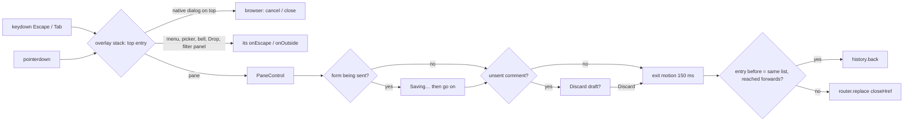

# Global Smooth Motion, Navigation Continuity & Interaction Experience System

> **v1.89.0 (D-420): the motion values below are superseded.** The current system (tokens instant 100 / fast 150 / standard 200 / smooth 250 / emphasis 300; easings standard (0.2,0,0,1), enter (0,0,0.2,1), exit (0.4,0,1,1); page transitions **on by default**; the TS mirror `features/ui/motion.ts`; the Motion Playground) is described in [`docs/qa/GLOBAL_MOTION_DESIGN_SYSTEM.md`](qa/GLOBAL_MOTION_DESIGN_SYSTEM.md) and [`docs/qa/GLOBAL_MOTION_TOKENS.md`](qa/GLOBAL_MOTION_TOKENS.md). The navigation-continuity parts of this document (overlay stack, pane control, place and origin memory, return-to) are unchanged and still current. In §3 below, `--motion-base/-moderate/-slow/-slower` no longer exist.

**Release:** v1.87.0 (D-417), after v1.86.0 (D-416). **Source:** the owner's brief, audited in `docs/qa/HEADER-AND-MOTION-AUDIT.md` (gap list 1–24). This release builds only what the audit marked missing or partly done, and keeps everything v1.80.0 (D-407) built: dialog and drawer motion, menus, folds, PendingLink, skeletons, toasts, PlaceMemory, discard draft, J/K, swipe sheets and the `page_transitions` switch (still Off by default).

**Rule for this document:** "verified" means that a named test or measurement shows it. Anything else is marked *not verified*.

## 1. Architecture

There is no new routing system, no library and no server change. Everything runs on the client, on top of the Next.js App Router and the address.

| Layer | File | Role |
|---|---|---|
| Tokens | `styles/globals.css` (`:root`), `features/shell/motion-rules.ts` | The one motion scale (durations, easings, distances). The v1.80 names are aliases of it. |
| Shared motion classes | `styles/globals.css` (v1.87.0 block) | `motion-fade-in`, `motion-slide-up`, `motion-slide-down`, `motion-scale-in`, `motion-expand`, `motion-stagger`, `pop-in`, `bulk-bar-in`, and the pane, sheet, palette, tooltip and sidebar rules. They move transform and opacity only, and reduced motion turns them off. |
| Overlay stack | `features/ui/overlay-stack.ts` (`openOverlay`, `useOverlay`) | One stack for every overlay. Escape and outside clicks reach the top one only. Modal non-native overlays get a Tab trap, scroll lock and inert. Focus returns on release. It is idempotent per element. |
| Exit helper | `features/ui/top-layer.ts` (v1.80) | Native `<dialog>` exit animation (also used by the palette now). |
| Pane control | `features/ui/PaneControl.tsx`, `features/ui/pane-close.ts`, `features/ui/pane-draft.ts` | The task and record panes: stack entry, closing without a history entry, exit motion, the draft guard, the saving hold, and idempotent close. |
| Place and origin memory | `features/shell/PlaceMemory.tsx`, `features/ui/OriginLink.tsx`, `features/ui/fold-memory.ts` | Scroll and link per page; the list a page was opened from (for breadcrumbs); folds per page; the tab's last moves (for closing panes). |
| Return-to | `lib/nav/return-to.ts` | The validated `?from=` way back across areas (Admin → Records → a request's page). |
| Race guards | `features/ui/form.tsx` (`useActionForm`), `features/ui/sure-nav.ts` | A late answer for a form that is gone doesn't move the page. A soft move the router dropped (the address stayed) is asked again, then put in place and redrawn. This is used by pane close and the filter panel's Apply. |

## 2. Component inventory (after v1.87.0)

| Component | Stack | Motion | Notes |
|---|---|---|---|
| Dialog / ConfirmDialog | native entry | v1.80 `ars-dialog` (on the new tokens) | `locked` while busy: Escape, × and the backdrop don't close it. The confirm button fires once (ref guard). |
| ConfirmButton | via ConfirmDialog | — | A ref guard against double runs. |
| CommandPalette (+ shortcut list) | native entry | slide-down 150 ms in; exit via `closeTopLayer` (Firefox and Safari animate it; Chrome closes at once) | Escape closes the palette only, not a pane below. |
| BottomSheet | modal entry | `mob-sheet` in (280 ms), slides out 150 ms | Trap, scroll lock (html), inert, focus back. Escape only when on top. |
| MobileNav | modal entry | fade in | Its own Tab trap is replaced by the stack's. |
| NotificationBell | popover | `pop-in` | Outside click and Escape go through the stack. |
| Menu / MenuCore | menu | `menu-pop` (v1.80) | The document mousedown is replaced by the stack. |
| Drop (`
`) | popover | v1.80 unfold | The Escape and mousedown listeners are replaced. |
| DateRangePicker | popover (modal on a phone) | `pop-in`; phone: `mob-sheet` | The mousedown listener is replaced. |
| PeoplePicker, PersonSelect | popover | — | The mousedown listeners are replaced. |
| PowerSearch filter panel | popover | `pop-in` | The Escape listener is replaced. |
| TaskPane / RecordPane | pane (modal in dialog mode and below 1024 px) | side: slide 16 px (280 ms); dialog: scale and fade (220 ms); out 150 ms | See section 4. |
| Hint ⓘ | — | fades in after 300 ms | Shown and hidden as before (display); only the fade is new. |
| Sidebar (folded rail) | — | items fade in after a toggle; tooltips | The tooltip is a fixed label beside the item (the rail scrolls, so a pseudo-element would be clipped), after 300 ms, on hover or focus. |
| Sidebar (open) | — | labels slide in after a toggle; moving bar; groups glide open | `NavIndicator`: transform only. |
| Bulk-selection bar | — | `bulk-bar-in` | |
| Overview cards | — | `LiveNumber`: only a changed figure gets a 350 ms emphasis | Nothing on the first draw. |

## 3. Motion specification (v1.87.0; superseded by D-420, see the note at the top)

| Token | Value | Used for |
|---|---|---|
| `--motion-instant` | 100 ms | hover, press (`--motion-hover`) |
| `--motion-fast` | 150 ms | menus, tooltips, exits, the page fade (`--motion-menu`, `--motion-dialog-out`, `--motion-page`) |
| `--motion-base` | 220 ms | dialogs in, expand (`--motion-dialog-in`) |
| `--motion-moderate` | 280 ms | panes, drawers, sheets |
| `--motion-slow` | 350 ms | emphasis (a changed figure), sign-in screen |
| `--motion-slower` | 450 ms | large moves only (progress bars); never under reduced motion |
| `--ease-standard` | `cubic-bezier(0.22, 1, 0.36, 1)` | most motion |
| `--ease-enter` | `cubic-bezier(0.16, 1, 0.3, 1)` (= the v1.80 `--ease-out`, now an alias) | things appearing |
| `--ease-exit` | `cubic-bezier(0.4, 0, 1, 1)` | things leaving (replaces `ease-in`) |
| `--ease-linear` | `linear` | fades of colour |
| `--motion-distance-1…6` | 2 / 4 / 8 / 16 / 24 / 32 px | slide distances |

- **Retired duplicates:** `--motion-fast/base/slow` were 120/200/320 ms, beside a second v1.80 set. Both now come from the one scale. The changes are 10–40 ms.
- **Tailwind:** `duration-instant|fast|base|moderate|slow|slower` and `ease-standard|enter|exit`.
- **Moved onto tokens:**
  - in CSS: sign-in in and out, `mob-sheet`, the `mob-*` switches and carets, PicBot (durations only; it keeps its small overshoot curve as a character);
  - in code: the sidebar width (`duration-150` → `duration-fast`), Loaders (500 and 300 ms → `slower`, `moderate`), ApprovalRoad (700 ms → `slower`), and OnboardingTour's two `transition-all` (now named properties).
- **Left as they are (illustrations, not interface):** the approval-journey animation and the brand loader (`jr-*`, `brand-*`).
- **Guard tests:**
  - `tests/ui/navigation-continuity.test.ts`: the CSS and TS values agree; no `transition: all` and no `transition-all` in `features/` and `app/`; the reduced-motion block lists every shared class.
  - `tests/ui/motion-review.test.tsx` (updated): the v1.80 names are aliases, and only transform, opacity and discrete properties move in the motion blocks.

## 4. Navigation lifecycle

1. **Open:** a task link becomes `?task=<id>` (push) through TaskPaneHost. A row becomes `?open=<id>` (push). A second click on the same task adds nothing.
2. **Draw:** the pane enters (slide or scale). PaneControl registers it on the stack. In dialog mode, and below 1024 px, Tab stays inside, `<html>` doesn't scroll and the rest of the page is inert.
3. **Close** (×, the dimmed page, Escape when the pane is on top):
   - a form being sent holds the close until it is saved;
   - an unsent comment asks **Discard draft?**;
   - the pane plays its 150 ms exit;
   - then `history.back()` when the entry before is the same screen without the pane and we got here moving forwards in this tab, else `router.replace(closeHref)`.

   Back after a close never reopens the pane. A close already under way is not started again.
4. **Full page and Back:** PlaceMemory notes the scroll and the link, the list's origin and the folds. Back restores them once.
5. **Across areas:** RecordPane's **Open full page** adds `?from=<the list address>`. The request page validates it (`parseReturnTo`):
   - a same-origin path, with no `//`, backslash, control character or hash, and no dot segments;
   - an allow-listed prefix (`/admin/records/…`, `/admin/records`, `/admin/insights…`, `/admin`, `/superadmin`);
   - an area this person may open (`evaluateAreaAccess` on the server).

   If it passes, the breadcrumb and **← Back to Admin → Records** use it. The page stays in the users area, and opening the link runs that page's own checks.
6. **Roles and authorisation:** nothing on the client changes a role or an area. Every page keeps its server checks, and an expired session still goes through the existing sign-in flow.

## 5. State-preservation strategy

| State | Where it is kept | How long |
|---|---|---|
| Route, tab, query, filters, sort, page | the address (unchanged) | — |
| Scroll and the link left by | `sessionStorage` `ars.place:<path+query>` (v1.80), now also from links inside a pane; used once | 30 min |
| The list a page was opened from | `sessionStorage` `ars.origin:<page path>` (pane parameters dropped) | 60 min |
| Folded groups (TaskGrid sections and groups, GroupFold) | `sessionStorage` `ars.fold:<path>:<grouping or label>` | 2 h |
| Open pane | the address (`?task=`, `?open=`) | — |
| The tab's last two addresses (for closing panes) | memory (module) | the page's life |
| The pane mode | `work.pane_mode` (server, v1.83) and `localStorage` (record pane, v1.85) | as before |

Nothing new is sent to the server or kept beyond the tab. These are page addresses and open or closed flags only.

## 6. Accessibility

- Escape and outside clicks act on the top overlay only (stack). Focus returns to the opener: the stack, PaneFocus, RecordPane and MenuCore.
- Modal overlays that aren't native dialogs (the pane in dialog mode, BottomSheet, MobileNav, a phone date picker):
  - `aria-modal` as before;
  - a Tab trap;
  - the rest of the page made `inert` (the toast region and live regions are left alone);
  - scroll locked, keeping the scrollbar's room (no sideways jump).
- Tooltips: Hint keeps `aria-description`. The rail tooltip is `role="tooltip"` and supplements the item's visible label (the accessible name is unchanged; the native `title` was removed, so the name isn't announced twice).
- Reduced motion: every shared class, pane, sheet, palette, tooltip, sidebar and figure animation is off. The pane exit doesn't wait. The global 0.01 ms rule (v1.80) still applies.
- axe (WCAG 2.2 AA, serious and critical): see section 8.

## 7. Performance (50 open/close cycles; the v1800-cls approach)

`tests/e2e/v1870-motion-perf.spec.ts`:
- a PerformanceObserver from the first paint (layout shift, long tasks);
- CDP heap after a forced garbage collection;
- DOM nodes, overlays left open, inert left behind, scroll lock left on, and history entries added.

1440 × 900, production build, local Docker MySQL.

| Measure (50 cycles) | Before: v1.85.3 | After: v1.87.0 |
|---|---|---|
| **Task pane** (a user, My Tasks), DOM nodes first → last | 1,138 → 1,138 | 1,844 → 1,846 (+2) |
| JS heap after GC (MB) | 8.1 → 10.0 | 9.3 → 12.3 |
| Panes, dialogs or sheets left open; inert or scroll lock left on | 0 / 0 / off | 0 / 0 / off |
| History entries added by 50 open/close cycles | **+46** (each close pushed) | **0** (close goes back) |
| Cumulative layout shift | 0 | 0 |
| Long tasks (longest) | 1 (80 ms) | 1 (99 ms) |
| Time per cycle (click → pane → Escape → gone) | 293 ms | 446 ms (the 150 ms exit plus waiting for the back move) |
| **Record pane** (IT, Admin → Records) | **Did not finish:** in one cycle Escape left the pane open (the move was dropped), the gap 20 defect | 50/50 closed. DOM 1,479 → 1,479; heap 6.4 → 7.7 MB; history +0; CLS 0; long tasks 0; 494 ms per cycle |

Notes:
- The node counts differ between the two builds because each run seeds its own data and the v1.87 screen draws a little more (an indicator, the slot store). Only growth over the cycles is compared, and it is 0 or 2 nodes.
- Heap growth of 1.3–3 MB over 50 cycles is the same on both builds (the router's page cache). It stays under the spec's 8 MB limit.
- Raw output: `test-results/motion-perf-before.json` and `test-results/motion-perf-after.json` (local, not committed).

- No `will-change` anywhere in the new CSS. Motion is transform and opacity only, no layout properties animate in the new block, and NavIndicator reads layout once per move (a ResizeObserver, no loop).

## 8. Test results

- **Unit (Vitest):** 215 files, 1,942 tests, all passed. New ones:
  - `overlay-stack.test.ts`: Escape to the top only, outside clicks, the Tab trap, modal and scroll-lock rules.
  - `overlay-stack.dom.test.ts` (jsdom): only the top overlay hears Escape and outside clicks; inert and scroll lock are applied and undone; the Tab wrap; idempotent open and release; focus return.
  - `navigation-continuity.test.ts`:
    - `parseReturnTo` refuses other sites, `//`, backslashes, schemes, control characters, dot tricks, paths outside the allow-list, an area the person can't open, and very long values;
    - `closeHow` and `sameAddress`;
    - the list origin;
    - fold memory;
    - the CSS and TS tokens agree, there is no `transition-all`, and reduced motion covers every shared class.
  - `motion-review.test.tsx`: updated for the token aliases.
- **e2e (Playwright, production build, axe WCAG 2.2 AA serious and critical):**
  - `v1870-navigation-continuity` (9 tests, all passed), all verified:
    - the owner's scenario as the Super Admin: filter, sort, pane, full page with "← Back to Admin → Records" and its query, comment, back to the same list with the pane, Escape to the exact listing, area unchanged, axe;
    - a forged `?from=` is ignored, and Admin isn't offered to a manager;
    - IT admin: full page, Back and Escape, 3 rounds, then Back leaves the list;
    - a user on My Tasks: fold, scroll, pane, comment, × closes by going back, the scroll and fold are kept, Back leaves My Tasks, and the fold is kept after the full page and Back;
    - a manager: the Waiting for me breadcrumb keeps the sort, axe;
    - races: a double-click opens one pane, a double × closes once, Escape right after Send waits for the save (stored once, no Discard question), a menu and the palette over the pane close first, and in dialog mode scroll is locked, the rest is inert, Tab stays inside, axe, and all of it is undone on close;
    - reduced motion: nothing in the pane animates longer than 1 ms;
    - phone 375: a sheet closes with Escape, scroll lock is undone, no sideways overflow and axe pass on 3 pages.
  - `v1870-motion-perf` (2 tests, passed): section 7.
  - `v1860-header-consistency` (7 tests, passed).
  - Related specs re-run on the final build: v1800-motion, v1800-cls, v1830-task-pane, v1760-pane-url, v1840-superadmin and v1850-admin (34 passed); v1730-layout-parity, v1790-overview-parity, v163-pm-home, v1771-quick-actions, v1530-modules, v171-nav, v1496-users-home, v1750-date-picker, v143-mobile and v136-ui-states (46 passed). Total 98 of 98 with the new specs. Updated for intended changes: v1850 (the full-page link carries `?from=`) and motion-review (the token aliases).
- **Not verified by a test:**
  - the sidebar motion (labels, indicator, group reveal, rail tooltips);
  - a changed figure's emphasis;
  - ConfirmDialog's lock and fire-once (code only);
  - the palette exit in Firefox and Safari.

## 9. Decisions

- **No library and no second router:** the stack extends `top-layer.ts` and the toast host. Panes stay URL-driven.
- **Close = back or replace, open = push** (the owner's rule). `history.back()` is used only when the entry before is provably the same list reached forwards in this tab. Otherwise `replace`, so Back never reopens a closed pane.
- **Native dialogs keep the browser's Escape, trap and inert.** The stack only records them, and stays out of the way when an unregistered native modal dialog is open.
- **The Hint tooltip keeps `display` toggling** (an always-present invisible pseudo-element widened phones by 20 px); the fade is a delayed animation.
- **Rail tooltips are a fixed element**, because the rail scrolls and would clip a pseudo-element.
- **Dropped moves are retried, not ignored** (`sure-nav.ts`). The app router occasionally drops a soft move started while another one settles: the server answers but the address stays. Seen as the audit's "Escape after Back ignored" and as the v1850 Apply failure. Both also happened on v1.85.3 (measured). Only when the address hasn't changed after 1.2 s is it asked again, and only then put in place with `history` plus a redraw. If the person moved elsewhere, nothing runs.
- **`page_transitions` stays Off** (gap 23): the owner's call.

## 10. Modified files

**New:**
- `features/ui/overlay-stack.ts`
- `features/ui/PaneControl.tsx` (replaces `PaneDraftGuard.tsx`, v1.86.0)
- `features/ui/pane-close.ts`
- `features/ui/OriginLink.tsx`
- `features/ui/fold-memory.ts`
- `features/ui/LiveNumber.tsx`
- `features/shell/NavIndicator.tsx`
- `lib/nav/return-to.ts`
- tests: `tests/ui/overlay-stack.test.ts`, `tests/ui/overlay-stack.dom.test.ts`, `tests/ui/navigation-continuity.test.ts`, `tests/e2e/v1870-navigation-continuity.spec.ts`, `tests/e2e/v1870-motion-perf.spec.ts`

**Changed:**
- Styles and tokens: `styles/globals.css`, `tailwind.config.ts`, `features/shell/motion-rules.ts`.
- Overlays: `features/ui/Dialog.tsx`, `ConfirmButton.tsx`, `features/shell/CommandPalette.tsx`, `features/mobile/BottomSheet.tsx`, `features/shell/MobileNav.tsx`, `NotificationBell.tsx`, `features/ui/MenuCore.tsx`, `Drop.tsx`, `DateRangePicker.tsx`, `PeoplePicker.tsx`, `PersonSelect.tsx`, `PowerSearch.tsx`.
- Panes: `features/ui/RecordPane.tsx`, `pane-draft.ts`, `features/work/TaskPane.tsx`, `TaskPaneHost.tsx`, `TaskDetail.tsx`, `WorkKeys.tsx`, `PaneParts.tsx`.
- Navigation: `features/shell/PlaceMemory.tsx`, `features/ui/Display.tsx` (Breadcrumbs), `app/users/requests/[id]/page.tsx`, `features/work/TaskGrid.tsx`, `features/ui/GroupFold.tsx`, `features/ui/form.tsx`.
- Motion: `features/shell/SidebarFrame.tsx`, `SideNav.tsx`, `features/ui/Hint.tsx`, `Loaders.tsx`, `features/requests/ApprovalRoad.tsx`, `features/help/OnboardingTour.tsx`, `features/home/OverviewParts.tsx`, `features/work/MoreParts.tsx`.
- Paperwork: `app/users/help/page.tsx`, `app/(public)/privacy/page.tsx` (a code comment only), `docs/USER-GUIDE.md`, `docs/RELEASE-NOTES.md`, `docs/qa/HEADER-AND-MOTION-AUDIT.md`, the living files.
- Test updated for an intended change: `tests/ui/motion-review.test.tsx` (the v1.80 token names are aliases; `visibility` added to the discrete properties allowed).

## 11. Known limitations

- **Browser Back with an unsent pane comment** isn't intercepted: the App Router gives no safe hook. Escape, ×, the backdrop and links are covered.
- **Gap 3 (one sidebar markup with fixed icons on collapse)** is not built. The folded rail keeps its Asana-style icon-over-caption layout (D-229), and moving to a single markup with a fixed icon column would be a redesign. Instead the change is smoothed: the labels slide in, the rail fades in, and the width animates (150 ms).
- **The `?from=` way back** is on the approval request's page, which the audit found. Tasks open in the pane, and tickets, meetings and information pages keep their own breadcrumbs (they still get the list origin through OriginLink).
- **The palette's exit animation** plays in Firefox and Safari (`closeTopLayer`). In Chrome the native close is instant (the v1.80 `ars-dialog` CSS route wasn't applied to the palette, to keep its look).
- The v1850 test "Records … power-search chips" failed the same way on v1.85.3 (Apply with the value "a" left the address unchanged: a dropped move). Since `sure-nav` it passes (the final run). The router's underlying cause wasn't found; the retry covers it.
